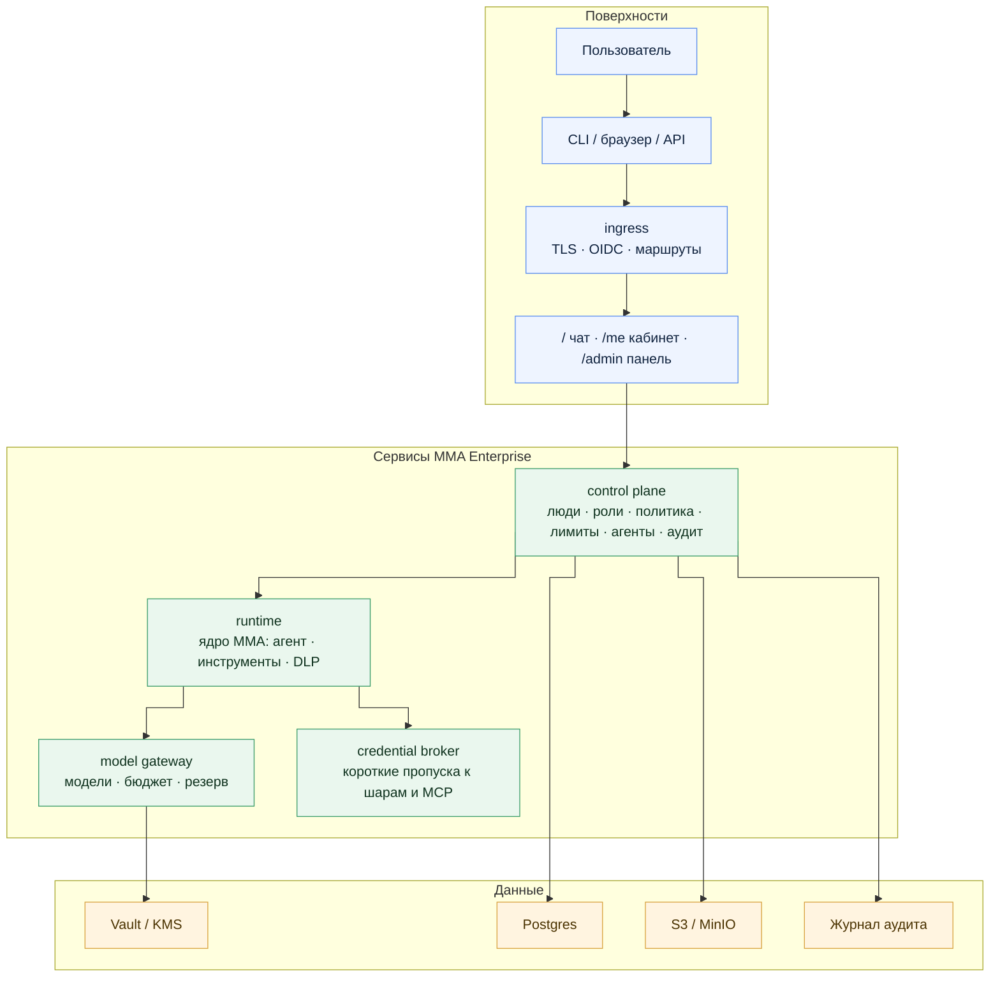
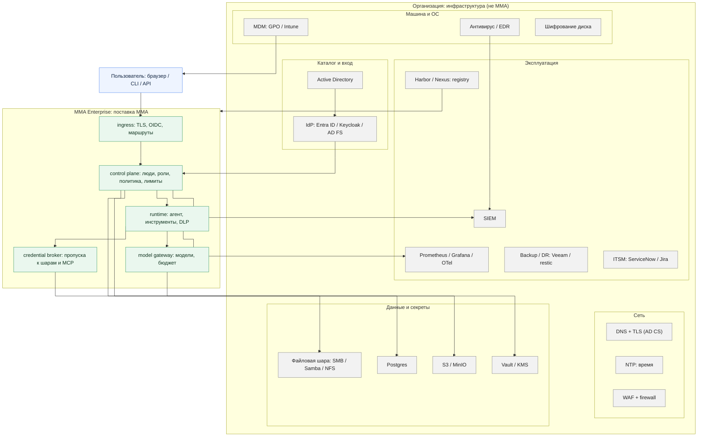
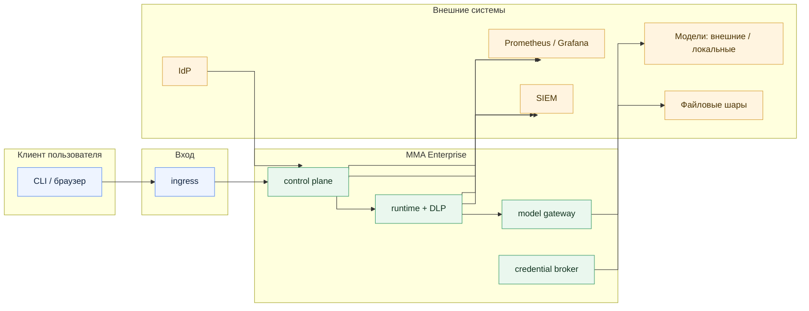

# MMA Enterprise как отдельная версия: идея

**Статус: идея, не спека.** Этот файл описывает, как могла бы выглядеть
MMA Enterprise как отдельная версия агента. Он не вводит нормативных контрактов
и не заменяет [MMA Enterprise: идея](./2026-11-05-mma-enterprise.md) —
это её продолжение: там картина продукта, здесь — ответ на вопрос
«почему это отдельная версия и как она работает».

> Термины и сокращения расшифровываются при первом упоминании
> по шаблону «полное название (далее — сокращение)», а дальше
> используется только сокращение — как в основной идее.

---

## 1. Если коротко

**micro-models-agent** (далее — **MMA**) — программа, которая даёт
языковой модели память, инструменты и правила. MMA уже существует
как локальная программа: один человек, один ноутбук,
свои файлы и модели. Это удобно, быстро и приватно.

MMA Enterprise — **та же программа, но как отдельная версия для компании**:
с пользователями, ролями, политиками, аудитом, лимитами и поддержкой.
Она не заменяет локальную версию и не является её «режимом для богатых».
У неё другие покупатели, другие требования и другие критерии успеха.

Главное правило: **ядро одно, версии две**. Enterprise не форкает код,
а добавляет сервисы вокруг ядра. Локальная версия остаётся входом,
лабораторией и источником фич; Enterprise — способ продать то же ядро
туда, где локальную версию не пустят.

---

## 2. Зачем отдельная версия

Локальный MMA решает задачу «помоги мне быстро и приватно».
Enterprise решает другую задачу: «помоги компании работать с моделью,
чтобы данные не утекали, деньги не тратились без учёта и каждый шаг
можно было объяснить аудитору».

| | Локальная версия | Enterprise |
| --- | --- | --- |
| **Для кого** | Один разработчик, свой ноутбук | Компания: от отдела до тысяч сотрудников |
| **Главная ценность** | Скорость, приватность, работа без настройки | Контроль, аудит, соответствие требованиям |
| **Главный риск** | Модель ошибётся | Данные утекут, бюджет превысится, регулятор оштрафует |
| **Кто платит** | Сам пользователь (или никто) | Компания из бюджета информационных технологий (далее — **IT**) и безопасности |
| **Критерий успеха** | «Быстро и удобно» | «Безопасно и объяснимо аудитору» |
| **Кто эксплуатирует** | Никто (пользователь сам) | Команда инфраструктуры и безопасности |

Enterprise проигрывает локальной версии в скорости и простоте
**по определению**: он платит за контроль такими вещами, как сеть,
вход через компанию и серверная политика. Попытка сделать «один MMA
для всех» дала бы худшее из двух миров: локальный потерял бы простоту,
а enterprise — контроль.

---

## 3. Что такое «отдельная версия» и чем она не является

### 3.1. Это не форк

Форк — вторая кодовая база: ядро копируется и дальше живёт отдельно.
Через полгода у двух копий разные баги, разные фичи, двойная поддержка.
Этого делать нельзя.

Вместо форка:

- ядро (`src/core/`, `src/tools/`, `src/modules/`) — одно и общее;
- локальная версия — это ядро плюс локальные поверхности:
  интерфейс командной строки (далее — **CLI**, Command Line Interface),
  цикл чтения-оценки-печати (далее — **REPL**, Read-Eval-Print Loop)
  и веб-интерфейс;
- enterprise — это то же ядро плюс серверные сервисы вокруг него.

### 3.2. Это не «режим» и не флаг

«Режим» подразумевает, что локальная версия превращается в enterprise
одним переключателем. Это не так: enterprise требует серверов, базы данных,
внешнего поставщика идентичности и команды эксплуатации. Это отдельная
поставка с отдельными требованиями к инфраструктуре.

### 3.3. Это не «издание» в смысле наценок

Enterprise — не локальная версия с заблокированными функциями.
Локальная версия не «урезанная»: она полноценный продукт для одного
человека. У enterprise другие функции (роли, аудит, лимиты), а не те же
функции «под замком».

### 3.4. Это «один релиз, несколько процессов»

Как GitLab или Kubernetes: один номер версии, один набор образов,
один установочный сценарий — но разные процессы внутри. Control plane,
runtime, model gateway и credential broker — отдельные сервисы,
а не один контейнер с супервизором.

---

## 4. Как устроена отдельная версия



Подпись на стрелке control plane → runtime: подписанная политика
со сроком жизни (**TTL**, Time To Live — срок, до которого клиент
доверяет полученной политике без повторного обращения к серверу).

**Ingress** — дверь: защищённое соединение (**TLS**, Transport Layer
Security), вход через компанию по протоколу **OIDC** (OpenID Connect —
стандартный протокол входа через внешнего поставщика идентичности)
и маршрутизация на `/`, `/me`, `/admin`.

**Control plane** — диспетчерская: кто этот человек, что ему можно,
сколько ему можно, какие агенты доступны, кто и что менял. Он не читает
файлы и не вызывает модель.

**Runtime** — исполнитель: тот же агент, что и в локальной версии.
Он спрашивает у control plane правила и применяет их. Защита
от утечек данных (**DLP**, Data Loss Prevention — классификация,
маскирование и блокировка чувствительного) работает внутри runtime
на границе провайдера. Если control plane недоступен, runtime
работает по последней валидной политике только до истечения TTL.

**Model gateway** — одна точка доступа к моделям: allowlist разрешённых
моделей, учёт токенов и денег, резерв при отказе провайдера.

**Credential broker** — выдаёт короткий пропуск к файловой шаре
или серверу **MCP** (Model Context Protocol) на одно действие,
а не постоянный доступ.

Подробности устройства — в основной идее, разделы 7–13.

---

## 5. Как работает пользователь

1. Открывает `https://mma.corp`, входит через корпоративный
   поставщик идентичности (**IdP**, Identity Provider — система,
   которая подтверждает, кто ты) с единым входом (**SSO**,
   Single Sign-On — пароль вводится один раз на все сервисы компании)
   и многофакторной аутентификацией (**MFA**, Multi-Factor
   Authentication — подтверждение входа вторым способом,
   например кодом из приложения или SMS), если компания её требует.
2. Видит чат и список готовых агентов — собирать агента с нуля
   не нужно, он выбирает из списка.
3. В личном кабинете (`/me`) видит свои лимиты, статистику,
   устройства и свои действия в аудите. Скачивает клиент оттуда же.
4. Клиент подключается к компании (`mma login --server https://mma.corp`)
   и получает политику и агентов с сервера. Устройства отзываются
   из кабинета без звонка администратору.

Пользователь **не может**: выбрать чужой workspace, вызвать инструмент,
который ему не выдан, отправить запрещённые данные наружу, посмотреть
чужой аудит, изменить политику безопасности.

---

## 6. Как работает администратор

Администратор начинает не с чата, а с панели (`/admin`):

- здоровье сервиса, алерты, обещание по доступности
  (**SLO**, Service Level Objective — измеряемое обязательство,
  например «сервис доступен 99,9% времени»);
- люди, группы, роли; увольнение отзывает доступ сразу;
- workspace (отделы), лимиты на человека и отдел;
- публикация политики и создание агентов;
- подключение файловых шар, подтверждение опасных действий;
- разбор инцидентов.

Администратор **не делает**: не читает чужие промпты без аварийного
доступа, не меняет себе роль, не совмещает изменение политики
и деплой в одном лице, не правит рабочий конфиг руками.

Роли: `org_admin`, `security_admin`, `workspace_admin`, `builder`,
`user`, `auditor`, `service`, `agent`, `guest`. Роли не складываются
автоматически — две роли выдаются двумя отдельными записями.
Группы компании (из AD/IdP) маппятся на роли, а не наоборот.
Права строятся в два слоя: управление доступом на основе ролей
(**RBAC**, Role-Based Access Control — роль задаёт базовый набор
возможностей) и на основе атрибутов (**ABAC**, Attribute-Based
Access Control — отдел, класс данных, время, устройство дополнительно
сужают эти возможности).

### 6.1. Как собираются пользователи из AD/IdP

Пользователи в enterprise **не создаются вручную** и не появляются
по кнопке «синхронизация». Поток постоянный, а посредником выступает
IdP, а не каталог пользователей Windows (**AD**, Active Directory —
каталог пользователей и групп в Windows) напрямую:

```text
AD / Entra ID / Keycloak
        │  SCIM (System for Cross-domain Identity Management —
        │  стандартный способ автоматически передавать пользователей
        │  и группы из IdP) или группы в OIDC-токене
        ▼
   control plane ──► сверка ──► upsert в базу
                        │
                        ├─ новые      → создать
                        ├─ изменились → обновить
                        ├─ удалены    → отключить (tombstone)
                        └─ конфликты  → в отчёт, не в «тихое» слияние
```

Зачем IdP-посредник: IdP уже знает про MFA, условный доступ
и отключение аккаунта. MMA читает из IdP, а не опрашивает AD
напрямую и не пытается «починить» грязный каталог.

#### Дублирование не возникает, если ключ правильный

Дубли появляются, когда ключом пользователя считают email или имя —
они меняются. Правильный ключ — **стабильный идентификатор**:

| Что | Роль |
| --- | --- |
| `objectGUID` (AD) / immutable IdP subject | **ключ слияния** — никогда не меняется |
| email / UPN | атрибут, обновляется, но не идентифицирует |
| группа + домен | `MMA-Admins` в двух доменах — разные группы |

Механика — **upsert, а не insert**: повторная синхронизация обновляет
существующую запись по стабильному ключу, а не создаёт вторую.
Дополнительно:

- **dry-run / предпросмотр**: перед применением sync показать diff —
  «создастся 12, обновится 40, отключится 3»;
- **tombstone**: удалённый в AD пользователь не удаляется сразу,
  а отключается — сессии убиты, доступ закрыт, запись остаётся
  для аудита;
- **ручные исключения** — только отдельным механизмом поверх sync,
  с TTL и записью в аудит, а не правкой «вручную в базе»;
- **сервисные учётки и боты** — не «пользователи»: им отдельная
  роль `service`, а не синхронизация как людей;
- **гости и подрядчики** — отдельная группа и отдельный TTL,
  их нельзя смешивать со штатными.

#### Почему «идеально с AD» не получится

AD в реальной компании — это свалка, и идеального управления
оттуда не будет никогда. Поэтому слой MMA делает грязные данные
предсказуемыми, а расхождения — видимыми в отчёте, а не спрятанными:

1. **Мусорные группы** («для старых прав», «для теста»,
   «для отпуска») — инвентаризация перед миграцией, берутся
   только реально используемые.
2. **Вложенные группы** — разворачивать до маппинга, иначе часть
   людей молча выпадет.
3. **Большие группы** — список групп в токене раздувается и режется;
   MMA-группы должны быть маленькими и целевыми
   (`MMA-Admins`, `MMA-Finance`), а не «все пользователи».
4. **Переименование/удаление группы** — маппинг ломается молча;
   нужен алерт «группа из маппинга исчезла в IdP».
5. **Одинаковые имена в разных доменах** — ключом является GUID,
   не имя.
6. **Отставание синхронизации** — между увольнением в AD и sync-циклом
   есть окно. Закрывается коротким циклом + webhook от IdP,
   а на сервере при каждом запросе проверяется, не отключён ли
   пользователь.

#### Порядок внедрения

1. **Инвентаризация** — группы, члены, вложенность, владельцы;
   отобрать реальные.
2. **Сопоставление** — таблица «группа AD → роль MMA → workspace»,
   одна группа = одна понятная роль.
3. **Пилот** — одна группа (например `MMA-Finance`): включить sync,
   проверить роли, невидимость чужих отделов, увольнение.
4. **Параллельный режим** — AD остаётся источником прав, MMA только
   читает; правится маппинг, а не люди вручную.
5. **Переключение** — все группы, SCIM для увольнений,
   ручные исключения отключаются.
6. **Откат** — вернуть предыдущий маппинг, отключить sync,
   пользователей сразу не удалять, инцидент — в аудит.

---

## 7. Как работает клиент: thin и hybrid

Клиент при первом запуске выбирает: «подключиться к компании»
или «работать локально». На корпоративном устройстве локальный режим
может быть запрещён политикой — кнопки «локально» тогда нет.

В enterprise-режиме важны две независимые оси:

| Ось | Значения | Что значит |
| --- | --- | --- |
| Подключение | enterprise / local | есть ли сервер компании |
| Исполнение | thin / hybrid | где выполняются инструменты |

- **Thin** — инструментов на клиенте нет вообще; всё делается на сервере.
  Для чувствительных данных.
- **Hybrid** — инструменты на клиенте, но политика приходит с сервера:
  подписана, версионирована, имеет TTL. Флаги вида `--no-dlp`,
  `--policy`, `--quota` игнорируются или приводят к понятной ошибке.

Честная оговорка: администратор своей машины может пропатчить клиент.
Поэтому для чувствительных данных — тонкий режим, серверная политика
и DLP, шифрование диска, короткоживущие токены и реакция на попытки
вмешательства. Абсолютной защиты на чужом железе не существует.

### 7.1. Пошагово: как клиент попадает на компьютер и настраивается

Пользователь **не настраивает клиент сам**. Настройка приходит
подписанной с control plane; пользователю остаётся один раз войти.

**Шаг 1. Получение.** Сотрудник открывает личный кабинет
`https://mma.corp/me` — там ссылка на установщик под его ОС:
Windows — установщик Windows (**MSI**, Windows Installer),
Linux — пакет Debian (**DEB**) или RPM Package Manager (**RPM**),
macOS — PKG при необходимости.
Внутри установщика уже зашито:

- сам CLI;
- доверенный корневой сертификат компании (чтобы TLS к `mma.corp`
  доверялся);
- адрес сервера;
- минимально допустимая версия клиента.

**Шаг 2. Первый запуск.** Клиент показывает один экран:
«Подключиться к компании» или «Работать локально». Если клиент
развёрнут компанией через GPO/Intune/MDM, выбора нет —
enterprise-режим уже включён, а локальный может быть запрещён
политикой.

**Шаг 3. Вход.** Пользователь выполняет:

```bash
mma login --server https://mma.corp
```

CLI показывает ссылку и код → пользователь открывает ссылку
в браузере → входит через IdP (SSO + MFA, если требуется) →
подтверждает код. Токен сохраняется **в системное хранилище паролей**
(Windows Credential Manager / macOS Keychain / Linux secret service),
а не в файле конфигурации.

**Шаг 4. Настройка приезжает с сервера.** Дальше клиент сам,
без участия пользователя:

1. `GET /v1/me` — кто я, какие workspace доступны;
2. `GET /v1/policy` — политика: версия, подпись (Ed25519), TTL,
   разрешённые инструменты, модели, лимиты, режим DLP;
3. проверяет подпись и срок жизни;
4. запрашивает список агентов → подписанный пакет агента
   (инструкции, навыки, инструменты, модель) → проверяет подпись →
   кладёт в локальный кэш.

**Шаг 5. Что нельзя переопределить.** Настройки безопасности не лежат
в файле конфигурации и не меняются флагами CLI:

- `--model`, `--allow-tool`, `--no-dlp`, `--policy`, `--quota` —
  игнорируются или приводят к понятной ошибке;
- переменные окружения не отключают управляемую политику;
- подмена кэша → подпись не сходится → клиент уходит в read-only
  или отказывает, попытка пишется в аудит;
- истёкший TTL → изменения запрещены, продлить локально нельзя;
- старая версия клиента → сервер отзывает доступ.

**Шаг 6. Если что-то пошло не так.**

- Нет внешнего интернета, но есть внутренняя сеть → работает
  как обычно;
- control plane недоступен → работает последний валидный пакет
  до конца TTL;
- политика устарела → только чтение;
- совсем нет сети → локальная модель, если разрешена, с явным
  статусом «оффлайн». Тихого переключения на внешнюю модель нет.

**Шаг 7. Обновления.** Клиент обновляется из внутреннего registry:
подпись + `sha256`, кольца canary → early → all, откат
на предыдущую версию, минимальная версия на стороне сервера.
Пользователь не скачивает ничего с GitHub.

Итог: пользователь ставит один установщик из личного кабинета,
один раз входит через браузер — и дальше клиент сам подтягивает
политику, агентов и обновления с сервера. Настроить «неправильно»
он не может не потому, что ему запретили, а потому что
настраивать нечего: безопасность приходит подписанной
с control plane.

---

## 8. Как поставляется отдельная версия

| Вариант | Где работает | Кому подходит |
| --- | --- | --- |
| **Docker-набор** | Один сервер | Пилот, филиал, небольшая компания, изолированный контур |
| **Kubernetes + Helm** | Кластер | Production, отказоустойчивость, несколько отделов |
| **Windows + Active Directory** | Серверы Windows | Компания вокруг AD, файловых шар и веб-сервера Windows |

Релиз — подписанный архив: образы, Helm-чарт (пакет для Kubernetes,
далее — **Helm**) или compose-файл,
установщики клиентов, манифесты, **SBOM** (Software Bill of Materials —
перечень компонентов, из чего собран продукт),
подписи. Образы загружаются во внутренний registry
(Harbor/Nexus), а не качаются с GitHub на рабочий сервер.

Высокая доступность (**HA**, High Availability — сервис продолжает
работать при отказе отдельного компонента: сервера, диска, сети)
— это не «контейнер перезапустился»
и не backup: нужны 2+ экземпляра, балансировщик, реплика базы
и автоматический переход. Docker-набор на одном сервере — это не HA,
и идея это прямо называет.

---

## 8.1. Обвязка вокруг MMA Enterprise

Вокруг enterprise-версии есть два слоя: инфраструктура организации
и сам MMA Enterprise. MMA не заменяет обвязку и не владеет ею —
она ходит с ней по стандартным протоколам.

### Слои обвязки



### Потоки доверия и данных



### Кто чем владеет

| Компонент | Владелец | Протокол / связь | Зачем |
| --- | --- | --- | --- |
| Антивирус / EDR (Endpoint Detection and Response — защита устройств), MDM (Mobile Device Management — управление устройствами), шифрование диска | Организация | Агент на устройстве, MDM API | Устройство управляемое; MMA знает факт, а не настраивает ОС |
| DNS (Domain Name System — система имён), TLS, NTP (Network Time Protocol — синхронизация времени), WAF (Web Application Firewall — защита веб-входа) | Организация | DNS, TLS, NTP, WAF перед ingress | Имена, сертификаты, время для подписей и TTL |
| AD → IdP | Организация | SCIM, OIDC, SAML, LDAP | Люди и группы; MMA читает из IdP, а не из AD напрямую |
| Файловая шара | Организация | SMB, NFS, API | Права даёт файловый сервер (ACL), MMA — только пропуск |
| Postgres, S3/MinIO | Организация (ресурс), MMA (схема, миграции) | SQL, S3 API | Данные control plane, артефакты, аудит, backup |
| Vault/KMS (Key Management Service — управление ключами) | Организация | HTTPS (HTTP over TLS — защищённый веб-протокол) | Ключи провайдеров и секреты, ротация |
| Harbor/Nexus, CI/CD (Continuous Integration / Continuous Delivery — сборка и доставка), GitOps | Организация + MMA | OCI Registry (Open Container Initiative — формат образов), Git | Образы из внутреннего registry, а не с GitHub в прод |
| SIEM (Security Information and Event Management — сбор и корреляция событий безопасности), Prometheus/Grafana/OTel (OpenTelemetry — сбор телеметрии) | Организация (приём), MMA (отправка) | OTLP (OpenTelemetry Protocol), JSON (JavaScript Object Notation), CEF (Common Event Format), HTTP (Hypertext Transfer Protocol) | События аудита и метрики; SIEM — независимый наблюдатель |
| Backup/DR (Disaster Recovery — восстановление после катастрофы), ITSM (IT Service Management — система заявок), уведомления | Организация | Veeam/restic, HTTP API, Teams/Slack/SMTP (Simple Mail Transfer Protocol — отправка почты) | Восстановление, заявки на доступ, алерты |
| ingress, control plane, runtime, gateway, broker | MMA Enterprise | HTTPS, `/v1`, OIDC | Сама поставка: один релиз, несколько процессов |
| DLP | MMA runtime (встроенный) | На границе провайдера; внешний DLP — API | Не отдельный DLP-сервер в базовой схеме |

Главный принцип: MMA не решает, что разрешено данным, и не владеет
ОС, каталогом, шарой и секретами. Она получает от обвязки факты
(кто вошёл, какое устройство, какой пропуск к шаре, куда слать
события) по стандартным протоколам — поэтому под каждый продукт
отдельный коннектор не пишется.

---

## 9. Что общее, а что разное

### Общее (одно ядро)

- петля агента, инструменты, enforcement, DLP, защита путей;
- формат сессии и журнала, наблюдаемость;
- провайдеры и модели, включая локальные;
- web-поверхность как один из входов.

### Разное (надстройка enterprise)

- control plane: пользователи, роли, workspace, политика, лимиты;
- SSO/SCIM, маппинг групп AD, OBO/Kerberos к шарам;
- подписанные пакеты политики и агентов с TTL;
- model gateway и credential broker;
- Admin UI, личный кабинет, централизованный аудит с `actor`;
- HA, Helm, Windows/AD-вариант поставки, canary-обновления.

Правило раздела: если фича меняет контракт ядра — она идёт в спеку
по `docs/specs/` до кода; если она живёт только в enterprise-сервисах —
она не трогает ядро и не создаёт вторую кодовую базу.

---

## 10. Плюсы и минусы отдельной версии

### Плюсы

1. **Закрывает shadow-AI**: сотрудники перестают уходить в личные чаты,
   данные остаются в контуре компании.
2. **Совпадает с индустриальным стандартом**: control plane, реестр
   агентов, отдельная identity на агента, least privilege, DLP, аудит,
   учёт стоимости — это то, что требуют Microsoft, Deloitte и вендоры
   MCP-платформ.
3. **Не убивает локальный продукт**: ядро одно, локальная версия
   остаётся входом и лабораторией; enterprise — вторая ветка роста.
4. **Честная работа с клиентом**: thin/hybrid, подписанная политика,
   признание ограничений защиты на чужом железе.
5. **Стандартные протоколы** (OIDC, SCIM, Kerberos, OTel, OCI)
   вместо кастомных коннекторов под каждый продукт.
6. **Регуляторная пригодность**: аудит, хранение, удаление, SBOM,
   подписи — то, что проверяет безопасник и аудитор.

### Минусы

1. **Сложность ×5**: пять сервисов плюс Postgres, S3, Vault, реестр,
   IdP и ingress. Без команды эксплуатации это не production.
2. **Не готово**: по §16 основной идеи нет control plane, SSO/SCIM/RBAC,
   `actor` в аудите, цепочки хешей, HA/Helm, подписей обновлений,
   Postgres/S3, лимитов, OBO/broker, Admin UI.
3. **Матрица режимов**: thin/hybrid × local/enterprise × три способа
   поставки — рост поверхности поддержки и риска рассинхрона
   поведения между режимами.
4. **Потеря local-first**: скорость, офлайн и приватность по умолчанию
   уступают место сети, IdP и серверной политике; офлайн ограничен TTL.
5. **AD/Kerberos-OBO — самый сложный кусок**: KCD/RBCD, SPN,
   keytab/gMSA, синхронизация времени, AES-only, отключение NTLM.
6. **Стоимость владения**: сервер, хранение, мониторинг, backup/DR
   и поддержка — постоянные расходы, которых у локальной версии нет.
7. **Оверхед для маленьких компаний**: полный стек избыточен для отдела
   из десяти человек; граница «пилот vs production» требует дисциплины.

---

## 11. Сравнительная таблица с оценками

Оценки 1–10 (10 — лучше). Это экспертные оценки идеи, а не замеры.

| Критерий | Локальный MMA | MMA Enterprise | Комментарий |
| --- | --- | --- | --- |
| Простота развёртывания | 9 | 3 | Один бинарь vs пять сервисов + инфра |
| Скорость / латентность | 9 | 6 | Сеть, IdP, gateway в цепочке |
| Офлайн / air-gap | 8 | 5 | Офлайн ограничен TTL политики |
| Безопасность данных (DLP) | 7 | 9 | Серверная политика + thin-режим |
| Идентификация и аудит | 4 | 9 | SSO, `actor`, цепочка хешей, SIEM |
| Многопользовательскость | 2 | 10 | Workspace, RBAC/ABAC, лимиты |
| Контроль бюджета | 5 | 9 | Квоты на человека и отдел, gateway |
| Масштабирование / HA | 3 | 8 | K8s + реплики, но только в полном варианте |
| Скорость разработки фич | 9 | 5 | Контракты, миграции, три канала поставки |
| Стоимость владения | 9 | 4 | Инфра + эксплуатация |
| Риск рассинхрона версий | 9 | 5 | Один релиз, но матрица режимов |
| Пригодность для регуляторов | 3 | 9 | Аудит, хранение, удаление, SBOM |
| **Среднее** | **6.3** | **6.5** | Enterprise выигрывает только в корпоративном контексте |

Вывод таблицы: enterprise выигрывает **только** там, где компания
не может обойтись без контроля, — и именно для этого он нужен.
В остальных критериях локальная версия лучше, потому что ей
не нужно платить за контроль.

---

## 12. Чего нет и где граница

Из основной идеи, §16 — честно, без маркетинга:

| Уже есть | Чего нет |
| --- | --- |
| DLP на границе провайдера | Control plane |
| Единая точка контроля инструментов | SSO, SCIM, RBAC |
| Защита путей, сетевые ограничения | `actor` в аудите, цепочка хешей |
| Service API, веб-интерфейс | HA и Helm |
| Обновление с `sha256`, аудит в файл | Подпись обновлений |
| Шифрование сессий (опция) | Postgres и S3 |
| Строгий профиль | Лимиты, OBO и broker, Admin UI |

**Пилот, который можно сделать сегодня:** один отдел, OIDC на reverse
proxy, строгий профиль, инструменты только на чтение, одна шара,
локальная модель, аудит в файл.

**Что нельзя назвать enterprise:** общий токен на всех, роли «на словах»,
аудит без `actor`, политика в файле конфигурации, один контейнер
со всем, обновление копированием файлов.

---

## 13. Предлагаемый порядок волн

Волны — предложение, а не контракт. Каждая волна должна иметь
проверяемый результат и не ломать предыдущую.

| Волна | Что появляется | Критерий готовности |
| --- | --- | --- |
| 0. Пилот | OIDC на reverse proxy, строгий профиль, read-only, аудит в файл | Один отдел работает, вход и отзыв проверены |
| 1. Идентичность | SSO, маппинг групп → роли, `actor` в аудите | Уволенный пользователь теряет доступ сразу |
| 2. Политика | Подписанные пакеты политики с TTL, thin/hybrid | Подмена политики отклоняется клиентом и пишется в аудит |
| 3. Лимиты и бюджет | Квоты на человека/отдел, model gateway | Исчерпание лимита блокирует и фиксируется |
| 4. Файлы | Credential broker, OBO/Kerberos к шарам | Группа А видит шару AA, группа Б — нет, отзыв действует сразу |
| 5. Production | Docker-набор → K8s/Helm, HA, backup/DR, canary | Восстановление из backup проверено, SLO держится |

Волны 1–2 — ядро enterprise-защиты; волны 3–4 — управляемость;
волна 5 — эксплуатация. Пропуск волн (сразу «production») — главный
риск проекта.

---

## 13.1. Тонкие места

Большие решения идеи верные. Тонкие места — почти все на стыках.
Каждое из них должно стать контрактом и проверкой до кода.

1. **Политика: отзыв против TTL.** Подпись защищает от подмены,
   но не от «валидного, но отозванного» пакета: у клиента ещё часы
   TTL. Нужен отдельный kill-switch (список отозванных версий
   и инструментов, проверяемый при каждом вызове) поверх TTL.

2. **Клиент на чужом железе.** Токен можно вытащить из системного
   хранилища и вызывать `/v1` напрямую; кэш политики и агентов
   читается и утекает; старую уязвимую версию можно запустить,
   если сервер не проверяет версию на каждом запросе. Граница
   thin/hybrid должна задаваться на workspace, а не на усмотрение
   пользователя.

3. **OBO/Kerberos — самое хрупкое место.** Действовать «от имени
   пользователя» (**OBO**, On-Behalf-Of) по Kerberos-делегированию
   (KCD/RBCD) — одна ошибка в SPN/CA даёт
   либо неработающий доступ, либо делегирование шире нужного;
   утечка токена = доступ к шарам пользователя; сервисная учётка
   workspace чинит это, но ломает склейку «человек ↔ учётка»
   в аудите шары. RC4/NTLM и рассинхрон времени — классика
   «работало на демо».

4. **Model gateway: учёт ≠ контроль.** Три источника числа токенов
   (клиент, gateway, провайдер) расходятся на ретраях, кэше
   и субагентах — нужен единый источник. Gateway видит весь трафик
   к моделям, включая DLP-данные: это новая точка утечки.
   Allowlist обходится своим endpoint, если клиент может его указать.

5. **Квоты посреди хода.** Блокировка mid-turn теряет работу
   пользователя; «доработать» делает лимит фиктивным; деградация
   на дешёвую модель mid-turn рвёт связность ответа. Параллельные
   ходы проходят проверку одновременно — нужна резервация бюджета,
   а не проверка постфактум.

6. **Аудит: полнота против приватности.** Полный промпт в журнале
   = утечка PII/секретов; только метаданные = бесполезно при разборе.
   Асинхронная запись = окна потерь при падении; цепочка хешей
   ломается при восстановлении из backup. SIEM тоже нуждается
   в DLP на сам аудит.

7. **Агент как identity.** Действует от имени пользователя
   или сам — и кто отвечает в аудите? Субагенты наследуют права
   родителя (обход) или нет (не могут делегировать)? Агент,
   опубликованный `builder`-ом, — это код компании: нужен review,
   а не «опубликовал».

8. **Изоляция workspace.** Общий индексатор/кэш, общий gateway
   (side-channel по времени и стоимости), забытые временные файлы
   и артефакты — утечки между отделами без «взлома».

9. **Минимальная версия — оружие обоюдное.** Залоченный клиент
   перестаёт работать из-за обновления, которое не может получить;
   canary = окно уязвимости по дизайну. Нужен grace period
   для офлайн-клиентов, а не жёсткий отказ.

10. **Air-gap.** Подписи и TTL зависят от часов; без NTP сертификаты
    «истекают» по неверным часам. Локальная модель — видеокарта,
    драйверы, подписанные веса. IdP в air-gap — отдельный сервис
    (Keycloak/AD FS) в поставку.

11. **Разделение полномочий.** В маленькой компании админ и безопасник —
    один человек, и запрет превращается в галочку. Аварийный доступ
    без внешнего наблюдателя (SIEM) становится постоянным.
    Аудит аудитора — только вне системы.

12. **Backup воскрешает права.** Восстановление Postgres возвращает
    уволенных пользователей и отозванные токены; restore без SIEM
    рвёт цепочку аудита; восстановленный runtime может работать
    по политике «из прошлого» или «из будущего».

13. **Наблюдаемость утекает сама.** `/metrics` без аутентификации,
    логи с путями и кусками промптов, Grafana/OTel-коллектор
    с доступом ко всем данным. Мониторинг обязан сам проходить
    DLP и RBAC.

14. **Пилотная ловушка.** Пилот «один отдел, read-only, локальная
    модель» успешен всегда — в нём нет ни одного трудного стыка
    выше. Критерии перехода между волнами обязаны проверять
    именно стыки: отзыв, OBO, mid-turn квоты, восстановление.

---

## 14. Открытые вопросы (не решено)

1. Формат и схема подписанного пакета политики: где живёт ключ подписи,
   как ротируется, что происходит при компрометации.
2. Где именно применяется DLP в тонком режиме — только на сервере
   или дублируется в runtime; как разводятся две точки enforcement.
3. Хранение аудита: Postgres + S3 + цепочка хешей — или один источник;
   кто и как удаляет данные по требованию.
4. Лимиты: жёсткие или мягкие, что происходит при исчерпании —
   блокировка, деградация на дешёвую модель или только алерт.
5. Модельный gateway: свой или внешний (LiteLLM); кто владеет ключами.
6. Windows/AD-вариант: насколько он обязателен в первой версии
   или это второй приоритет после Linux/K8s.
7. Как измеряется «пилот успешен»: какие метрики SLO и безопасности
   считаются критерием перехода к следующей волне.

---

## 15. Одна страница

- Отдельная версия — это **вторая ветка одного продукта**, а не форк
  и не «режим» локальной версии.
- Ядро одно; enterprise добавляет control plane, gateway и broker
  вокруг него.
- Локальная версия выигрывает в простоте, скорости и офлайне;
  enterprise выигрывает в контроле, аудите и соответствии —
  и именно для этого он нужен.
- Клиент выбирает «компания / локально»; в enterprise политика
  приходит подписанной, с TTL, и не переопределяется флагами.
- Клиент пользователь не настраивает: установщик из `/me`
  (MSI/DEB/RPM, в нём сертификат, адрес сервера, минимальная версия),
  один вход через браузер, токен в системном хранилище паролей,
  политика и агенты — подписанными пакетами с сервера (§7.1).
- Пользователи не создаются вручную: поток AD/IdP → control plane
  по SCIM/OIDC, слияние по стабильному ключу (GUID), а не по email —
  дублей нет; dry-run, tombstone при увольнении, маппинг групп
  версионируется, «идеального» AD не существует (§6.1).
- Для чувствительных данных — тонкий режим и серверная политика,
  потому что клиент на чужом железе нельзя защитить абсолютно.
- Поставка: один релиз, несколько процессов; Docker для пилота,
  Kubernetes для production, Windows/AD — отдельный вариант.
- Начинать с пилота (OIDC + read-only + аудит в файл), а не
  с полного стека.
- Тонкие места — на стыках: отзыв против TTL, клиент против токена,
  OBO/Kerberos, учёт против контроля в gateway, квоты посреди хода,
  аудит против приватности, backup против отозванных прав (§13.1).
- Обвязка — два слоя: инфраструктура организации (EDR/MDM, DNS/TLS/NTP,
  AD→IdP, шара, Postgres/S3, Vault, registry, SIEM/monitoring, backup)
  и сам MMA Enterprise (ingress → control plane → runtime → gateway
  → broker); DLP — встроенный в runtime, а не отдельный сервер (§8.1).
- Пока это идея: контракты, схемы данных и проверки появятся
  в спеках по `docs/specs/` до кода, а не после.
