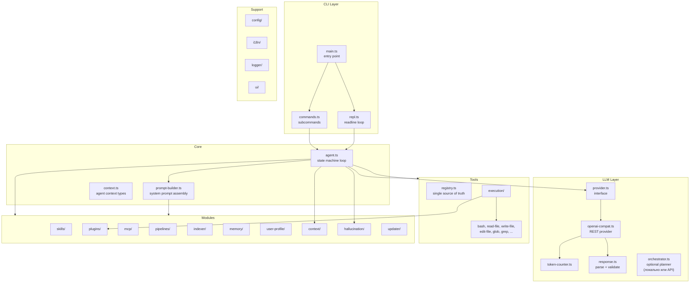
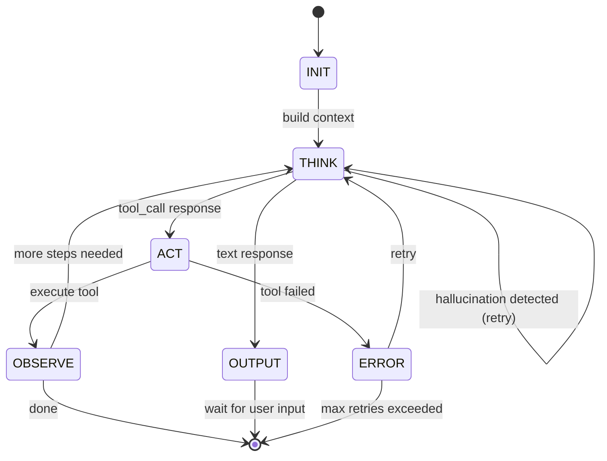
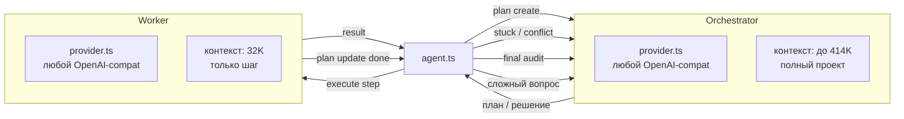
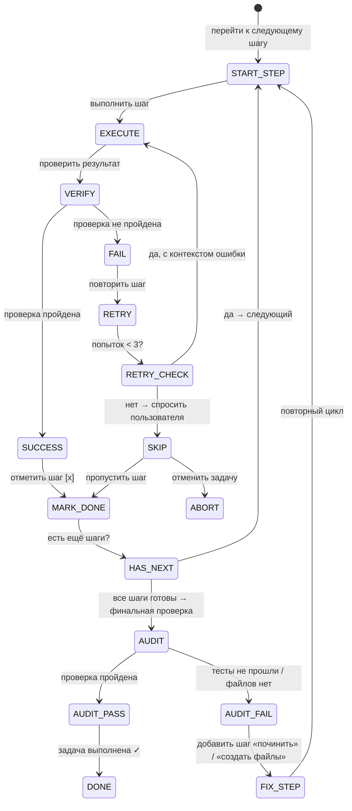
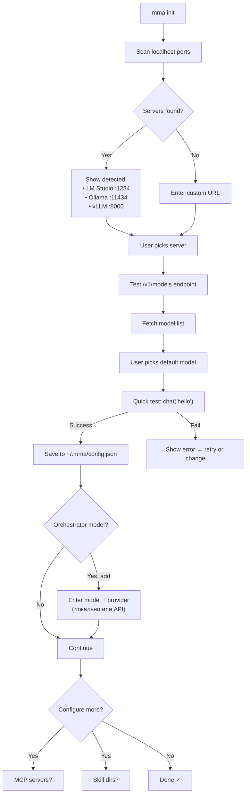
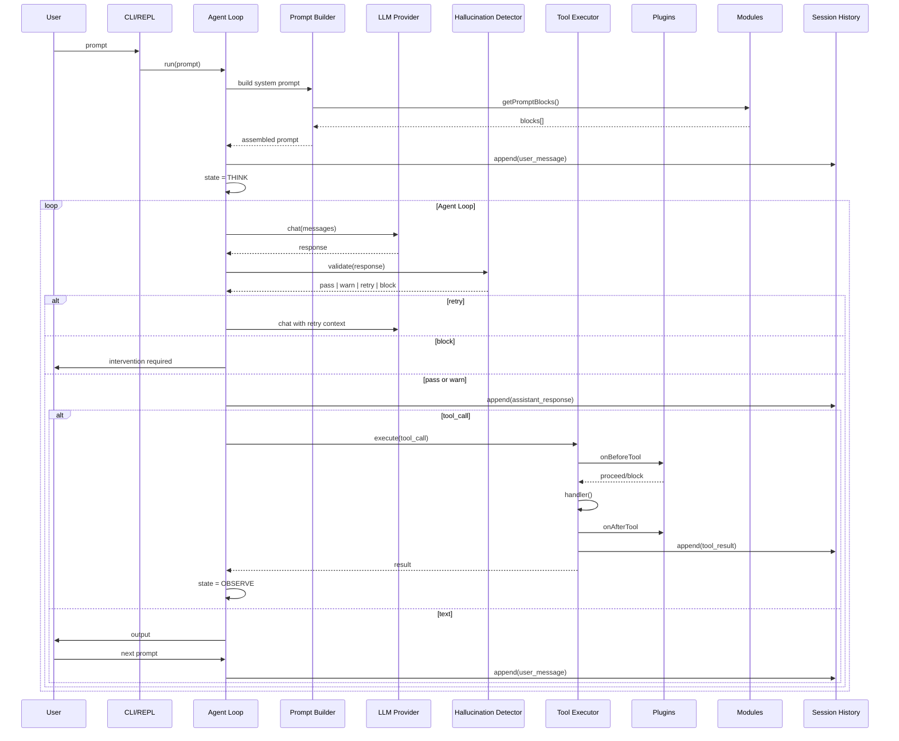

# MMA v2 — Architecture Design

**Date:** 2025-07-28
**Status:** Approved
**Branch:** `easy_mma`
**Engine:** Bun + TypeScript
**Default model:** Qwen3.5 9B 32K (thinking)

---

## 1. Overview

MMA v2 — modular AI coding agent designed for 9B parameter models with 32K context.
Complete rewrite from MMA v1. Key differences:

- **KISS** — simple state machine loop, no god objects
- **Modular** — every feature is a self-contained module
- **Isolated** — each task/file operates in isolated context
- **Small files** — no file >300 lines (target)
- **Composable prompt** — system prompt built from module blocks
- **No TUI** — minimal CLI + REPL with markdown formatting

---

## 2. High-Level Architecture



---

## 3. Core Layer

### 3.1 Agent Loop (`core/agent.ts`)

Simple **state machine** with 6 states:



```
States:
  INIT    → collect system prompt blocks from all modules → build context
  THINK   → call LLM → validate response (hallucination check)
  ACT     → parse tool_call → execute via ToolExecutor
  OBSERVE → process results → check termination → loop or done
```

No if-else nesting. Each state is a separate function.
Plugins hook into state transitions via `onBeforeThink`, `onAfterThink`, etc.

### 3.2 Prompt Builder (`core/prompt-builder.ts`)

Collects `PromptBlock[]` from all modules, sorts by priority, fits into 8K token budget:

```ts
interface PromptBlock {
  content: string
  priority: 'critical' | 'high' | 'normal' | 'low'
  essential: boolean       // never trimmed
  estimatedTokens: number
}

// Builder algorithm:
// 1. Gather all blocks from modules
// 2. Place essential blocks first
// 3. Sort non-essential by priority
// 4. Greedy fill until budget (8K tokens)
// 5. Return { prompt, excluded[] }
```

---

## 4. LLM Layer

### 4.1 Provider Interface (`llm/provider.ts`)

```ts
interface LLMProvider {
  chat(messages: Message[]): AsyncIterable<Chunk>
  countTokens(text: string): number
  model: string
  contextWindow: number
}
```

### 4.2 OpenAI-Compatible Provider (`llm/openai-compat.ts`)

Single provider for all backends:
- LM Studio
- Ollama
- vLLM
- Together AI
- Any OpenAI-compatible endpoint

Supports:
- Streaming SSE
- Reasoning mode (Qwen3 thinking tokens)
- Tool call format conversion

### 4.3 Response Parsing (`llm/response.ts`)

Parse LLM response into typed result:
```ts
type LLMResponse =
  | { type: 'text'; content: string }
  | { type: 'tool_call'; calls: ToolCall[] }
  | { type: 'reasoning'; content: string }
```

### 4.4 Orchestrator Model (`llm/orchestrator.ts`)

Опциональная модель-оркестратор для планирования и сложных решений.
Orchestrator использует **тот же `LLMProvider` интерфейс** — может быть как через API, так и локально. 
Это просто другой экземпляр провайдера с другой моделью.

```ts
// config
orchestrator: {
  model: 'qwen3-70b-414k',    // может быть локальным
  provider: {
    baseUrl: 'http://localhost:1234/v1'  // или API эндпоинт
  }
}
// или через API:
orchestrator: {
  model: 'gpt-4o',
  provider: {
    baseUrl: 'https://api.openai.com/v1',
    apiKey: 'sk-...'
  }
}
```

Если настроен — agent loop делегирует часть задач на orchestrator:



**Что делает orchestrator:**
- Создание плана (разбивка на шаги)
- Решение конфликтов (off-track, stuck)
- Ответы на сложные вопросы
- Audit завершённой задачи

**Что делает worker:**
- Выполнение каждого шага плана
- Чтение/запись файлов, запуск команд
- Обычная agent loop

Если `orchestrator.model` не указан — все операции делает основная модель.

---

## 5. Tools System

### 5.1 Registry (`tools/registry.ts`)

Single source of truth — no duplicate definitions:

```ts
interface ToolDefinition {
  name: string
  description: string
  parameters: JSONSchema  // for LLM function calling
  handler: (ctx: ToolContext, args: unknown) => Promise<ToolResult>
}
```

### 5.2 Executor (`tools/executor.ts`)

Dispatch pipeline:

```
Plugins:onBeforeTool → validate args → handler() → Plugins:onAfterTool
                                                      ↓
                                           hallucination:check
                                                      ↓
                                           log to session history
```

### 5.3 Tool Descriptions

Каждый инструмент — отдельный файл `tools/<name>.ts`. Интерфейс:

```ts
interface ToolDefinition {
  name: string                    // snake_case, уникальное
  description: string             // для LLM (что делает, когда использовать)
  parameters: JSONSchema          // OpenAI function calling schema
  handler: (ctx: ToolContext, args: unknown) => Promise<ToolResult>
}
```

**Инструменты файловой системы:**

| Tool | Parameters | Что делает | Когда использовать |
|------|-----------|------------|-------------------|
| `read_file` | `{ path: string, offset?: number, limit?: number }` | Читает файл, опционально с offset/limit | Для чтения исходников, конфигов |
| `write_file` | `{ path: string, content: string }` | Создаёт/перезаписывает файл | Для создания новых файлов |
| `edit_file` | `{ path: string, old: string, new: string }` | Find-replace в существующем файле | Для целенаправленных правок |
| `glob` | `{ pattern: string }` | Поиск файлов по glob-паттерну | Для поиска файлов по имени/расширению |
| `grep` | `{ pattern: string, include?: string }` | Поиск содержимого regex | Для поиска вхождения, импортов |
| `list_dir` | `{ path: string }` | Список содержимого директории | Для навигации по проекту |
| `create_dir` | `{ path: string }` | Создаёт директорию | Перед созданием файла в новой папке |
| `delete_file` | `{ path: string }` | Удаляет файл | Для очистки |
| `move_file` | `{ from: string, to: string }` | Перемещает/переименовывает | Для рефакторинга |
| `file_info` | `{ path: string }` | Метаданные файла (размер, дата) | Для проверки существования |

**Инструменты выполнения:**

| Tool | Parameters | Что делает | Когда использовать |
|------|-----------|------------|-------------------|
| `bash` | `{ command: string, workdir?: string }` | Выполняет shell команду | Для запуска тестов, билда, git |
| `subagent` | `{ task: string, tools?: string[] }` | Запускает изолированного субагента с ограниченным набором инструментов | Для parallel задач, исследования без изменения контекста |
| `web_search` | `{ query: string }` | Поиск в интернете | Для поиска документации |
| `web_fetch` | `{ url: string }` | HTTP GET с markdown-конвертацией | Для чтения документации, API |
| `web_browse` | `{ action: string, ... }` | Headless browser (навигация, клики, скриншоты) | Для E2E тестов, отладки UI |

**Инструменты планирования:**

| Tool | Parameters | Что делает | Когда использовать |
|------|-----------|------------|-------------------|
| `plan` | `{ action: 'create', title: string, steps: string[] }` | Создаёт многошаговый план. **Вызывается системой** принудительно для multi-step задач. | На старте комплексной задачи |
| `plan` | `{ action: 'update', step: number, status: 'done' | 'failed' | 'skipped', note?: string }` | Обновляет статус шага. **Модель вызывает после завершения каждого шага.** | После выполнения шага |
| `plan` | `{ action: 'abort' }` | Отменяет текущий план | Если задача больше не актуальна |
| `todo` | `{ action: 'add', step?: number, items: string[] }` | Добавляет подзадачи к шагу | Для детализации шага |
| `todo` | `{ action: 'done', id: string }` | Отмечает подзадачу выполненной | Для трекинга прогресса внутри шага |
| `verify` | `{ step?: number }` | Запускает верификацию шага: проверка файлов, синтаксис, тесты. **Вызывается системой автоматически** после каждого plan update. | Для автоматической проверки |

**Инструменты взаимодействия:**

| Tool | Parameters | Что делает | Когда использовать |
|------|-----------|------------|-------------------|
| `question` | `{ question: string, options?: string[] }` | Задаёт вопрос пользователю | Для уточнений, выбора |
| `approve` | `{ action: string, details: string }` | Запрашивает подтверждение перед опасной операцией | Для rm -rf, массовых удалений |

**Инструменты расширения:**

| Tool | Parameters | Что делает | Когда использовать |
|------|-----------|------------|-------------------|
| `load_skill` | `{ task: string }` | Загружает SKILL.md по описанию задачи | Когда агенту нужны специфические знания |
| `pipeline_run` | `{ name: string, params: Record<string, string> }` | Запускает task workflow пайплайн | Для повторяющихся процессов |
| `mcp_call` | `{ server: string, tool: string, args: unknown }` | Вызывает инструмент внешнего MCP сервера | Для доступа к внешним API, БД |
| `search_history` | `{ query: string, max_results?: number }` | Поиск в истории прошлых сессий | Для вспоминания деталей |

---

## 6. Modules

Every module follows a standard interface:

```ts
interface AgentModule {
  name: string
  getSystemPromptBlock?(): PromptBlock | null
  getToolDefinitions?(): ToolDefinition[]
  getPlugin?(): AgentPlugin
}
```

### 6.1 Skills (`modules/skills/`)

**Loading:** 3 sources — builtin `modules/skills/builtin/`, global `~/.mma/skills/`, project `.mma/skills/`

**Matching by description (not name):**
- Each skill has `name`, `description`, `keywords[]` in YAML frontmatter
- On startup: keyword overlap between task prompt and skill keywords
- At runtime: LLM calls `load_skill`, system matches description overlap
- In prompt: list of loaded skills with 50-token summaries

**Format in prompt:**
```
[Loaded Skills]
- typescript-expert: TypeScript generics, type system, compiler API
- git-expert: Branching, merge conflict resolution
```

### 6.2 Plugins (`modules/plugins/`)

**Interface:**
```ts
interface AgentPlugin {
  name: string
  priority?: number          // higher = runs first
  onBuildPrompt?(): string | null
  onBeforeThink?(ctx: AgentContext): void
  onAfterThink?(ctx: AgentContext, response: LLMResponse): void
  onBeforeTool?(ctx: AgentContext, call: ToolCall): boolean  // false = block
  onAfterTool?(ctx: AgentContext, result: ToolResult): void
  onError?(ctx: AgentContext, error: Error): void
  onSessionStart?(ctx: AgentContext): void
  onSessionEnd?(ctx: AgentContext): void
}
```

**Loading:** Builtin → global `~/.mma/plugins/` → project `.mma/plugins/`
**Execution:** All plugins run for each hook. `onBeforeTool` short-circuits if any returns `false`.
**Error isolation:** Plugin error → logged, other plugins continue.

### 6.3 MCP Client (`modules/mcp/`)

- Connects to MCP servers via stdio or SSE
- Each server provides tool list → registered in ToolRegistry dynamically
- Tool calls proxied: `mcp_call { server, tool, args }`

```
LLM → mcp_call("server-a", "read-file", {path: "/x"}) 
     → MCP client → server-a process → result → LLM
```

### 6.4 Pipelines (`modules/pipelines/`)

**Definition (YAML):**
```yaml
name: implement-feature
steps:
  - id: research
    agent: explore
    prompt: "Изучи код для {feature}"
  - id: plan
    agent: plan
    depends_on: [research]
    prompt: "Составь план на основе {{steps.research.output}}"
  - id: implement-web
    agent: code
    parallel: true
    depends_on: [plan]
    prompt: "Реализуй веб часть"
  - id: implement-api
    agent: code
    parallel: true
    depends_on: [plan]
    prompt: "Реализуй API часть"
  - id: verify
    agent: verify
    depends_on: [implement-web, implement-api]
    prompt: "Проверь всё"
```

**Engine:**
1. Parse YAML → internal DAG
2. Resolve `depends_on` — step ready when all predecessors complete
3. Run ready steps in parallel (`Promise.all`, max 3 concurrent)
4. Template engine resolves `{{steps.<id>.output}}`
5. Error: fail-fast. Retry: up to 3 attempts with exponential backoff.

### 6.5 Indexer (`modules/indexer/`)

- **Walker:** Walk project files, detect language, extract exports/symbols
- **Cache:** Disk (JSON) + memory. Realtime: `fs.watch` for changes
- **Output:** Structured project map for system prompt (~2K tokens)
- **On change:** Only re-index changed files

### 6.6 Memory (`modules/memory/`)

Persistent markdown files in `.mma/memory/`:
- `conventions.md` — project conventions learned over time
- `decisions.md` — architectural decisions
- `errors.md` — recurring errors and solutions

Each entry: timestamp + description. Auto-learn from tool results.

### 6.7 User Profile (`modules/user-profile/`)

Collects:
- OS, shell, platform info
- Preferred tools, tech stack
- Coding style preferences
- Notes from user interactions

Persisted to `~/.mma/profile.json`. Compressed to ~500 tokens for system prompt.

### 6.8 Context Manager (`modules/context/`)

**Бюджет вычисляется динамически** от `model.contextWindow` (32K / 64K / 128K и т.д.):

```
System prompt:    25%  от contextWindow (фикс, не сжимается)
Response reserve: 12%  зарезервировано под ответ модели
History:          63%  динамическая часть (сжимается)
```

Примеры:

| contextWindow | System prompt | Reserve | History |
|---------------|--------------|---------|---------|
| 32K | 8K | 4K | 20K |
| 64K | 16K | 8K | 40K |
| 128K | 32K | 16K | 80K |

**Compaction (sliding window + structured extraction):**
- Срабатывает когда **history** превышает **75% своего бюджета** (не хардкод)
- Или каждые **15 итераций** (эвристика, настраивается)
- Keep last 6 turns **in full**
- Older turns → extract: facts, decisions, tool results, errors → compressed block
- Preserve causality chains (read X → decided Y → wrote Z)
- No second LLM call — pattern extraction only

**History recording:**
- Every message appended to `~/.mma/sessions/<project>/<session-id>.jsonl`
- Full raw history on disk, never lost
- Tool `search_history` searches this file

### 6.9 Hallucination Detection (`modules/hallucination/`)

Две точки проверки:

1. **Response validation** — в agent loop после `THINK`, перед показом ответа пользователю
2. **Result validation** — в tool executor после `Plugins:onAfterTool`, проверка фактов

**Response validation pipeline:**
```
LLM response → confidence check → consistency check → pass/fail
```

**1. Factual (`factual.ts`):**
- Track known paths from `read_file`, `glob`, `grep`, `write_file` results
- Cross-check paths mentioned in response against known set
- Flag paths that don't exist and weren't read

**2. Consistency (`consistency.ts`):**
- Track sets: `created_files`, `deleted_files`, `decisions`
- Flag contradictions (file said created but no tool call, decision reversal)

**3. Confidence (`confidence.ts`):**
- Empty/short responses (<10 tokens) → fail
- Repetitive responses (>50% overlap with previous) → fail
- Uncertainty markers ("I think", "maybe", "probably") → warn

**Reactions:**
- `pass` → show to user
- `warn` → show with `[⚠️ Uncertainty]` prefix
- `retry` → DON'T show, re-call LLM with context of problem
- `block` (3+ retries exhausted) → interrupt, ask user

### 6.10 Updater (`modules/updater/`)

- Async check npm registry for newer version
- Runs in background (non-blocking)
- On next session start: suggest update if available

### 6.11 Task Execution Guarantees (`modules/execution/`)

Модуль, отвечающий за гарантию выполнения задачи агентом.
Без этого модуля агент с 9B моделью легко теряет цель, забывает шаги, уходит в сторону.

**Основные механизмы:**

#### 6.11.1 План в system prompt

План создаётся инструментом `plan` и **всегда** отображается в system prompt как отдельный блок:

```
[Plan: implement-oauth]  (steps: 1/5 done, current: step 2)
[x] 1. Изучить текущую структуру auth
[ ] 2. Создать OAuth роуты (src/routes/oauth.ts)
[ ] 3. Создать OAuth сервис (src/services/oauth.ts)
[ ] 4. Написать тесты
[ ] 5. Проверить что тесты проходят
```

- Шаги автоматически загружаются в блок `getSystemPromptBlock()` модуля execution
- Модель видит план в каждом THINK — не может «забыть»
- `[x] status` обновляется после каждого шага
- Если модель делает что-то вне плана — следует `[Outside plan: explain or return to plan]`

#### 6.11.2 Создание плана

План создаётся **принудительно** (не модель решает, а система) для multi-step задач.
Эвристика: запрос упоминает >1 файла, или содержит слова «реализуй», «сделай», «добавь», «напиши» + >10 слов.

```mermaid
flowchart LR
    TASK["Пользователь:<br/>\"реализуй OAuth\""] 
    TASK --> HEURISTIC{"multi-step?<br/>файлов > 1 или слов > 10"}
    HEURISTIC -->|простое| NO_PLAN["выполнить напрямую<br/>без плана"]
    HEURISTIC -->|сложное| CREATE["system: создать план"]
    
    CREATE --> BUILD["execution/planner.ts<br/>разбить на шаги"]
    BUILD --> PROMPT["system prompt вставляет<br/>модели директиву: создай план"]
    PROMPT --> MODEL_CREATE["модель вызывает<br/>plan action=create"]
    
    MODEL_CREATE --> ORCH_OR_DIRECT{"есть orchestrator.model?"}
    ORCH_OR_DIRECT -->|да| ORCH["orchestrator создаёт план<br/>worker только исполняет"]
    ORCH_OR_DIRECT -->|нет| WORKER["основная модель<br/>создаёт и исполняет"]
    
    ORCH --> SAVE["план сохранён<br/>в system prompt"]
    WORKER --> SAVE
    
    SAVE --> CONFIRM{"показать<br/>пользователю?"}
    CONFIRM -->|да| SHOW_USER["вывод в терминал<br/>ожидание подтверждения"]
    CONFIRM -->|нет, тихий режим| EXEC["выполнять"]
    SHOW_USER -->|enter| EXEC
```



- **Пользователь не выбирает** — план создаётся автоматически при multi-step задаче
- Если план не нужен — `/plan abort`
- Модель **обязана** вызвать `plan update <step> done` после каждого шага — иначе stuck-detector срабатывает через 8 итераций
- Прогресс выводится пользователю после каждого update:
  ```
  [Plan: implement-oauth]  2/5  ██░░░░░  40%
  ✓  Изучить структуру auth
  →  Создать OAuth роуты (src/routes/oauth.ts)  [выполняется...]
  ☐  Создать OAuth сервис
  ☐  Написать тесты
  ☐  Проверить тесты
  ```
- Если настроен `orchestrator.model` — планирование и сложные решения уходят на orchestrator, а основная модель только исполняет шаги

#### 6.11.3 Инструменты

| Tool | Description |
|------|-------------|
| `plan` | `create` / `show` / `update <step> done` / `abort` |
| `todo` | `add` / `list` / `done` (подзадачи внутри шага) |
| `verify` | Запустить проверку (test/lint) для текущего шага |

#### 6.11.4 Execution loop с проверками



#### 6.11.5 Верификация шагов

После каждого write/edit автоматически или по команде `verify`:

1. **Для файлов TS/JS:** `tsc --noEmit` или скрипт из `package.json`
2. **Для тестов:** `npm test` или `bun test` (только если есть тесты)
3. **Для плана в целом:** проверка что все упомянутые в шагах файлы существуют на диске
4. **Проверка синтаксиса** изменённых файлов (без компиляции)

#### 6.11.6 Stuck detection

- **N итераций без прогресса:** если модель не завершила текущий шаг за X вызовов LLM (по умолчанию `stuckThreshold: 8`, настраивается в конфиге) → `execution` модуль вставляет в system prompt `[⚠️ Stuck on step 2. Current: <reason>. Suggest: <help>]`
- **Повторяющиеся ошибки:** один и тот же инструмент падает > 2 раз → `execution` модуль предлагает альтернативный подход
- **Off-track:** модель вызывает инструмент, не относящийся к текущему шагу → `[⚠️ Outside plan: step 2 is "create OAuth routes", but you're editing src/utils/logger.ts. Explain or return.]`

#### 6.11.7 Финальный аудит

Когда все шаги `[x]`:

1. Проверить что каждый файл, упомянутый в шагах, существует
2. Запустить `npm test` или `bun test` (если есть тесты)
3. Показать пользователю: `[✓] Task complete: создано 3 файла, изменено 2 файла, тесты проходят`
4. Если тесты не проходят → новая итерация: «починить тесты»

#### 6.11.8 Error recovery protocol

```mermaid
flowchart LR
    FAIL["Инструмент упал"] -->{"ошибка<br/>повторяется?"}
    -->|1-2 раза| RETRY["retry с контекстом ошибки"]
    -->|3+ раза| ESCALATE["escalate: показать пользователю"]
    ESCALATE --> CHOICE{"пользователь решил"}
    CHOICE -->|"пропустить шаг"| SKIP["[x] step skipped"]
    CHOICE -->|"решить вручную"| MANUAL["ждать ручного исправления"]
    CHOICE -->|"продолжить"| RETRY
```

Механизмы:
- На каждый `plan` шаг создаётся подзадача с лимитом попыток
- После 3 неудач — `question` пользователю
- Пользователь может: пропустить, исправить вручную, отменить задачу
- Все ошибки пишутся в `memory/errors.md` для будущих сессий

#### 6.11.9 Интеграция с hallucination модулем

- Если hallucination детектор выдал `block` на шаге N → execution модуль помечает шаг как требующий повторения
- Если выдал `warn` → записывает в лог шага, но продолжает выполнение

## 7. CLI + REPL

### 7.1 CLI (`cli/main.ts`)

```bash
mma <prompt>                          # single run
mma init                              # interactive setup wizard
mma config set <key> <value>
mma config show
mma model list | use | add | remove
mma provider list | use | add | remove
```

### 7.2 REPL (`cli/repl.ts`)

Readline loop with:
- **Slash commands:** `/help`, `/mode`, `/session`, `/plan`, `/todo`, `/memory`, `/model`, `/provider`, `/config`, `/exit`
- **Deep tab completion** (see 7.4)
- **Fast navigation** (see 7.5)
- **Persistent history** across sessions (`~/.mma/repl-history`)
- **Multi-line support** (paste code blocks)
- **Ctrl+C/D** signal handling
- **Markdown output** with ANSI syntax highlighting via `ui/md-formatter.ts`

No TUI — no status bars, no themes, no spinners.

### 7.3 Interactive Setup Wizard (`cli/setup.ts`)

Запускается через `mma init` или автоматически при первом запуске (если нет конфига).

**Discovery flow:**



**Implementation notes:**
- Port scanning: simple `fetch` to common ports (no nmap, no external deps)
- Timeout per port: 2 seconds
- Each step is a separate question via readline prompt
- Config saved atomically (write to temp → rename)
- Orchestrator model optional — если не указана, всё работает на одной модели

### 7.4 Deep Tab Completion (`cli/completer.ts`)

**Multi-level completion:**

```
/                          → /help, /model, /config, /plan, /todo, /session, /exit
/model <TAB>               → list, use, info, add, remove
/model use <TAB>           → qwen3.5-9b, llama-3.2-3b, ... (from config)
/config set <TAB>          → model, provider.baseUrl, provider.apiKey, locale, logLevel
/config set model <TAB>    → qwen3.5-9b, llama-3.2-3b, ... (from config)
/plan create <TAB>         → (no completion, expects free text)
```

**Architecture:**

```ts
// cli/completer.ts

interface CompletionContext {
  line: string           // full input line
  cursor: number         // cursor position
  tokens: string[]       // whitespace-split tokens
  partial: string        // current word being typed (token at cursor)
  tokenIndex: number     // which token the cursor is on
}

interface CompletionProvider {
  name: string
  match(ctx: CompletionContext): boolean
  complete(ctx: CompletionContext): string[]
}

class Completer {
  private providers: CompletionProvider[] = []

  registerProvider(provider: CompletionProvider): void
  async complete(line: string): Promise<[string[], string]>
}
```

**Built-in providers:**

| Provider | When | Completes |
|----------|------|-----------|
| `SlashCommandProvider` | `line.startsWith('/')` and `tokenIndex === 0` | Command names: `help`, `model`, `config`, ... |
| `SubcommandProvider` | After a command match | Subcommands from command tree |
| `ModelArgProvider` | After `/model use`, `/model info` | Model names from config |
| `ConfigKeyProvider` | After `/config set` | Config key paths (`model`, `provider.baseUrl`, ...) |
| `FilePathProvider` | Any token with `/` or `\` | File system paths from CWD |
| `ProviderArgProvider` | After `/provider use` | Provider names from config |

**Integration with REPL:**
```ts
// cli/repl.ts
import { Completer } from './completer'

const completer = new Completer()
completer.registerProvider(new SlashCommandProvider())
completer.registerProvider(new SubcommandProvider())
completer.registerProvider(new ModelArgProvider(config))
// ...

const rl = readline.createInterface({
  input: process.stdin,
  output: process.stdout,
  completer: (line) => completer.complete(line)
})
```

### 7.5 Fast Navigation

Standard readline keybindings — встроены в Node/Bun readline:

| Binding | Action |
|---------|--------|
| `Ctrl+A` / `Home` | Начало строки |
| `Ctrl+E` / `End` | Конец строки |
| `Ctrl+←` / `Alt+B` | Слово назад |
| `Ctrl+→` / `Alt+F` | Слово вперёд |
| `Ctrl+U` | Вырезать до начала |
| `Ctrl+K` | Вырезать до конца |
| `Ctrl+W` | Вырезать слово назад |
| `Ctrl+Y` | Вставить из буфера |
| `↑` / `↓` | История команд |
| `Ctrl+R` | Reverse history search |
| `Ctrl+L` | Очистить экран |
| `Ctrl+C` | Прервать (cancel current) |
| `Ctrl+D` | Выход (если строка пуста) |
| `Ctrl+Z` | Suspend (Unix) |

**Persistent history:**
- История сохраняется в `~/.mma/repl-history` (постоянная между сессиями)
- `Ctrl+R` — fuzzy search по всей истории
- Максимум 1000 записей, ротация (tail)

**Multi-line input:**
- Если строка заканчивается на `\` → продолжение на следующей строке
- Если вставлен код с `{ }` → auto-detect multi-line режим
- Enter на пустой строке → завершить ввод, выполнить

---

## 8. Configuration (`config/`)

**3-layer merge:**
```
defaults.ts → ~/.mma/config.json (global) → .mmrc (project)
```

**Single defaults source** (`config/defaults.ts`):
```ts
export const DEFAULTS = {
  model: 'qwen3.5-9b',
  provider: {
    type: 'openai-compat',
    baseUrl: 'http://localhost:1234/v1',
    apiKey: 'not-needed'
  },
  // Опциональная модель-оркестратор для планирования и сложных решений.
  // Может быть как локальной (qwen3-70b на том же сервере), так и API (gpt-4o).
  // orchestrator использует свой provider (может отличаться от основного).
  // Если не указана — все операции выполняет основная модель.
  orchestrator: {
    model: undefined,      // например: 'gpt-4o' или 'qwen3-70b-414k'
    provider: undefined    // если отличается от основного
    // provider не указан → используется основной provider
    // model не указана → orchestrator отключён
  },
  contextWindow: 32768,
  contextBudget: {
    systemPrompt: 0.25,   // 25% от contextWindow
    responseReserve: 0.12, // 12% под ответ
    compactionThreshold: 0.75 // 75% от history budget
  },
  maxToolIterations: 25,
  stuckThreshold: 8,        // итераций без прогресса до stuck-detector
  autoPlan: true,           // авто-создание плана для multi-step
  logLevel: 'info',
  locale: 'en'
}
```

No duplication — `defaults.ts` is the one source imported everywhere.

---

## 9. i18n (`i18n/`)

Only for **user-facing messages** from the agent.
CLI, logs, internal messages — always English.

```ts
t('file.created', { path: 'src/index.ts' }) // → "Created src/index.ts"
t('error.timeout')                           // → "Request timed out"
```

Default locale: `en`. Switch via `config.set('locale', 'ru')`.

---

## 10. Logging

### App Logger (`logger/app-logger.ts`)
- Debug/info/warn/error to console + file
- Filters: `LOG_LEVEL` env var
- Used for development and debugging of the agent itself

### Session History (`modules/context/history.ts`)
- Per-project: `~/.mma/sessions/<project>/<session-id>.jsonl`
- Every message dumped raw (user, assistant, tool_call, tool_result)
- **Rotation:** sessions >30 days → `.gz` archive
- **Searchable:** via `search_history` tool

---

## 11. Data Flow



---

## 12. Directory Structure

```
E:\projects\micro-models-agent\
├── src/
│   ├── core/
│   │   ├── agent.ts
│   │   ├── prompt-builder.ts
│   │   ├── types.ts
│   │   └── index.ts
│   ├── llm/
│   │   ├── provider.ts
│   │   ├── openai-compat.ts
│   │   ├── token-counter.ts
│   │   ├── response.ts
│   │   ├── orchestrator.ts          # Optional orchestrator model
│   │   └── index.ts
│   ├── tools/
│   │   ├── registry.ts
│   │   ├── executor.ts
│   │   ├── bash.ts
│   │   ├── read-file.ts
│   │   ├── write-file.ts
│   │   ├── edit-file.ts
│   │   ├── glob.ts
│   │   ├── grep.ts
│   │   ├── list-dir.ts
│   │   ├── create-dir.ts
│   │   ├── delete-file.ts
│   │   ├── move-file.ts
│   │   ├── file-info.ts
│   │   ├── subagent.ts
│   │   ├── search-history.ts
│   │   ├── web-search.ts
│   │   ├── web-fetch.ts
│   │   ├── web-browse.ts
│   │   ├── plan.ts
│   │   ├── todo.ts
│   │   ├── question.ts
│   │   ├── approve.ts
│   │   └── index.ts
│   ├── modules/
│   │   ├── skills/
│   │   │   ├── loader.ts
│   │   │   ├── matcher.ts
│   │   │   ├── index.ts
│   │   │   └── builtin/
│   │   ├── plugins/
│   │   │   ├── manager.ts
│   │   │   ├── loader.ts
│   │   │   ├── types.ts
│   │   │   ├── index.ts
│   │   │   └── builtin/
│   │   │       ├── lint-on-write.ts
│   │   │       └── notify.ts
│   │   ├── mcp/
│   │   │   ├── client.ts
│   │   │   ├── registry.ts
│   │   │   └── index.ts
│   │   ├── pipelines/
│   │   │   ├── engine.ts
│   │   │   ├── parser.ts
│   │   │   ├── template.ts
│   │   │   └── index.ts
│   │   ├── indexer/
│   │   │   ├── walker.ts
│   │   │   ├── cache.ts
│   │   │   └── index.ts
│   │   ├── memory/
│   │   │   ├── store.ts
│   │   │   ├── search.ts
│   │   │   └── index.ts
│   │   ├── user-profile/
│   │   │   ├── profile.ts
│   │   │   ├── compressor.ts
│   │   │   └── index.ts
│   │   ├── context/
│   │   │   ├── manager.ts
│   │   │   ├── history.ts
│   │   │   └── index.ts
│   │   ├── hallucination/
│   │   │   ├── detector.ts
│   │   │   ├── factual.ts
│   │   │   ├── consistency.ts
│   │   │   ├── confidence.ts
│   │   │   └── index.ts
│   │   ├── updater/
│   │   │   ├── checker.ts
│   │   │   └── index.ts
│   │   └── execution/
│   │       ├── planner.ts
│   │       ├── tracker.ts
│   │       ├── verifier.ts
│   │       ├── stuck-detector.ts
│   │       ├── auditor.ts
│   │       └── index.ts
│   ├── cli/
│   │   ├── main.ts
│   │   ├── commands.ts
│   │   ├── repl.ts
│   │   ├── completer.ts          # Deep tab completion
│   │   ├── setup.ts              # Interactive setup wizard
│   │   └── index.ts
│   ├── config/
│   │   ├── config.ts
│   │   ├── types.ts
│   │   ├── defaults.ts
│   │   └── index.ts
│   ├── i18n/
│   │   ├── en.json
│   │   ├── ru.json
│   │   └── index.ts
│   ├── ui/
│   │   ├── md-formatter.ts
│   │   ├── output.ts
│   │   └── index.ts
│   ├── logger/
│   │   ├── app-logger.ts
│   │   └── index.ts
│   └── index.ts
├── docs/
│   └── specs/
│       └── 2025-07-28-mma-v2-design.md
├── node_modules/
├── package.json
├── tsconfig.json
├── bun.lock
└── .gitignore
```

~74 source files. Target: no file >300 lines.

---

## 13. Key Design Decisions

| Decision | Choice | Rationale |
|----------|--------|-----------|
| Agent loop | State machine | Predictable, testable, no if-else nesting |
| Plugins | Simple hook list | No event bus overhead, KISS |
| Tool definitions | Single registry | No duplication, single source of truth |
| Config defaults | One `defaults.ts` | No sync issues across 3 files |
| Prompt assembly | Block collection from modules | Each module owns its prompt content |
| Context compaction | Sliding window + pattern extraction | Fast, no second LLM call |
| Hallucination check | Pre-output pipeline | Catches errors before user sees them |
| Skill discovery | Keyword overlap + LLM selection | No embeddings, no external API |
| MCP | Client only | Simpler, covers use cases |
| Pipelines | DAG-based | Supports parallelism, clear dependencies |
| i18n | User messages only | CLI stays English, minimal scope |
| History | JSONL on disk | Full fidelity, searchable |
| UI | Markdown → ANSI | No TUI, no themes, no status bars |
| Tab completion | Provider-based registry | Each command registers its arg completer |
| Setup wizard | Port scan + test prompt | No external deps, pure fetch/readline |
| REPL history | File `~/.mma/repl-history` | Persistent, fuzzy-searchable via Ctrl+R |
| Task execution | Plan in system prompt block | Always visible, off-track guard, auto-verify |
| Error recovery | 3 retry → user question | All errors logged to memory for future |
| Orchestrator | Optional separate model | Plan + decisions on larger model, execution on 9B |
| Plan creation | Forced for multi-step | Not model's choice — system heuristic |
| Progress display | Per-step terminal output | `[Plan] 2/5 ██░░░ 40%` — видно всегда |
