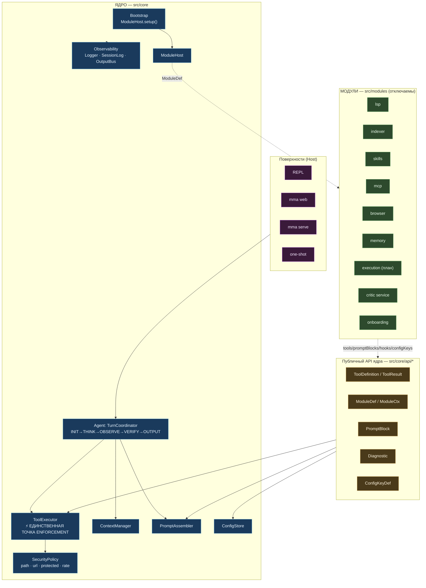
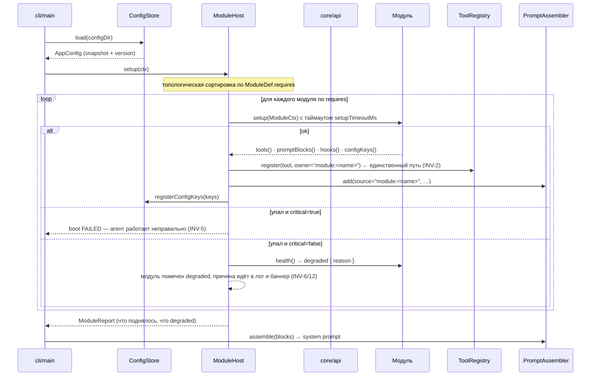
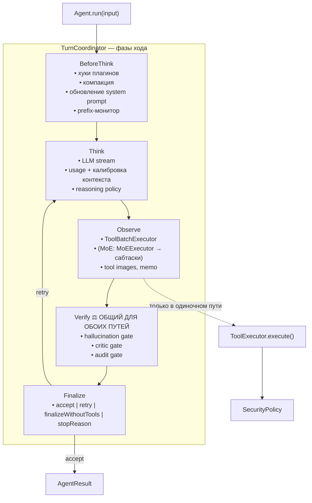
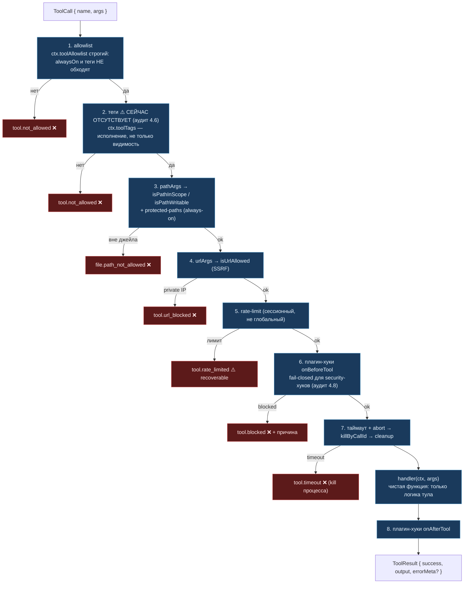
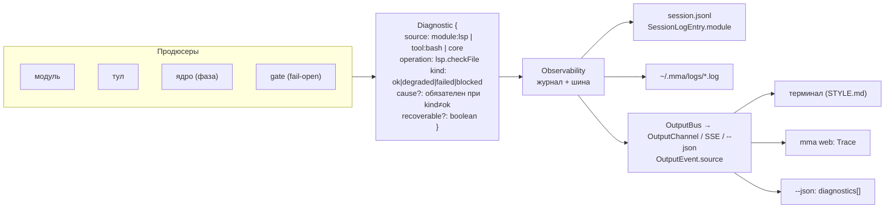
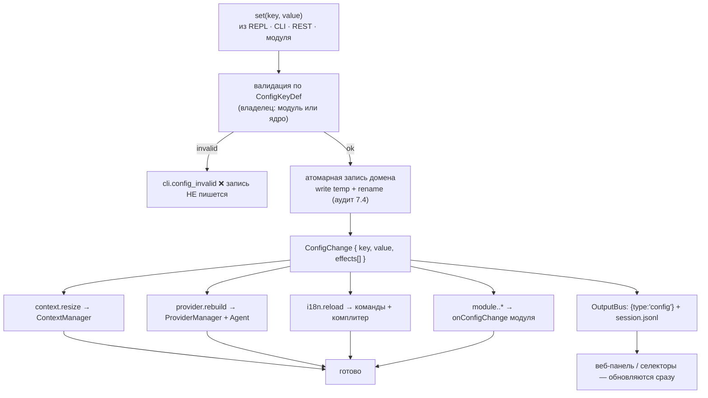

# MMA — Architecture v2: схемы и контракты

**Дата:** 2026-10-12 · **К спецификации:** [architecture v2](./2026-10-12-architecture-v2-design.md)
**Читать, если:** правишь `src/core/`, `src/tools/`, добавляешь модуль/тул/ключ конфига.

Документ отвечает на два вопроса:
**1)** как течёт ход и где стоят границы, **2)** кто с кем говорит и по какому контракту.

Все схемы помечены `[TARGET]`. Текущее состояние — в
[architecture.md](../agents/architecture.md); расхождение само по себе является долгом (§5 спеки).

---

## 1. Общая схема: одна точка исполнения

Главная идея: **модуль ничего не защищает сам**. Модуль объявляет, что он делает; всё
остальное делает ядро.



**Правило слоёв:** ядро знает о модулях только через `src/core/api/*`. Модуль знает о ядре
только через тот же пакет. Никаких прямых импортов `modules → core/agent/*` и
`tool.handler(...)` вне `src/tools/` (INV-3, INV-4).

---

## 2. Boot: что происходит при старте



Ключевое отличие от текущего: `ModuleReport` — **обязательный** артефакт. Сегодня
`withTimeout(mcp.initialize(), 10_000)` + `logger.warn` — это единственный след отказа,
и он неотличим от «MCP не настроен».

---

## 3. Ход: фазы и общий VERIFY

MoE сегодня **заменяет** петлю целиком и обходит все гейты (аудит 5.1). В `[TARGET]`
различие только в `Observe`: у MoE «действия» — сабтаски, у одиночного пути — вызовы тулов.
`Verify` и `Finalize` — общие.



**Контракт между путями:**

| | Одиночный путь | MoE-путь |
|---|---|---|
| Observe | `ToolBatchExecutor` → `ToolExecutor.execute()` | `MoEExecutor` → сабтаски |
| Think | `llmProvider.chat` | оркестратор + сабагенты |
| **Verify** | **тот же** `HallucinationGate → CriticGate → AuditGate` | **тот же** |
| **Finalize** | **тот же** | **тот же** |

Инвариант INV-22 проверяется тестом «MoE-ход проходит те же гейты».

---

## 4. Вызов тула: enforcement

Единственное место, где применяются границы. Хендлер получает уже проверенные аргументы.



**Декларация тула** вместо проверок внутри хендлера:

```ts
const writeFileTool: ToolDefinition = {
  name: "write_file",
  tags: ["file"],
  caps: [{ fs: "write" }],
  pathArgs: ["path"],          // enforcement проверит сам
  // handler НЕ импортирует isPathWritable / protectedPathBlock
};
```

| Тип объявления | Что видит enforcement | Пример |
|---|---|---|
| `caps: [{fs:"write"}]` | требуется write-право, rate-limit на записи | `write_file` |
| `pathArgs: ["path"]` | scope + protected-paths по каждому пути | `read_file`, `glob` (по результату) |
| `urlArgs: ["url"]` | SSRF-политика | `web_fetch`, `browser`, `attach_image` |
| `caps: [{proc:true}]` + `manual:{reason}` | видимое исключение с причиной | `bash` |

Тул без `caps` и без `manual` **не компилируется** (INV-10) — это проверка типами,
а не ревью.

---

## 5. Наблюдаемость: один позвоночник, три стока



**Правило INV-12:** если `kind !== "ok"`, поле `cause` обязательно. Пустой `cause`
при `degraded` — это баг: без него поломка неотличима от успеха (именно это делает
критик и MoE-верификатор — аудит 5.6, 5.8).

**Правило деградации:** модуль в `degraded` обязан отдавать `PromptBlock.degraded` с
причиной. Модель должна видеть «модуль X работает частично: <reason>», а не пустой блок
(сейчас карта проекта просто исчезает — аудит 8.7).

---

## 6. Конфигурация: запись → эффекты



Сравнение с `[AS-IS]`: сегодня `setConfigValue` возвращает `reconfigure: boolean`,
а **что именно делать — решает поверхность**; плюс `applyProviderModelMemory` мутирует
`provider.entries[]` из слоя конфига (INV-19), а `WebUiState.config` держит снимок с
bootstrap и перезаписывает все домены (INV-20).

---

## 7. Матрица контрактов

Кто с кем говорит, каким контрактом и в каком направлении.

| Проводник | Откуда | Куда | Контракт | Направление |
|---|---|---|---|---|
| `ToolCall` | Agent (Observe) | `ToolExecutor` | `ToolCall { id, name, args }` | ядро → ядро |
| `ToolDefinition` | модуль | `ToolRegistry` | `{ name, caps, pathArgs, urlArgs, handler }` | модуль → ядро |
| `ToolResult` | хендлер | Agent | `{ success, output, errorMeta?, images? }` | модуль → ядро |
| `PromptBlock` | модуль | `PromptAssembler` | `{ content, source, priority, essential, degraded? }` | модуль → ядро |
| `ConfigKeyDef` | модуль | `ConfigStore` | `{ key, domain, type, validate }` | модуль → ядро |
| `ConfigChange` | `ConfigStore` | подписчики | `{ key, value, effects[] }` | ядро → модуль |
| `ModuleDef` | модуль | `ModuleHost` | `{ name, requires, critical, setup, teardown, health, … }` | модуль → ядро |
| `Diagnostic` | всё | `Observability` | `{ source, operation, kind, cause? }` | любое → ядро |
| `ModuleHealth` | модуль | баннер / `/status` | `{ state: ok\|degraded\|down, reason? }` | модуль → UI |
| `OutputEvent` | ядро | терминал / SSE / `--json` | `{ source, level, kind, text, data }` | ядро → поверхность |
| `AgentResult` | Agent | Host | `{ success, text, stopReason?, interrupted?, usage }` | ядро → поверхность |
| `HostBridge` | ядро | плагин | `{ isBusy, submit, interrupt, subscribeOutput }` | ядро → плагин |
| `TurnSummary` | Agent | плагин | `{ success, durationMs, toolCalls, interrupted? }` | ядро → плагин |

**Чего в таблице нет и не должно быть:**

| Запрещено | Почему | Инвариант |
|---|---|---|
| модуль → `core/agent/*` | ядро перестаёт быть заменяемым | INV-3 |
| модуль → чужой `tool.handler` мимо `ToolExecutor` | обходят allowlist, security, таймаут | INV-4 |
| хендлер тула → `isPathWritable`/`protectedPathBlock` | enforcement уедет обратно в хендлеры | INV-9 |
| `ToolRegistry.register` вне `ModuleHost` | снова три реестра | INV-2 |
| глобальные синглтоны состояния (`processRegistry`, rate-limiter) | общие между сессиями | INV-5 |

---

## 8. Пять проверок, которые закрывают весь этот каркас

| Проверка | Тип | Что падает |
|---|---|---|
| `check-arch: file-size` | скрипт + `.arch-allowlist.json` | файл >300 строк без записи с датой и причиной |
| `check-arch: import-direction` | AST | `src/modules/**` импортирует `core/agent/*` |
| `check-arch: tool-handler` | AST | `tool.handler(` вне `src/tools/` |
| `tests/arch/ownership.test.ts` | рефлексия | тул/промпт-блок без `owner`/`source` |
| `tests/arch/tool-capabilities.test.ts` | типы + AST | тул без `caps`/`pathArgs`/`urlArgs`/`manual` |

Все пять — в `bun run quality` (волна W1). До неё §1 спеки держится **на дисциплине**,
и это осознанный долг, а не норма.