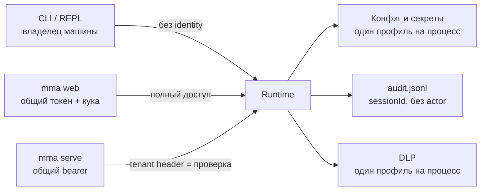
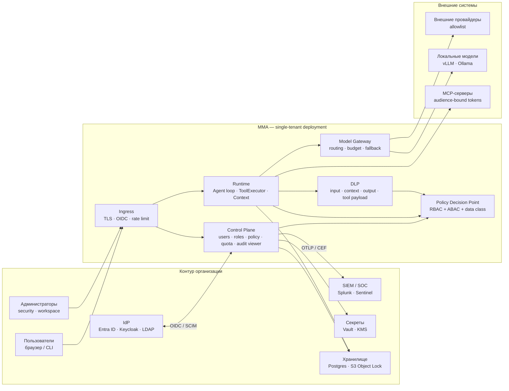
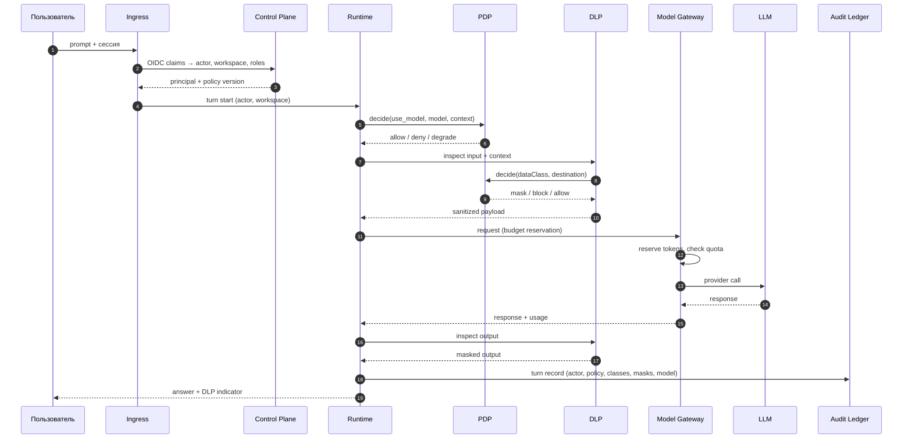
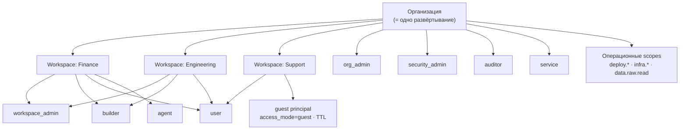
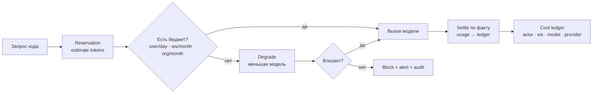
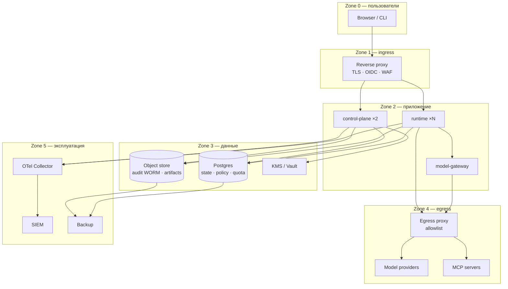
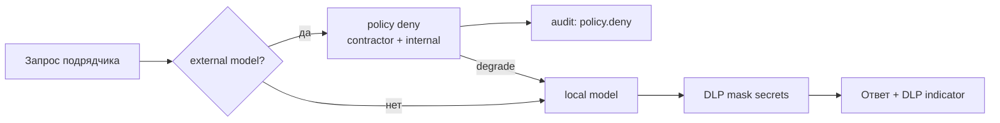
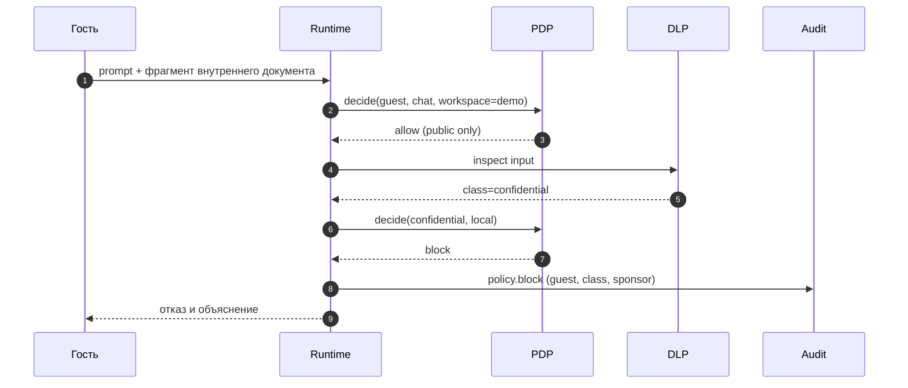
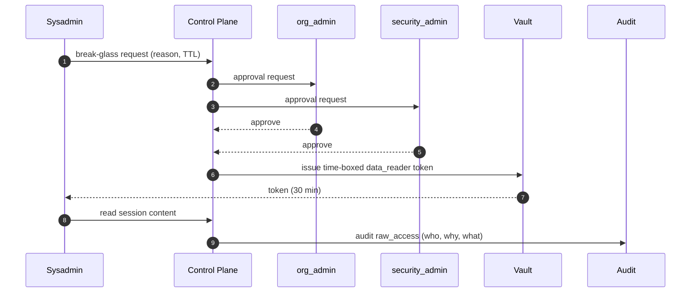
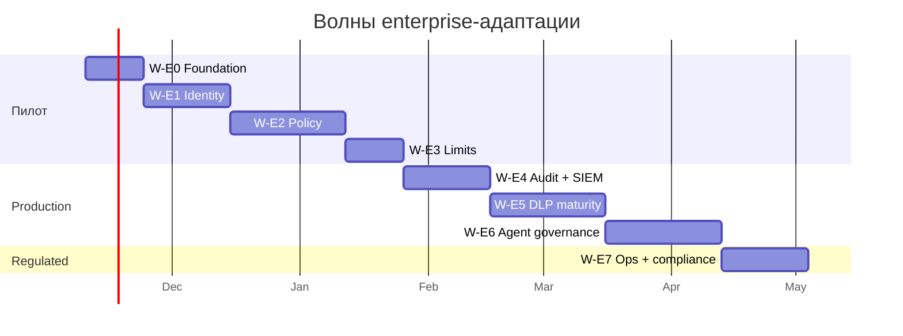

# MMA в контуре организации: enterprise-адаптация

**Дата:** 2026-11-03 · **Статус:** draft for decision · **Ветка:** `docs/enterprise-deployment`
**Аудитория:** инженерная roadmap + CISO/security review.
**Цель документа:** не «описать идеальный продукт», а дать основание для решения,
**с чего именно начинать** адаптацию MMA к внедрению в организации.

**Связанные документы:**
[architecture v2](./2026-10-12-architecture-v2-design.md) ·
[production readiness](./2026-09-28-production-readiness-design.md) ·
[corporate data policy](./2026-10-19-corporate-data-policy-design.md) ·
[DLP transparency](./2026-11-02-dlp-transparency-and-coverage-design.md) ·
[service API](../agents/service-api.md) ·
[observability](../agents/observability.md) ·
[debt register](../agents/debt.md).

---

## 0. Как читать этот документ

| Если вы…                                   | Читайте                                |
| ------------------------------------------ | -------------------------------------- |
| принимаете решение о старте                | §1, §5, §7, §8                         |
| проектируете реализацию                    | §3, §4, §6, §4.10–4.12, Приложения A–E |
| проводите security review                  | §3, §4.10–4.12, §5, §9, Приложение D   |
| отвечаете на вопрос «мы готовы к продаже?» | §1, §5, §11                            |
| не понимаете аббревиатуру или термин       | §15 (справочник)                       |

Оценка в §5 намеренно разделена на две: **как локальный harness** и **как
enterprise-платформа**. Это разные продукты, и смешивать их — главная ошибка
при планировании.

---

## 1. Резюме для решения

### 1.1. Оценка

| Что оцениваем                               |         Балл | Почему                                                                                                                                                                                      |
| ------------------------------------------- | -----------: | ------------------------------------------------------------------------------------------------------------------------------------------------------------------------------------------- |
| MMA как **локальный агентный harness**      | **7.5 / 10** | Сильная петля, единая точка enforcement, зрелый DLP на границе провайдера, SSRF/пути/команды, тесты-гварды. Слабости (нет identity plane, HA, контейнера) для одного разработчика не важны. |
| MMA как **enterprise-платформа**            | **4.0 / 10** | Технические контроли есть, организационного слоя нет: пользователи, роли, SSO, квоты, per-user policy, SIEM, retention, эксплуатация.                                                       |
| Целевое состояние после пилота (W-E0…E3)    | **6.9 / 10** | Достаточно для одного департамента: SSO, роли, per-role DLP, квоты, аудит с актором.                                                                                                        |
| Целевое состояние после всех волн (W-E0…E7) | **8.8 / 10** | Конкурентоспособно с self-hosted сегментом; остаётся не-облачный продуктовый масштаб.                                                                                                       |

Формула и веса — в §5.1.

### 1.2. Три вывода

1. **Проблема не в безопасности, а в отсутствии плоскости управления.**
   У MMA уже есть то, чего нет у большинства self-hosted чатов: DLP на границе
   провайдера с обратимой псевдонимизацией, fail-closed, единая точка применения
   политик для тулов. Не хватает не «ещё одного фильтра», а **кто** субъект,
   **какая** у него политика и **кто** это подтвердит аудитору.

2. **Single-tenant — правильная целевая модель, и это упрощает задачу.**
   «1 организация = 1 развёртывание» снимает необходимость в multi-tenant
   изоляции, биллинге и делегировании между организациями. Внутри — workspace'ы
   как логическая граница. Это соответствует текущему инварианту
   «1 тенант = 1 процесс».

3. **Начинать нужно не с DLP и не с sandbox, а с identity + policy + audit.**
   Без субъекта (кто) и решения (что можно) остальные контроли нечем связать.
   Первые четыре волны (§7) дают пилот; DLP-зрелость и sandbox — следующие.

### 1.3. Рекомендуемый первый шаг

Пилот на **одном департаменте (20–50 пользователей), одном workspace,
одном внешнем провайдере через шлюз**, с волнами **W-E0 + W-E1** параллельно.
Критерий выхода пилота — 9 базовых, 5 агентных и 4 ролевых приёмочных теста
из §14, а не «работает у нас».

---

## 2. Что значит «внедрить в организацию»

Внедрение считается состоявшимся, когда выполняются **девять проверок**, каждая
из которых может провалиться независимо. Это одновременно и definition of done,
и сценарий security review.

|   № | Проверка                                                                                                                              | Что доказывает                                            |
| --: | ------------------------------------------------------------------------------------------------------------------------------------- | --------------------------------------------------------- |
|   1 | Отключение пользователя в IdP блокирует вход, продолжение сессии и tool-call под его прежним согласием                                | Жизненный цикл identity, а не «свой список пользователей» |
|   2 | Пользователь не может через агента сделать то, чего не может в исходной системе                                                       | Least privilege и parity прав                             |
|   3 | Синтетические PII в промпте, в документе и в ответе модели редактируются/блокируются по классу данных                                 | DLP на входе, контексте и выходе                          |
|   4 | Смена роли с `internal` на `confidential` меняет поведение чата, агента и прямого tool-call без правки каждого тула                   | Политика привязана к роли и классу, а не к инструменту    |
|   5 | Взаимодействие вчерашнего дня восстанавливается из аудита: кто, какая модель ответила, какие документы и тулы, какое решение политики | Реконструируемый аудит                                    |
|   6 | Инвентарь моделей/тулов/агентов получается запросом, а не опросом                                                                     | Inventory как побочный продукт enforcement                |
|   7 | Замена модели в workflow не меняет политику и поля аудита                                                                             | Одна политика на много моделей                            |
|   8 | Исчерпание квоты командой даёт блокировку до вызова модели, алерт и запись о попытке                                                  | Квота — превентивный контроль, а не дашборд               |
|   9 | История, эмбеддинги, логи и бэкапы находятся в регионе и под ключами заказчика; provider logging выключен или подтверждён контрактом  | Residency и ответственность                               |

Дополнительно для MMA (специфика агента с инструментами):

|   № | Проверка                                                                                        |
| --: | ----------------------------------------------------------------------------------------------- |
|  10 | Prompt injection из файла/веб-страницы не приводит к записи вне workspace и не обходит approval |
|  11 | Kill-switch останавливает in-flight мутации, а не только новые запросы                          |
|  12 | Approval переживает рестарт процесса и фиксирует, кто и когда подтвердил                        |
|  13 | Подмена строки в аудит-логе детектируется проверкой цепочки/подписи                             |
|  14 | MCP-сервер получает токен с audience этого сервера и не может использовать его для другого API  |

Ролевые проверки (детали — §4.10–4.12, тесты E2E-15…18):

|   № | Проверка                                                                                          |
| --: | ------------------------------------------------------------------------------------------------- |
|  15 | Гость не читает внутренние документы, а его сессия и контент исчезают по TTL                      |
|  16 | Ограниченный пользователь не выходит во внешнюю модель и не вызывает MCP                          |
|  17 | Админ workspace не может поднять clearance или изменить глобальную политику                       |
|  18 | Разделение обязанностей: `infra.*` без break-glass не читает контент, `security_admin` не деплоит |

---

## 3. Текущее состояние: что уже есть

Раздел фиксирует **факты**, а не намерения. Полная инвентаризация — в
[production readiness](./2026-09-28-production-readiness-design.md) и спеках DLP.

### 3.1. Сильные стороны (их нельзя потерять при рефакторинге)

| Механизм                       | Где                                                               | Почему это ценно                                                                  |
| ------------------------------ | ----------------------------------------------------------------- | --------------------------------------------------------------------------------- |
| Единая точка enforcement тулов | `src/tools/executor.ts` (`enforcePathArgs`, `enforceUrlArgs`)     | Политика не может быть забыта в хендлере; новые тулы обязаны объявить `security`  |
| DLP на границе провайдера      | `src/modules/security/data-policy/guard.ts`, `egress-provider.ts` | Инспекция **до** отправки модели и **после** ответа, fail-closed                  |
| Классификация данных           | `data-policy/classify.ts`                                         | Приоритет `secret > path > machine/env > pii`, дедуп                              |
| Обратимая псевдонимизация      | `data-policy/tokens.ts`, `project.ts`                             | Модель видит `<PII:…>`, приложение восстанавливает; секреты необратимы            |
| Детекторы                      | `data-policy/detectors/*`                                         | Секреты, пути, env, PII РФ/BY, base64/hex, «склеенные» секреты, Unicode-гомоглифы |
| Защищённые пути always-on      | `security/protected-paths.ts`                                     | `.git/`, `.env*`, ключи, `.npmrc`, `.netrc` — независимо от конфига               |
| SSRF/DNS/IP-гарды              | `security/outbound-policy.ts`, `dns-guard.ts`, `ip-guard.ts`      | Вебхуки, веб-тулы, изображения                                                    |
| Аудит и нотификации            | `security/audit-log.ts`, `audit-webhook.ts`, `audit-notifier.ts`  | Файл + webhook с retry-очередью и DLP-фильтрацией тела                            |
| Rate limit                     | `security/rate-limiter.ts`                                        | Глобальные RPM/параллелизм процесса                                               |
| Шифрование сессий              | `security/session-encryption.ts`                                  | AES-256-CBC + HMAC, но выключено по умолчанию                                     |
| Шлюз для веб/сервиса           | `webui/egress.ts`, `service/server.ts`                            | Один guard на JSON, SSE, файлы, задачи                                            |
| Taint производного текста      | `data-policy/turn-journal.ts`                                     | Помнит, что уже утекало в ходе, для последующих решений                           |
| Гварды-тесты                   | `tests/security/*`, `tests/arch/egress-guard.test.ts`             | Инварианты держатся тестами, а не дисциплиной                                     |

### 3.2. Чего нет (по доменам)

| Домен                    | Сейчас                                                                                                                                                                                        | Следствие                                                                            |
| ------------------------ | --------------------------------------------------------------------------------------------------------------------------------------------------------------------------------------------- | ------------------------------------------------------------------------------------ |
| Identity                 | Один статический токен на поверхность: bearer в `mma serve` (`service.token`, timing-safe), `x-mma-token`/кука в `mma web` (`MMA_WEBUI_TOKEN`). Пользователей, логина, MFA, logout нет        | Нет SSO, SCIM, service accounts, отзыва доступа                                      |
| Роли                     | Нет RBAC/ABAC. `X-Mma-Principal`/`X-Mma-Run` — **непроверяемые метки**; `X-Mma-Tier`/`X-Mma-Scopes` объявлены в OpenAPI, но рантайм их игнорирует (`DEBT(service-tier-scopes-control-plane)`) | Нельзя «своя политика для роли»; нельзя least privilege                              |
| Multi-user               | Нет; «1 тенант = 1 процесс». `X-Mma-Tenant` только сверяется с тенантом процесса, чужой → 403                                                                                                 | Нельзя разделить департаменты внутри одной организации                               |
| Per-user policy          | DLP-конфиг один на процесс                                                                                                                                                                    | Нельзя разрешить финансам то, что запрещено стажёрам                                 |
| Классификация документов | Классы только технические (`secret`, `path`, `machine`, `env`, `pii`, `fileContent`)                                                                                                          | Нет `public/internal/confidential/restricted`                                        |
| DLP на выходе            | Проекция ответа есть, но нет отдельной политики «что нельзя возвращать»                                                                                                                       | Утечка через ответ модели контролируется слабее, чем через промпт                    |
| DLP для MCP              | Вне объёма (зафиксировано в спеке)                                                                                                                                                            | Tool-payload'ы MCP не инспектируются                                                 |
| Retention / legal hold   | Ротация: `session.jsonl` 8 МБ, gzip через 30 дней, `maxSessions: 50`; retention-политики и legal hold нет                                                                                     | Нельзя ответить аудитору «что и сколько хранится»                                    |
| PII at rest              | `sessionEncryption.enabled=false` по умолчанию (`DEBT at-rest-pii`); история/лог/память не шифруются                                                                                          | Компрометация диска = утечка                                                         |
| Квоты                    | 60 LLM-запросов/мин и 5 параллельных тулов **глобально на процесс**; `contextWindow 32768`, `maxToolIterations 200`, `maxTokens` хода. Per-user/team нет                                      | Нельзя ограничить департамент; глобальный лимит «съедает» один активный пользователь |
| Cost attribution         | `CostTracker` только суммирует; `providerBudget` читает баланс OpenRouter; enforcement нет                                                                                                    | Нельзя выставить счёт департаменту и остановить трату                                |
| SIEM                     | Generic webhook (по умолчанию выключен, `minSeverity: medium`), нет CEF/LEEF/OTLP                                                                                                             | Нет корреляции с корпоративным SOC                                                   |
| Tamper-evidence          | `audit.jsonl` append-only файл без hash chain/подписи; в записи только `sessionId`, **без actor**; `authentication` не эмитится                                                               | Аудит не является доказательством и не отвечает «кто»                                |
| HITL durability          | `question`/`approve` живут в процессе; `approve` для protected-path одноразовый                                                                                                               | Рестарт теряет ожидание; нет эскалации                                               |
| Sandbox                  | Bash/файлы исполняются на хосте; `security.bash.blacklist` — фильтр, не граница                                                                                                               | Успешный prompt injection = RCE                                                      |
| MCP OAuth                | Нет per-user OAuth 2.1 и audience-проверки                                                                                                                                                    | Широкий токен = обход разделения обязанностей                                        |
| Поставка                 | Нет Dockerfile/Helm; `/v1/health` и `/v1/ready` есть только в `mma serve`, `/healthz` нет                                                                                                     | Нельзя развернуть в VPC заказчика штатно                                             |
| HA / SLO                 | Нет; один процесс, нет реплик, бэкапов, runbook                                                                                                                                               | Нельзя дать гарантии доступности                                                     |
| Governance artifacts     | Нет risk file, DPIA-маппинга, policy-as-code                                                                                                                                                  | ISO/SOC2/EU AI Act — вручную                                                         |

### 3.3. Текущая модель доступа в одном экране



**Практическое следствие:** любой, кто получил токен, получает **всё** —
чат, конфиг, файлы, провайдеров, аудит. Разделения «администратор /
пользователь / аудитор» нет. Для организации это означает, что токен нельзя
выдать сотруднику: он эквивалентен root.

### 3.4. Что уже ограничено (и на каком уровне)

| Уровень  | Лимит                 | Значение           | Ключ                                                                                                  |
| -------- | --------------------- | ------------------ | ----------------------------------------------------------------------------------------------------- |
| Процесс  | LLM-запросы/мин       | 60                 | `security.rateLimits.maxRequestsPerMinute`                                                            |
| Процесс  | Параллельные тулы     | 5                  | `security.rateLimits.maxParallelTasks`                                                                |
| Сессия   | Окно контекста        | 32 768             | `contextWindow`                                                                                       |
| Сессия   | Итерации тулов        | 200                | `maxToolIterations`                                                                                   |
| Сессия   | Файловые операции     | 100                | `security.maxFileOperations` (проверяется внутри тулов, не в `ToolExecutor` — расхождение с INV-9/10) |
| Ход      | Порог «застрял»       | 6                  | `stuckThreshold`                                                                                      |
| Ход      | Критик                | 4 вызова, 1 repair | `critic.maxCalls`, `critic.maxRepairCycles`                                                           |
| Сабагент | `max_tokens`          | 32 000             | clamp в `subagent-limits.ts`                                                                          |
| Сабагент | Время                 | 180 с / 1800 с     | `subagent.timeoutMs`, `subagent.maxDurationMs`                                                        |
| Сервис   | Очередь / sync wait   | 5 / 10 с           | `service.maxQueueLength`, `service.syncWaitMs`                                                        |
| Сервис   | Retention результатов | 7 дней             | `service.resultRetentionDays`                                                                         |

Важно: **ни один из этих лимитов не привязан к пользователю, команде или
организации.** Они защищают процесс от runaway-рана, но не бюджет.

---

## 4. Целевая архитектура

### 4.1. Принципы

1. **Один субъект — один актор.** Каждое действие (чат, tool-call, egress,
   админ-операция) несёт `actor` и `workspace`. Анонимных действий нет.
2. **Одно решение — один PDP.** Проверка прав и данных вызывается из одной
   точки; хендлеры политику не реализуют (расширение INV-9/10).
3. **Политика — данные, не код.** Bundle версионируется, подписывается,
   ревьюится как код; смена политики — событие аудита.
4. **Deny by default для внешнего egress.** Внутренние модели — исключение,
   оформленное политикой, а не настройкой по умолчанию.
5. **Квота — до вызова, аудит — после.** Блокировка бессмысленна, если модель
   уже получила токены.
6. **Организационный слой не живёт в хендлерах.** Identity/policy/quota/audit —
   сервисы, а не поля в тулах.
7. **Один тенант = одно развёртывание.** Multi-tenant SaaS — non-goal.

### 4.2. Контекстная схема



### 4.3. Компоненты и ответственность

| Компонент         | Ответственность                                                         | Что не делает                          |
| ----------------- | ----------------------------------------------------------------------- | -------------------------------------- |
| **Ingress**       | TLS, OIDC-сессия, базовый rate limit, маршрутизация                     | Не принимает решений о данных          |
| **Control Plane** | Пользователи, workspace'ы, роли, policy bundles, квоты, просмотр аудита | Не исполняет агента                    |
| **Runtime**       | Петля агента, тулы, контекст, вызовы модели                             | Не хранит политику у себя в коде       |
| **PDP**           | `decide(actor, action, resource, context) → allow/deny/mask/approval`   | Не хранит секреты и не вызывает модели |
| **DLP**           | Классификация, детекция, маскирование, блок, rehydrate                  | Не решает, «можно ли роль» — это PDP   |
| **Model Gateway** | Роутинг, reservation бюджета, fallback, учёт токенов                    | Не применяет data-политику             |
| **Audit Ledger**  | Append-only запись, hash chain, экспорт, retention                      | Не редактирует события                 |
| **Secrets**       | Ключи провайдеров, signing keys, DB credentials                         | Не выдаёт их пользователям             |

### 4.4. Поток запроса



Ключевое: **два решения** (PDP о действии, PDP о данных) и **две инспекции**
(вход, выход). Оба решения и обе инспекции попадают в одну запись аудита.

### 4.5. Модель идентичности и ролей



| Роль              | Может                                                                       | Не может                                       |
| ----------------- | --------------------------------------------------------------------------- | ---------------------------------------------- |
| `org_admin`       | Управлять IdP-маппингом, workspace'ами, глобальными политиками, квотами org | Читать содержимое чужих сессий без break-glass |
| `security_admin`  | DLP-политика, tool allowlist, инциденты, retention                          | Менять роли org_admin, деплоить код            |
| `workspace_admin` | Пользователи и квоты своего workspace, allowlist в рамках глобального       | Поднимать класс данных выше разрешённого       |
| `builder`         | Агенты, скиллы, промпты, тесты                                              | Менять политику, выдавать себе тулы            |
| `user`            | Чат, запуск разрешённых агентов                                             | Менять конфиг, читать аудит, менять политику   |
| `auditor`         | Read-only аудит и политика, экспорт                                         | Исполнять агента, менять политику              |
| `service`         | API по scopes (`session.create`, `task.run`, `events.read`)                 | Ходить в UI, менять политику                   |
| `agent`           | Только task-scoped тулы/модели, выданные на запуск                          | Иметь standing credentials                     |

**`guest` — не роль, а тип принципала.** `actor.type=guest`, `access_mode=guest`,
TTL и sponsor. Гость не член workspace и получает отдельный policy profile
(`public` + локальная модель), а не набор прав обычного `user`.

**Операционные scopes — не роли.** DevOps и sysadmin в примерах ниже — это
должностные функции, которым выдают **явные scopes**, а не новые RBAC-роли.
Scopes не наследуются от роли и не складываются: `org_admin` не получает
`infra.*` автоматически.

| Scope                           | Что даёт                   | Кому в примере       | Ограничение           |
| ------------------------------- | -------------------------- | -------------------- | --------------------- |
| `deploy.run`, `deploy.rollback` | rollout/rollback, canary   | DevOps               | без policy и контента |
| `ops.read`                      | health, метрики, стоимость | DevOps               | без промптов          |
| `infra.kms`                     | ключи, ротация             | Sysadmin             | два подтверждения     |
| `infra.backup`                  | backup/restore             | Sysadmin             | restore в изоляцию    |
| `audit.integrity`               | проверка hash chain        | Sysadmin, auditor    | без контента          |
| `data.raw.read`                 | break-glass чтение         | Безопасник, Sysadmin | два approval + TTL    |

**Non-human identity.** У агента есть собственный `agent_id` и sponsor
(`workspace_admin`), срок делегирования и список тулов. Токен — короткоживущий,
audience-bound (MCP-сервер не может переиспользовать его для другого API).

**Человек ≠ роль.** Одна персона может нести несколько ролей (например,
безопасник с `security_admin` + `auditor`), но **права не суммируются
неограниченно**: каждая роль и scope проверяются отдельно, а человек с
`infra.*` не получает доступ к контенту только потому, что у него есть доступ
к БД.

### 4.6. Модель политики

Решение принимается по четырём осям:

```
role × workspace × data class × destination → effect
```

`destination`: `local_model`, `external_model:<allowlisted>`, `mcp:<server>`,
`webhook:<host>`, `file:<workspace>`.

`effect`: `allow | mask | block | require_approval | degrade`.

Пример bundle (policy-as-code):

```yaml
apiVersion: mma.policy/v1
version: 7
defaults:
  external_egress: deny
  unknown_data_class: mask
rules:
  - id: restricted-never-external
    when: { dataClass: [restricted], destination: external_model }
    effect: block
  - id: confidential-mask-external
    when: { dataClass: [confidential], destination: external_model }
    effect: mask
  - id: finance-pii-local-only
    when: { role: [user], workspace: [finance], dataClass: [pii], destination: external_model }
    effect: block
  - id: prod-write-requires-approval
    when: { tool: [bash, write, edit], workspace: [production] }
    effect: require_approval
  - id: auditor-readonly
    when: { role: [auditor], action: [tool.invoke] }
    effect: block
```

Свойства, без которых модель политики не работает:

- **Версия в каждом решении.** Аудит хранит `policy_version`, иначе нельзя
  объяснить вчерашнее поведение.
- **Два глаза на изменение.** Публикация bundle требует approval второго
  `security_admin`; изменение — событие аудита.
- **Тестируемость.** У bundle есть unit-тесты; CI не пропускает политику, которая
  разрешает `restricted → external`.

### 4.7. Лимиты и бюджет



Правила:

- **Резервация, а не пост-фактум.** Иначе параллельные запросы вместе
  пробивают cap.
- **Три уровня:** `user/day`, `workspace/month`, `org/month`; плюс
  `session/run` (tokens, turns, time).
- **Действия при исчерпании:** block, degrade до локальной модели, notify.
- **Атрибуция:** ledger хранит `actor`, `workspace`, `agent`, `model`,
  `provider`, `tokens_in/out`, `cost`, `currency`, `price_version`.
- **Сверка:** отчёт «ledger vs счёт провайдера» — обязательный, иначе цифрам
  не верят.

### 4.8. Аудит и наблюдаемость

Одна запись на значимое действие:

```jsonc
{
  "event_id": "evt_...",
  "ts": "2026-11-03T10:00:00Z",
  "org": "acme",
  "workspace": "finance",
  "actor": { "type": "user", "id": "u_123", "display": "a.ivanov" },
  "agent": { "id": "ag_reporting", "sponsor": "u_100" },
  "session_id": "ses_...",
  "turn_id": "trn_...",
  "action": "model.call",
  "resource": "gpt-4.1-mini",
  "data_classes": ["pii"],
  "policy": { "version": 7, "decision": "mask", "reason": "confidential-mask-external" },
  "model": { "requested": "gpt-4.1-mini", "actual": "gpt-4.1-mini", "provider": "openai" },
  "usage": { "tokens_in": 1200, "tokens_out": 300, "cost": 0.0042, "currency": "USD" },
  "approval": null,
  "hash_prev": "sha256:...",
  "hash_self": "sha256:...",
}
```

Требования:

| Требование         | Решение                                                                     |
| ------------------ | --------------------------------------------------------------------------- |
| Tamper-evident     | Hash chain + ежедневный anchor в WORM-хранилище                             |
| Реконструируемость | Один `turn_id` связывает prompt, решения, тулы, модель, ответ               |
| SIEM               | OTLP GenAI + JSON/CEF-экспортёр; pull и push                                |
| Retention          | hot 90 дней → warm 1 год → cold/legal hold 7 лет                            |
| EU AI Act          | ≥ 6 месяцев для high-risk логов; настраиваемо выше                          |
| Privacy            | Поля редактируются, а не отключаются; доступ к оригиналам — отдельное право |
| Удаление           | Deleting = tombstone + крипто-стирание ключа партиции                       |

**Что не логируем:** сырые секреты, полные PII в открытом виде, ключи
провайдеров, содержимое защищённых файлов. Логируем класс и hash/превью.

### 4.9. Топология развёртывания (single-tenant)



Режимы:

| Режим         | Что внутри                                               | Когда                              |
| ------------- | -------------------------------------------------------- | ---------------------------------- |
| `on-prem`     | Все зоны в ЦОД заказчика; внешние модели опционально     | Банки, госсектор                   |
| `private-vpc` | Приложение и данные в VPC; egress только к allowlist     | Средний бизнес                     |
| `air-gapped`  | Локальные модели, offline policy bundles, без телеметрии | КИИ, оборонка                      |
| `hybrid`      | Runtime on-prem, control plane managed                   | Не рекомендуется: ломает residency |

### 4.10. Персоны: кто это и чем ограничен

**Персона** — пример должностной задачи, **не** перечень ролей для реализации.
Продуктовая модель остаётся компактной (§4.5): 8 базовых ролей, операционные
scopes и тип принципала `guest`. Одна персона может использовать несколько
ролей/scopes, но права не «складываются в безлимит».

| Пример задач                                      | Базовая роль                   | Атрибуты / scopes                                                            | Как пользуется                                | Ограничения                                            |
| ------------------------------------------------- | ------------------------------ | ---------------------------------------------------------------------------- | --------------------------------------------- | ------------------------------------------------------ |
| **Сотрудник**                                     | `user`                         | `clearance: internal/confidential`, workspace                                | Чат, файлы своего workspace, разрешённые тулы | Админ-действия, чужие workspace, сырой аудит           |
| **Ограниченный пользователь** (подрядчик, стажёр) | `user`                         | `employment: contractor`, `clearance: internal`, `tools: []`, `model: local` | Локальный чат, чтение разрешённых документов  | Внешние модели, запись, MCP, экспорт                   |
| **Гость**                                         | принципал `guest`              | `sponsor`, `ttl: 8h`, `workspace: demo`, `clearance: public`                 | Демо-чат по публичным данным                  | Файлы, тулы, память, внешние модели, сохранение сессии |
| **Админ workspace**                               | `workspace_admin` (+`builder`) | workspace                                                                    | Люди, квоты, allowlist своего workspace       | Глобальная политика, чужие workspace, деплой           |
| **Безопасник**                                    | `security_admin` (+`auditor`)  | org                                                                          | DLP-политика, инциденты, аудит, retention     | Деплой, KMS, сырой контент без break-glass             |
| **DevOps**                                        | `user`                         | scopes `deploy.run`, `deploy.rollback`, `ops.read`                           | Деплой, rollout/rollback, health, метрики     | Контент, data-политика, KMS, роли                      |
| **Системный администратор**                       | `user` (ops-only)              | scopes `infra.kms`, `infra.backup`, `audit.integrity`, `data.raw.read`       | KMS, БД, сеть, бэкапы, сертификаты            | Чат и контент без break-glass                          |

### 4.11. Сценарии

#### S1. Сотрудник: договор с персональными данными

**Контекст:** финансовый отдел, `clearance: confidential`, внешняя модель
разрешена с маскированием.

1. Вход через OIDC → `actor=u_123`, `workspace=finance`, `roles=[user]`,
   `policy_version=7`.
2. Загружает договор. DLP классифицирует: `confidential` + `pii`.
3. Запрос к внешней модели. PDP: `confidential-mask-external` → `mask`.
   Модель получает `<PII:9f…>` и `<PERSON:41…>`, а не исходные значения.
4. Ответ проходит output-инспекцию; приложение восстанавливает токены на своей
   стороне (браузер/клиент) и показывает индикатор: «3 фрагмента замаскированы».
5. Каждый вызов модели — одна запись аудита с `data_classes`, `policy_version`,
   количеством масок и фактической моделью.

**Отказ:** попытка отправить договор через `web_fetch` на внешний хост →
`destination=external` → `block`, пользователь видит причину.

**Аудит:** `model.call`, `dlp.mask`, `policy.allow`, `tool.deny` (при попытке).

#### S2. Ограниченный пользователь: тикет с PII

**Контекст:** подрядчик в support, `clearance: internal`, внешние модели
запрещены, тулы не выданы, квота 20 000 токенов/день.



1. В IdP у сотрудника атрибут `employment=contractor`; политика накладывает
   overlay: `external_egress=deny`, `tools=[]`.
2. Вставляет тикет с телефоном клиента. Запрос к внешней модели → `deny`.
3. Интерфейс предлагает локальную модель; запрос уходит в on-prem, секреты
   маскируются, PII остаётся в контуре.
4. Попытка вызвать MCP Jira → `tool.deny` по allowlist.
5. Экспорт файла и копирование в буфер с файлами отключены; доступен только
   текст ответа.

**Аудит:** `policy.deny` (external), `policy.degrade` (local), `tool.deny`,
`dlp.mask`, `quota.warn` при 80% дневной квоты.

#### S3. Гость: демо для внешнего партнёра

**Контекст:** партнёру выдан доступ на 8 часов, `workspace=demo`,
`clearance=public`, sponsor — `workspace_admin`.



1. Гость входит по OIDC-аккаунту из IdP (или одноразовой ссылке), сессия
   эфемерная: нет памяти, нет resume, нет списка прошлых чатов.
2. Загрузка файлов отключена; можно только вставить текст.
3. Вставлен внутренний документ → DLP видит `confidential` → `block`.
4. Разрешён только локальный public-контент; ответ помечен «guest».
5. Через 8 часов сессия и её контент удаляются; аудит сохраняется по retention.

**Аудит:** `guest.session.start` (sponsor, TTL), `policy.block`,
`guest.session.expire`.

#### S4. Админ workspace: онбординг десяти человек

**Контекст:** `workspace_admin` в `engineering`, глобальная политика — от
`security_admin`.

1. Входит в admin console; видит **только** свой workspace.
2. Создаёт/приглашает пользователей, назначает `user` или `builder`.
3. Ставит квоту workspace: 1 000 $/мес; видит расход по людям и моделям.
4. Добавляет `web_fetch` в allowlist workspace — только если инструмент уже
   разрешён глобально.
5. Пытается поднять `clearance` до `restricted` → `deny`: это уровень
   `security_admin`/`org_admin`.
6. Пытается изменить глобальное DLP-правило → `deny`, создаётся запрос
   безопаснику.

**Аудит:** `admin.user.create`, `admin.role.assign`, `admin.quota.set`,
`policy.deny` (две попытки), `request.create`.

#### S5. Безопасник: инцидент с `.env`

**Контекст:** `security_admin`, алерт из SIEM.

1. Приходит алерт: `security_block` — чтение `.env` в `engineering`.
2. Открывает инцидент: actor, tool, путь (маскирован), policy version,
   решение `block`.
3. Видит только masked-превью; для оригинала оформляет break-glass (см. S7).
4. Пишет правило `restricted-never-external`, прогоняет dry-run на replay
   последних 30 дней: сколько запросов было бы заблокировано.
5. Публикует bundle; требуется второе подтверждение `security_admin`
   (для org-wide политики — `org_admin`); версия +1, событие в аудите и SIEM.
6. Деплой не выполняет — это человек с `deploy.*` scopes.

**Аудит:** `incident.open`, `policy.test`, `policy.publish` (два approver),
`audit.raw_access` (если был break-glass).

#### S6. DevOps: канареечный релиз

**Контекст:** сотрудник с ролью `user` и scopes `deploy.run` /
`deploy.rollback` / `ops.read`; доступ к environment, но не к контенту.

1. CI собирает образ, подписывает, публикует в registry.
2. DevOps выкатывает 10% трафика: `deploy.start`, health/ready зелёные.
3. Смотрит p95 latency, error rate, стоимость на запрос; **не видит** промпты.
4. SLO-алерт → `deploy.rollback` одной командой; версия возвращается.
5. Ротация ключей провайдера: выполняет DevOps, подтверждает `security_admin`;
   значение ключа не показывается никому.
6. Поменять data-политику или выдать себе `security_admin` не может.

**Аудит:** `deploy.start`, `deploy.promote`, `deploy.rollback`, `secret.rotate`
(два approver).

#### S7. Системный администратор: восстановление и break-glass

**Контекст:** сотрудник со scopes `infra.kms` / `infra.backup` /
`audit.integrity` и `data.raw.read`; доступ через jump host + MFA, без
обычного логина в чат.



1. Восстанавливает Postgres из бэкапа в изолированное окружение, проверяет
   hash chain аудита и контрольные суммы.
2. Для чтения конкретной сессии оформляет break-glass: причина, объект, TTL
   30 минут.
3. Требуются два подтверждения: `org_admin` + `security_admin`.
4. Vault выдаёт time-boxed токен только на чтение; каждое чтение — событие
   аудита с причиной.
5. По истечении TTL токен отзывается; попытка продлить — новый запрос.

**Аудит:** `infra.backup.restore`, `audit.chain.verify`, `breakglass.request`,
`breakglass.approve` ×2, `audit.raw_access`, `breakglass.expire`.

### 4.12. Матрица доступа

Легенда: ✅ разрешено · 🔶 маска/approval/ограничение · ⛔ запрещено ·
➖ не применимо. Матрица — **верхняя граница** при условии, что инструмент и
модель включены в allowlist workspace; по умолчанию действует deny.

| Действие                  |  Сотрудник   | Ограниченный |   Гость   |   Админ WS   |   Безопасник   |    DevOps     |    Sysadmin    |
| ------------------------- | :----------: | :----------: | :-------: | :----------: | :------------: | :-----------: | :------------: |
| Чат с локальной моделью   |      ✅      |      ✅      | ✅ public |      ✅      |       ✅       |      🔶       |       ⛔       |
| Чат с внешней моделью     |   🔶 mask    |      ⛔      |    ⛔     |   🔶 mask    |    🔶 mask     |      ⛔       |       ⛔       |
| Загрузка файлов           |      ✅      |      ⛔      |    ⛔     |      ✅      |       ✅       |      ⛔       |       ⛔       |
| Чтение файлов workspace   |      ✅      |      🔶      |    ⛔     |      ✅      |       ✅       |      ⛔       |       ⛔       |
| Запись файлов / `bash`    | 🔶 approval  |      ⛔      |    ⛔     | 🔶 approval  |       ⛔       |      ⛔       |       ⛔       |
| MCP / внешние тулы        | 🔶 allowlist |      ⛔      |    ⛔     | 🔶 allowlist |       ⛔       |      ⛔       |       ⛔       |
| Экспорт результата        |      🔶      |      ⛔      |    ⛔     |      🔶      |       🔶       |      ⛔       |       ⛔       |
| Просмотр аудита           |      ⛔      |      ⛔      |    ⛔     |  🔶 свой WS  |       ✅       |  🔶 metadata  |  🔶 integrity  |
| Сырой контент сессии      |      ⛔      |      ⛔      |    ⛔     |      ⛔      | 🔶 break-glass |      ⛔       | 🔶 break-glass |
| Управление пользователями |      ⛔      |      ⛔      |    ⛔     |  ✅ свой WS  |       ⛔       |      ⛔       |       ⛔       |
| Изменение data-политики   |      ⛔      |      ⛔      |    ⛔     |      ⛔      | ✅ + 2-е лицо  |      ⛔       |       ⛔       |
| Деплой / rollback         |      ⛔      |      ⛔      |    ⛔     |      ⛔      |       ⛔       |      ✅       |       🔶       |
| KMS / БД / бэкапы         |      ⛔      |      ⛔      |    ⛔     |      ⛔      |       ⛔       | 🔶 с approval |       ✅       |

**Почему матрица выглядит именно так (separation of duties).** Колонки —
примеры должностных функций, а не роли продукта; права каждой определяются
базовой ролью + выданными scopes.

- **Сотрудник** не может экспортировать без ограничения: экспорт — самый
  частый канал утечки, поэтому он под контролем, а не «по умолчанию».
- **Ограниченный** не получает внешнюю модель: его `clearance` ниже, а
  локальная модель даёт полезную работу без egress.
- **Гость** не является членом workspace: это отдельный тип принципала с TTL,
  иначе «временный» доступ становится постоянным.
- **Админ workspace** управляет людьми и бюджетом, но не политикой: иначе
  бизнес-подразделение сможет ослабить контроль.
- **Безопасник** меняет политику, но не деплоит: компрометация его учётки не
  должна давать доступ к исполнению кода.
- **DevOps** деплоит, но не читает контент и не меняет политику: код и данные
  разделены.
- **Sysadmin** имеет доступ к инфраструктуре, но не к контенту: доступ к БД не
  равен праву читать. Только break-glass с двумя подтверждениями.

**Анти-паттерны, которых не должно быть в реализации:**

- `infra.*` scope получает токен приложения «для удобства».
- `security_admin` деплоит «быстро поправить».
- `guest` добавляется в workspace как обычный `user`.
- `workspace_admin` может поднять `clearance` или изменить глобальный DLP.
- DevOps хранит ключи провайдеров в переменных окружения своего ноутбука.

---

## 5. Оценка и сравнение

### 5.1. Как считается балл

Семь доменов, веса отражают, что спрашивают на security review.

| Домен                   |  Вес |  Сейчас | Цель (пилот) | Цель (prod) | Что тянет вниз                                               |
| ----------------------- | ---: | ------: | -----------: | ----------: | ------------------------------------------------------------ |
| Identity & access       |  20% | **2.0** |          7.0 |         9.0 | Нет пользователей, SSO, SCIM, ролей, service accounts        |
| DLP & data governance   |  20% | **6.5** |          8.0 |         9.0 | Нет классов документов, output-политики, MCP, retention, NER |
| Agent action security   |  15% | **6.0** |          7.5 |         9.0 | Нет sandbox, durable HITL, MCP OAuth, kill-switch            |
| Audit & observability   |  15% | **4.0** |          7.0 |         9.0 | Нет актора, tamper-evidence, SIEM, OTel                      |
| Limits & cost           |  10% | **3.0** |          7.0 |         8.5 | Нет per-user/team, reservation, attribution                  |
| Deployment & isolation  |  10% | **3.0** |          6.0 |         8.5 | Нет контейнера, health, HA, SLO, workspace-изоляции          |
| Governance & compliance |  10% | **2.0** |          5.0 |         8.0 | Нет policy-as-code, risk file, маппинга, DPIA                |
| **Взвешенный итог**     | 100% | **4.0** |      **6.9** |     **8.8** |                                                              |

Расчёт «сейчас»: `0.2·2 + 0.2·6.5 + 0.15·6 + 0.15·4 + 0.1·3 + 0.1·3 + 0.1·2 = 4.0`.

Это **не** результат пентеста или сертификации, а оценка покрытия контролей по
коду и документации на 2026-11-03. Балл DLP высокий не потому, что «всё
сделано», а потому что техническая глубина (классификация, обратимая
псевдонимизация, fail-closed) уже выше, чем у большинства self-hosted
продуктов; организационная часть DLP при этом отсутствует и вынесена в
Governance.

### 5.2. Лучшие и худшие стороны MMA

**Сильные стороны (защищать):**

- **DLP глубиной на границе провайдера**, а не «фильтр в UI»: классификация,
  обратимая псевдонимизация, отдельная необратимая маска секретов, fail-closed,
  покрытие чата, Service API, webhook и audit-нотификаций. Это редкость даже у
  платных продуктов.
- **Один enforcement point** для тулов: path/url/rate/protected — нельзя забыть
  в новом хендлере.
- **Полный self-host и air-gap**: нет обязательной SaaS-зависимости, есть
  локальные модели.
- **Открытый код и тесты-гварды**: политику можно проверить, а не «поверить
  вендору».
- **Малый вес**: работает на 9B-моделях и скромном железе — важно для
  организаций без GPU-парка.

**Слабые стороны (чинить):**

- **Нет организационного субъекта.** Один токен и одно пространство политик на
  процесс — это не «организация», а «один разработчик». `X-Mma-Principal` —
  непроверяемая метка, а не identity.
- **Админ-плоскости нет.** Политику нельзя выдать, проверить, откатить и
  объяснить без правки файлов на сервере. Конфиг-API доступен любому с токеном.
- **Аудит не доказательство.** `audit.jsonl` можно отредактировать; в записи
  только `sessionId`, нет actor, нет hash chain, нет экспорта в SOC.
- **Квоты не превентивны.** 60 rpm и 5 параллельных тулов — глобальные; один
  активный пользователь исчерпывает лимит департамента. `CostTracker` не
  останавливает трату.
- **Эксплуатация не промышленная.** Нет контейнера и `/healthz` (health/ready
  есть только в `mma serve`), нет HA, бэкапов, SLO и runbook.
- **Гигиена веб-сессии.** Кука без `Secure` (`util.ts`), CSP с `'unsafe-inline'`
  (`DEBT(webui-csp-inline-script)`) — недопустимо для интернет-периметра.
- **Агентные риски впереди DLP-зрелости.** Sandbox, durable approval и
  MCP-audience — обязательны для «агент пишет в прод».

### 5.3. Сравнение с рынком

Балл — та же взвешенная модель, экспертная оценка по публичной документации на
октябрь 2026. Это не рейтинг продуктов, а карта **где MMA выигрывает и где
проигрывает**. Баллы вендоров не являются бенчмарком: тарифы, редакции и
региональные ограничения меняют покрытие контролей.

| Класс / продукт                             | Identity | DLP | Audit | Limits | Deploy |    Итог | Лучшее                                      | Худшее                                        |
| ------------------------------------------- | -------: | --: | ----: | -----: | -----: | ------: | ------------------------------------------- | --------------------------------------------- |
| **MMA сейчас**                              |        2 | 6.5 |     4 |      3 |      3 | **4.0** | Глубина DLP, self-host, единый enforcement  | Нет identity/admin/ops                        |
| **MMA цель**                                |        9 |   9 |     9 |    8.5 |    8.5 | **8.8** | Сочетание DLP + self-host + агентные тулы   | Придётся строить control plane                |
| Microsoft Copilot Studio / Azure AI Foundry |        9 |   8 |     9 |      8 |      5 | **8.5** | Entra/Purview/Sentinel из коробки; SOC2/ISO | Cloud lock-in, residency, нет on-prem         |
| AWS Bedrock Agents                          |        8 | 6.5 |     8 |    7.5 |      6 | **7.8** | IAM/CloudTrail, приватные сети, масштаб     | Guardrails слабее DLP-класса; vendor-specific |
| Google Vertex Agent Builder                 |        8 |   7 |     8 |      8 |    5.5 | **7.7** | IAM, VPC-SC, CMEK, audit                    | Cloud-only, сложность                         |
| Dify Enterprise                             |        7 | 3.5 |     5 |      6 |    7.5 | **5.9** | Workspace/RBAC, self-host, UX               | DLP уровня «фильтр», governance неглубокий    |
| LibreChat                                   |        7 |   2 |     4 |      5 |      8 | **5.4** | OIDC/SAML/LDAP, per-user token balance, MIT | Нет DLP/агентного enforcement                 |
| Open WebUI                                  |        8 |   2 |     5 |      3 |      8 | **5.4** | LDAP/SCIM/groups/audit, offline             | DLP нет; лицензия на брендинг >50 users       |
| AnythingLLM                                 |        4 |   2 |     3 |      3 |      7 | **3.7** | Быстрый старт, MIT                          | Multi-user только Docker, governance нет      |

**Что скопировать у сильных:**

- У **Copilot/Foundry** — модель «IdP + policy engine + audit + DLP» как
  отдельные плоскости, а не флаги в приложении.
- У **Bedrock** — per-call authorization и trace каждого tool-call.
- У **Open WebUI** — SCIM/LDAP и группы как первый шаг, не последний.
- У **LibreChat** — per-user token balance как простой MVP квоты.
- У **Dify** — workspace как единица делегирования.

**Где MMA может выиграть:**

- **Self-host + air-gap + DLP на egress** — комбинация, которой нет у
  cloud-first продуктов.
- **Агентные тулы под политикой** — чаты защищают промпт; MMA умеет защищать
  `bash`, файлы, URL и MCP в одной точке.
- **Малые модели** — стоимость внедрения ниже, чем у платформ, требующих GPU.

---

## 6. Buy vs build

| Блок           | Решение                                                          | Почему                                                                         |
| -------------- | ---------------------------------------------------------------- | ------------------------------------------------------------------------------ |
| IdP, SSO, SCIM | **Купить/взять готовое** (Entra ID, Keycloak, Okta)              | Свой IdP — это безопасность, которую нельзя позволить себе писать              |
| Policy engine  | **Тонкий PDP + OPA/Rego** (MVP: JSON-правила в TS)               | OPA — CNCF, тестируемый, вендор-нейтральный; Cedar — если AWS-only             |
| DLP-детекторы  | **Оставить свои + коннектор к внешнему DLP** (Purview, Presidio) | Свои детекторы уже сильны на секретах/путях; NER и юрисдикции — у специалистов |
| SIEM           | **Интегрировать** (Splunk, Sentinel, QRadar)                     | Свой SIEM — non-goal                                                           |
| Секреты        | **Vault / KMS**                                                  | Ротация, аудит доступа, HSM                                                    |
| Model gateway  | **Интегрировать** LiteLLM-совместимый или встроенный             | Роутинг/бюджеты — не дифференциатор                                            |
| Sandbox        | **Контейнерный runtime** (Docker/gVisor), позже Firecracker      | Своя изоляция ОС — слишком дорого                                              |
| Audit store    | **Postgres + S3 Object Lock**                                    | Дёшево, WORM, знакомо аудиторам                                                |
| Admin UI       | **Строить** (минимальный)                                        | Без него политику не выдадут                                                   |

Правило: **дифференциатор строим, инфраструктуру покупаем.** Дифференциатор
MMA — DLP на egress + enforcement агентных тулов + локальные модели.

---

## 7. План внедрения по волнам

Порядок выбран так, чтобы каждая волна заканчивалась **проверяемым результатом**
и не требовала «сначала всё отрефакторить».



| Волна                     | Результат                       | Объём                                                                                                                                                                                                               | Критерий приёмки                                                          |
| ------------------------- | ------------------------------- | ------------------------------------------------------------------------------------------------------------------------------------------------------------------------------------------------------------------- | ------------------------------------------------------------------------- |
| **W-E0 Foundation**       | Развёртывается в VPC заказчика  | Dockerfile/Helm, `/healthz` (алиас существующих `/v1/health` и `/v1/ready`), graceful shutdown, enterprise-профиль конфига (paths on, contentScan on, sessionEncryption on, auditNotifier on), secrets из env/Vault | `docker run` → health 200; профиль проходит 9 тестов в части конфигурации |
| **W-E1 Identity**         | SSO и субъект в каждом действии | OIDC-вход в web вместо общего токена, SCIM (или sync из IdP), users/workspaces/roles, service API keys со scopes, logout/active sessions, cookie `Secure`, `actor` в аудите `audit.jsonl`                           | Тест 1: disable в IdP блокирует вход/сессию/tool-call                     |
| **W-E2 Policy**           | Роли реально ограничивают       | PDP + RBAC/ABAC, классы `public/internal/confidential/restricted`, per-role DLP overlays, tool allowlist на роль, минимальный admin UI, policy-as-code + тесты                                                      | Тесты 2, 4, 7: смена роли меняет чат, агента и tool-call                  |
| **W-E3 Limits**           | Нельзя превысить бюджет         | Quota service, reservation/settle, `user/day` + `workspace/month` + `org/month`, rate limit per user, cost ledger                                                                                                   | Тест 8: блокировка до вызова, алерт, запись о попытке                     |
| **W-E4 Audit + SIEM**     | Аудит — доказательство          | Hash chain, WORM, OTel GenAI spans, SIEM-экспортёр, retention/legal hold, аудит админ-действий, UI просмотра                                                                                                        | Тесты 5, 13: восстановление вчерашнего хода; подмена строки ловится       |
| **W-E5 DLP maturity**     | DLP покрывает выход и MCP       | Output-политика, классификация документов, DLP для MCP, коннектор к внешнему DLP, NER, режим `warn`                                                                                                                 | Тест 3: PII в промпте, документе и ответе                                 |
| **W-E6 Agent governance** | Агент не может выйти за пределы | Sandbox-профиль, durable HITL, kill-switch, MCP OAuth 2.1 + audience, agent identity и scoped credentials                                                                                                           | Тесты 10–12, 14                                                           |
| **W-E7 Ops + compliance** | Промышленная эксплуатация       | HA (2+ реплики), backup/restore, SLO + runbook, подпись policy bundles, risk file / DPIA-маппинг, пентест                                                                                                           | Тесты 6, 9; RTO/RPO подтверждены учениями                                 |

**Зависимости:** W-E1 → W-E2 → W-E3; W-E4 можно начинать параллельно с W-E2
(схема события не зависит от UI). W-E5 зависит от W-E2 (классы) и W-E3
(стоимость). W-E6 зависит от W-E2/E4.

**Оценка трудозатрат:** 2–3 инженера, ~20–26 недель до W-E7. Пилот (W-E0…E3) —
10–12 недель.

### 7.1. Что делать в первые две недели

1. Зафиксировать IdP и способ provisioning (OIDC + SCIM или sync).
2. Утвердить персоны, роли и матрицу «роль × класс × destination» (§4.5,
   §4.10–4.12) — это политическое решение, не инженерное.
3. Собрать enterprise-профиль конфига и контейнер (W-E0).
4. Ввести `actor` в существующий аудит — даже без полного control plane это
   сразу повышает ценность логов.
5. Выбрать 3–5 acceptance-тестов, которые будут прогоняться на каждом релизе.

---

## 8. Ключевые решения (ADR)

| ID         | Решение                                                        | Альтернатива                 | Почему так                                                                |
| ---------- | -------------------------------------------------------------- | ---------------------------- | ------------------------------------------------------------------------- |
| **ADR-1**  | Single-tenant на развёртывание; workspace — логическая граница | Multi-tenant SaaS            | Изоляция, residency, отсутствие биллинга; совпадает с текущим инвариантом |
| **ADR-2**  | IdP покупаем; свой user store не строим                        | Свой логин/пароли            | Безопасность и lifecycle дешевле купить                                   |
| **ADR-3**  | Один PDP-интерфейс; OPA/Rego или JSON-правила на MVP           | Проверки в каждом хендлере   | Иначе политика дрейфует (уже было в архитектуре)                          |
| **ADR-4**  | Квота — reservation до вызова                                  | Пост-фактум лимит по usage   | Параллельные запросы пробивают cap                                        |
| **ADR-5**  | Аудит — hash chain + WORM                                      | «Логи в файле»               | Аудит должен быть доказательством                                         |
| **ADR-6**  | DLP: свои детекторы + внешний коннектор                        | Только внешний DLP-прокси    | Свой слой уже глубоко встроен; прокси не видит tool-payload               |
| **ADR-7**  | Agent identity: service account на агента, task-scoped токены  | Один общий API-ключ          | Least privilege и аудит «чей агент»                                       |
| **ADR-8**  | Sandbox — контейнерный профиль                                 | Чёрные списки команд         | Список — фильтр, не граница                                               |
| **ADR-9**  | Admin UI минимальный, но обязательный                          | Только YAML/CLI              | Политику без UI не выдадут в организации                                  |
| **ADR-10** | Модели — через gateway с бюджетом                              | Прямые вызовы провайдера     | Одна точка учёта, failover, блокировка                                    |
| **ADR-11** | Разделение обязанностей: policy ≠ deploy ≠ infra               | Один «супер-админ»           | Компрометация одной учётки не даёт и политику, и исполнение, и данные     |
| **ADR-12** | Гость — тип принципала с TTL и sponsor                         | Гость как `user` в workspace | Иначе временный доступ становится постоянным и получает память/файлы      |
| **ADR-13** | Break-glass только двумя лицами и на время                     | Постоянный `data_reader`     | Доступ к сырому контенту должен быть исключением с доказательством        |

---

## 9. Риски и non-goals

### 9.1. Риски

| Риск                                           | Вероятность | Влияние | Митигация                                                       |
| ---------------------------------------------- | ----------- | ------- | --------------------------------------------------------------- |
| Ложные срабатывания DLP → пользователи обходят | Высокая     | Высокое | Режим `warn` на пилоте, tuning, NER, объяснение в UI            |
| Scope creep: identity затрагивает все модули   | Высокая     | Среднее | Волны и контракты; `actor` через контекст, не через каждый тул  |
| Задержка PDP на каждом tool-call               | Средняя     | Среднее | Локальный кэш решений + версия bundle + benchmark p95           |
| Air-gap ломает обновления политики             | Средняя     | Среднее | Offline bundles, подпись, ручной импорт                         |
| Миграция конфига ломает существующих           | Средняя     | Среднее | Версионирование, `config migrate`, default = текущее поведение  |
| Малая модель «не понимает» отказ политики      | Средняя     | Низкое  | Формулировки ошибок в `tool.friendly.*`, подсказка «что делать» |
| Аудит растёт быстрее бюджета                   | Средняя     | Среднее | Tiered retention, партиции, сжатие, cap на событие              |
| Пентест найдет обход sandbox                   | Низкая      | Высокое | Defense in depth: sandbox + policy + egress allowlist           |

### 9.2. Non-goals

- Multi-tenant SaaS, биллинг между организациями, delegated admin между
  тенантами.
- Собственный IdP, собственный SIEM, собственный model gateway, собственный
  ML-DLP-движок.
- Юридические заключения по EU AI Act / 152-ФЗ — только инженерный маппинг.
- Изменение UX-канона чата (`STYLE.md`) и i18n-контракта.
- Полный рефакторинг ядра «заодно»: изменения — по швам, с гвардами.

---

## 10. Открытые вопросы (нужно решение до старта)

|   № | Вопрос                                                     | Кто решает       | Влияние                        |
| --: | ---------------------------------------------------------- | ---------------- | ------------------------------ |
|   1 | Какой IdP у заказчика: Entra ID, Keycloak, LDAP+OIDC?      | CISO/IT          | W-E1, схема SCIM               |
|   2 | Нужен ли air-gap?                                          | Заказчик         | Модели, обновления, телеметрия |
|   3 | Кто владеет policy bundle — security или workspace?        | Governance       | Модель ролей                   |
|   4 | Retention: 6 мес., 1 год, 7 лет?                           | Legal/compliance | Хранилище, стоимость           |
|   5 | Внешний DLP: Purview, Google DLP, Presidio, свой?          | CISO             | W-E5                           |
|   6 | Бюджет в валюте провайдера или внутренних кредитах?        | Finance          | Cost ledger                    |
|   7 | Нужна ли HA и какой RTO/RPO?                               | Ops              | W-E7, стоимость                |
|   8 | Агенты получают identity на пользователя или на workspace? | Security         | ADR-7, аудит                   |
|   9 | Разрешать ли `require_approval` в нерабочее время?         | Ops              | HITL, эскалация                |
|  10 | Кто подписывает policy bundle вторым ключом?               | Security         | Два глаза                      |

---

## 11. Приложение A: маппинг на фреймворки

| Требование                                    | MMA-контроль                                      | Где                      |
| --------------------------------------------- | ------------------------------------------------- | ------------------------ |
| **ISO 27001 A.5.15–5.18** Access control      | Роли, workspace, least privilege, review          | §4.5, W-E1/E2            |
| **ISO 27001 A.8.2** Privileged access         | Отдельные `org_admin`/`security_admin`, два глаза | §4.5, ADR-3              |
| **ISO 27001 A.8.11** Data masking             | Псевдонимизация, маска секретов                   | `data-policy/project.ts` |
| **ISO 27001 A.8.12** DLP                      | Egress guard, классы, output                      | §4.4, W-E5               |
| **ISO 27001 A.8.15–8.16** Logging/monitoring  | Audit ledger, SIEM, алерты                        | §4.8, W-E4               |
| **ISO 27001 A.8.24** Cryptography             | TLS, KMS/Vault, at-rest encryption                | W-E0/E7                  |
| **SOC 2 CC6** Logical access                  | OIDC/SCIM, роли, отзыв                            | W-E1                     |
| **SOC 2 CC7** Monitoring                      | Аудит, алерты, retention                          | W-E4                     |
| **NIST AI RMF Govern**                        | Policy-as-code, роли, инвентарь                   | §4.6, W-E2               |
| **NIST AI RMF Map**                           | Классы данных, контекст, destination              | §4.6                     |
| **NIST AI RMF Measure**                       | Cost/tokens, DLP-метрики, eval                    | §4.7–4.8                 |
| **NIST AI RMF Manage**                        | Kill-switch, approval, инциденты                  | W-E6                     |
| **OWASP LLM01** Prompt injection              | Sandbox, least privilege, approval                | W-E6                     |
| **OWASP LLM02** Sensitive disclosure          | DLP input/output, маска                           | W-E5                     |
| **OWASP LLM06** Excessive agency              | Tool allowlist, scoped credentials                | W-E2/E6                  |
| **OWASP LLM07** System prompt leakage         | Проекция промпта, DLP                             | `data-policy`            |
| **OWASP LLM10** Unbounded consumption         | Квоты, reservation, kill-switch                   | W-E3                     |
| **EU AI Act Art. 14** Human oversight         | Durable HITL, панель                              | W-E6                     |
| **EU AI Act Art. 19** Logs ≥ 6 мес.           | Retention tier                                    | W-E4                     |
| **GDPR Art. 5(1)(e), 17** Storage/deletion    | Retention, tombstone, crypto-erase                | W-E4                     |
| **152-ФЗ ст. 18, 19** Localization/protection | On-prem, KMS, журналы                             | §4.9                     |
| **NIST SP 800-207** Zero trust                | Per-call authz, audience tokens                   | §4.5                     |

---

## 12. Приложение B: enterprise-профиль конфига (эскиз)

Не финальный контракт; показывает, какие ключи должны существовать.

```yaml
# mma.enterprise.yaml — эскиз, не реализовано
deployment:
  mode: on-prem # on-prem | private-vpc | air-gapped
  tenant: acme
  region: ru-msk

identity:
  provider: oidc # oidc | saml | ldap
  issuer: https://idp.acme.example
  client_id: mma
  scim: true
  group_role_map:
    MMA-Admins: org_admin
    MMA-Security: security_admin
    MMA-Audit: auditor
    MMA-Finance: user
  group_scope_map: # scopes выдаются отдельно от роли
    MMA-Platform: [deploy.run, deploy.rollback, ops.read]
    MMA-Infra: [infra.kms, infra.backup, audit.integrity]
  session:
    absolute_hours: 12
    idle_minutes: 30

policy:
  engine: opa # opa | builtin
  bundle: /etc/mma/policy
  require_two_person_publish: true
  default:
    external_egress: deny
    unknown_data_class: mask

data:
  classes: [public, internal, confidential, restricted]
  dlp:
    mode: enforce # enforce | warn
    detectors: [secrets, paths, pii_rf, pii_by, machine, encoded]
    ner: false
    external_connector: none # purview | google-dlp | presidio
  retention:
    hot_days: 90
    warm_days: 365
    legal_hold_days: 2555
    legal_hold_enabled: true

limits:
  user:
    tokens_per_day: 200000
    cost_per_month_usd: 50
    max_concurrent: 2
  workspace:
    tokens_per_month: 5000000
    cost_per_month_usd: 1000
  org:
    cost_per_month_usd: 20000
  on_exhausted: degrade # block | degrade | notify

audit:
  ledger: postgres
  worm: s3-object-lock
  hash_chain: true
  export: [otlp, cef, json]
  siem:
    endpoint: https://siem.acme.example/ingest
  include_prompt: masked # none | masked | full (только с approval)

agents:
  sandbox: true
  approval:
    durable: true
    ttl_minutes: 60
    escalate_to: security_admin
  kill_switch: true
  mcp:
    oauth: true
    audience_check: true

models:
  gateway: litellm
  allowlist: [gpt-4.1-mini, claude-sonnet, local-qwen]
  fallback: local-qwen
```

---

## 13. Приложение C: что меняется в существующих контрактах

Это список **точек расширения**, а не рефакторинга. Всё, что не перечислено,
остаётся как есть до отдельного решения.

| Контракт                  | Сейчас                                   | Целевое изменение                                                       | Совместимость                                 |
| ------------------------- | ---------------------------------------- | ----------------------------------------------------------------------- | --------------------------------------------- |
| `session.jsonl`           | `source`, `module`, tokens, duration     | + `actor`, `workspace`, `policy_version`, `decision`, `data_classes`    | Новые поля; старые читатели игнорируют        |
| `audit.jsonl`             | `sessionId` + action                     | + `event_id`, `actor`, `hash_prev`, `hash_self`, `policy`               | Новый формат; миграция чтения                 |
| `ToolDefinition.security` | `{ caps, pathArgs?, urlArgs?, manual? }` | + `dataClasses?`, `risk?`, `requiredRole?` (декларация, не enforcement) | Опциональные поля                             |
| `ToolExecutor.execute()`  | path/url/rate                            | + вызов PDP перед исполнением; решение в аудит                          | Поведение при пустой политике = текущее       |
| Provider egress guard     | классификация + mask/block               | + `workspace`/`role` в контексте; решение PDP о destination             | Default = текущий `dataPolicy`                |
| Config                    | v1/v2 домены                             | + `identity`, `policy`, `limits`, `audit`, `agents`                     | `config migrate`, default = текущее поведение |
| HTTP `mma serve`          | bearer + `X-Mma-Tenant`                  | + API keys со scopes; `X-Mma-Tenant` остаётся проверкой                 | Bearer можно оставить для миграции            |
| HTTP `mma web`            | общий токен/кука                         | OIDC-сессия; cookie `Secure`; logout                                    | Токен — только для loopback/dev               |
| `question`/`approve`      | in-process                               | Durable approval service + approval token                               | Fallback на текущий режим                     |
| Rate limiter              | глобальный                               | + per-actor/per-workspace счётчики                                      | Глобальный остаётся как backstop              |
| Health                    | `/v1/health`, `/v1/ready`                | `/healthz`, `/readyz` как алиасы                                        | Обратная совместимость                        |

**Правило миграции:** каждый контракт сначала получает новое поле/сервис,
работающий параллельно со старым; удаление старого — отдельная волна после
того, как enterprise-профиль пройдёт приёмочные тесты.

---

## 14. Приложение D: приёмочные тесты

Прогоняются на каждом релизе enterprise-профиля; падение = блокирующий дефект.

| ID     | Тест                                            | Ожидание                                                                 |
| ------ | ----------------------------------------------- | ------------------------------------------------------------------------ |
| E2E-1  | Disable user in IdP → login, resume, tool-call  | Все три отказаны                                                         |
| E2E-2  | Tool-call, недоступный пользователю в источнике | Отказ + запись с actor/tool/decision                                     |
| E2E-3  | Synthetic PII в prompt, document, ответе        | Редакция/блок по классу; оригинал не в логах                             |
| E2E-4  | Смена роли `internal → confidential`            | Чат, агент и прямой tool-call меняют поведение без правки тулов          |
| E2E-5  | Реконструкция вчерашнего turn                   | Восстановимы actor, model actual, документы, тулы, policy version        |
| E2E-6  | Inventory query                                 | Возвращает модели/тулы/агентов из фактического трафика                   |
| E2E-7  | Замена модели в workflow                        | Политика и поля аудита те же                                             |
| E2E-8  | Исчерпание квоты команды                        | Блок до вызова + алерт + запись попытки                                  |
| E2E-9  | Проверка residency                              | Данные/логи/бэкапы в регионе и под ключами заказчика                     |
| E2E-10 | Prompt injection из файла                       | Нет записи вне workspace, нет обхода approval                            |
| E2E-11 | Kill-switch                                     | In-flight мутации остановлены                                            |
| E2E-12 | Рестарт во время approval                       | Approval сохранён, решение и автор восстановимы                          |
| E2E-13 | Подмена строки аудита                           | Детектируется проверкой цепочки                                          |
| E2E-14 | MCP token audience                              | Токен отвергается другим API                                             |
| E2E-15 | Гость: внутренний документ + истечение TTL      | Блок; сессия и контент удалены, аудит сохранён                           |
| E2E-16 | Ограниченный: внешняя модель и тулы             | Внешняя модель и MCP запрещены; локальная работает                       |
| E2E-17 | Админ WS: поднять clearance / изменить policy   | Оба действия запрещены и записаны                                        |
| E2E-18 | Разделение обязанностей                         | `infra.*` без break-glass не читает контент; `security_admin` не деплоит |

---

## 15. Приложение E: справочник аббревиатур и терминов

Если встретили незнакомое слово — оно здесь. Аббревиатуры сгруппированы по
смыслу; внутри группы — по алфавиту.

### 15.1. Продукт, документ, разработка

| Сокращение  | Расшифровка                                  | Что значит в этом документе                                  |
| ----------- | -------------------------------------------- | ------------------------------------------------------------ |
| **MMA**     | Micro Models Agent                           | Название проекта: агентный harness для малых моделей         |
| **AI**      | Artificial Intelligence                      | Искусственный интеллект                                      |
| **GenAI**   | Generative AI                                | Генеративный ИИ (LLM, чат, агенты)                           |
| **LLM**     | Large Language Model                         | Большая языковая модель                                      |
| **GPT**     | Generative Pre-trained Transformer           | Семейство моделей; в примерах — `gpt-4.1-mini`               |
| **MCP**     | Model Context Protocol                       | Протокол подключения агента к внешним инструментам и данным  |
| **API**     | Application Programming Interface            | Программный интерфейс                                        |
| **REST**    | Representational State Transfer              | Стиль HTTP API, который использует `mma serve`               |
| **SSE**     | Server-Sent Events                           | Поток событий от сервера к клиенту (чат, логи)               |
| **JSON**    | JavaScript Object Notation                   | Текстовый формат данных                                      |
| **JSONC**   | JSON with Comments                           | JSON с комментариями (примеры в документе)                   |
| **YAML**    | YAML Ain't Markup Language                   | Формат конфигов и policy bundles                             |
| **HTTP**    | Hypertext Transfer Protocol                  | Протокол веб-запросов                                        |
| **URL**     | Uniform Resource Locator                     | Адрес ресурса                                                |
| **CLI**     | Command-Line Interface                       | Интерфейс командной строки                                   |
| **REPL**    | Read-Eval-Print Loop                         | Интерактивная консоль `mma`                                  |
| **UI**      | User Interface                               | Пользовательский интерфейс                                   |
| **UX**      | User Experience                              | Пользовательский опыт                                        |
| **E2E**     | End-to-End                                   | Сквозной тест/сценарий «от входа до результата»              |
| **CI/CD**   | Continuous Integration / Continuous Delivery | Непрерывная сборка и доставка                                |
| **MVP**     | Minimum Viable Product                       | Минимально достаточная версия                                |
| **ADR**     | Architecture Decision Record                 | Запись архитектурного решения                                |
| **ML**      | Machine Learning                             | Машинное обучение                                            |
| **GPU**     | Graphics Processing Unit                     | Графический ускоритель для моделей                           |
| **DB**      | Database                                     | База данных                                                  |
| **RPM**     | Requests Per Minute                          | Запросов в минуту (rate limit)                               |
| **USD**     | United States Dollar                         | Доллар США (валюта бюджетов)                                 |
| **BY**      | Belarus                                      | Код страны; в DLP — белорусские идентификаторы               |
| **MIT**     | MIT License                                  | Разрешительная open-source лицензия (LibreChat, AnythingLLM) |
| **AWS**     | Amazon Web Services                          | Облако Amazon                                                |
| **IAM**     | Identity and Access Management               | Управление идентичностью и доступом                          |
| **AES**     | Advanced Encryption Standard                 | Симметричный шифр (AES-256)                                  |
| **CBC**     | Cipher Block Chaining                        | Режим сцепления блоков шифра                                 |
| **HMAC**    | Hash-based Message Authentication Code       | Код аутентификации на хеше (проверка целостности)            |
| **RCE**     | Remote Code Execution                        | Удалённое исполнение кода — критическая уязвимость           |
| **CMEK**    | Customer-Managed Encryption Keys             | Ключи шифрования под управлением заказчика                   |
| **CNCF**    | Cloud Native Computing Foundation            | Фонд, под которым развивается OPA                            |
| **NER**     | Named Entity Recognition                     | Распознавание именованных сущностей (ФИО, адреса)            |
| **OPA**     | Open Policy Agent                            | Движок политик на языке Rego                                 |
| **HITL**    | Human-in-the-Loop                            | Человек в контуре принятия решения                           |
| **CISO**    | Chief Information Security Officer           | Руководитель информационной безопасности                     |
| **NIST SP** | NIST Special Publication                     | Серия документов NIST (например, SP 800-207)                 |
| **INV**     | Invariant                                    | Внутренний номер архитектурного инварианта                   |
| **DEBT**    | Debt marker                                  | Пометка отложенного долга в коде/спеке                       |

### 15.2. Идентичность и доступ

| Сокращение    | Расшифровка                                 | Что значит в этом документе                                   |
| ------------- | ------------------------------------------- | ------------------------------------------------------------- |
| **SSO**       | Single Sign-On                              | Единый вход: один логин на все корпоративные системы          |
| **IdP**       | Identity Provider                           | Поставщик идентичности: Entra ID, Keycloak, Okta              |
| **OIDC**      | OpenID Connect                              | Протокол входа поверх OAuth 2.0                               |
| **OAuth 2.1** | Open Authorization 2.1                      | Протокол делегирования доступа; audience-bound токены для MCP |
| **SAML**      | Security Assertion Markup Language          | Корпоративный протокол SSO                                    |
| **SCIM**      | System for Cross-domain Identity Management | Автоматическое создание/удаление пользователей из IdP         |
| **LDAP**      | Lightweight Directory Access Protocol       | Протокол каталога пользователей (Active Directory)            |
| **MFA**       | Multi-Factor Authentication                 | Многофакторная аутентификация                                 |
| **RBAC**      | Role-Based Access Control                   | Доступ по ролям                                               |
| **ABAC**      | Attribute-Based Access Control              | Доступ по атрибутам (workspace, clearance, TTL)               |
| **PDP**       | Policy Decision Point                       | Точка принятия решения: `allow/deny/mask/approval/degrade`    |
| **ACL**       | Access Control List                         | Список разрешений на объект (упоминается как ориентир)        |

### 15.3. Данные, безопасность, угрозы

| Сокращение | Расшифровка                         | Что значит в этом документе                         |
| ---------- | ----------------------------------- | --------------------------------------------------- |
| **DLP**    | Data Loss Prevention                | Предотвращение утечек: классификация, маска, блок   |
| **PII**    | Personally Identifiable Information | Персональные данные (ФИО, телефон, паспорт)         |
| **SSRF**   | Server-Side Request Forgery         | Атака, где сервер заставляют сходить на чужой адрес |
| **TLS**    | Transport Layer Security            | Шифрование канала (HTTPS)                           |
| **WAF**    | Web Application Firewall            | Фильтр веб-трафика перед приложением                |
| **CSP**    | Content Security Policy             | Заголовок, ограничивающий источники скриптов        |
| **CSRF**   | Cross-Site Request Forgery          | Атака от имени пользователя через чужой сайт        |
| **DNS**    | Domain Name System                  | Сопоставление доменов и IP                          |
| **IP**     | Internet Protocol                   | Сетевой адрес                                       |
| **KMS**    | Key Management Service              | Управление ключами шифрования                       |
| **HSM**    | Hardware Security Module            | Аппаратный модуль для ключей                        |
| **VPC**    | Virtual Private Cloud               | Изолированная сеть в облаке заказчика               |
| **WORM**   | Write Once, Read Many               | Хранилище «только запись», защита аудита от правки  |
| **TTL**    | Time To Live                        | Срок жизни токена/сессии/гостевого доступа          |

### 15.4. Эксплуатация, инфраструктура, наблюдаемость

| Сокращение   | Расшифровка                               | Что значит в этом документе                                        |
| ------------ | ----------------------------------------- | ------------------------------------------------------------------ |
| **SIEM**     | Security Information and Event Management | Система сбора и корреляции событий безопасности (Splunk, Sentinel) |
| **SOC**      | Security Operations Center                | Команда/центр мониторинга безопасности                             |
| **SOC 2**    | System and Organization Controls 2        | Аудит-стандарт для SaaS/сервисов (не путать с SOC)                 |
| **OTel**     | OpenTelemetry                             | Стандарт трейсов, метрик и логов                                   |
| **OTLP**     | OpenTelemetry Protocol                    | Протокол экспорта телеметрии                                       |
| **CEF**      | Common Event Format                       | Формат событий для SIEM (ArcSight)                                 |
| **LEEF**     | Log Event Extended Format                 | Формат событий для SIEM (QRadar)                                   |
| **SLO**      | Service Level Objective                   | Целевой уровень сервиса (доступность, latency)                     |
| **HA**       | High Availability                         | Высокая доступность, несколько реплик                              |
| **RTO**      | Recovery Time Objective                   | Сколько допустимо восстанавливаться после сбоя                     |
| **RPO**      | Recovery Point Objective                  | Сколько данных допустимо потерять                                  |
| **Postgres** | PostgreSQL                                | Реляционная БД для состояния, политик, квот                        |
| **S3**       | Simple Storage Service                    | Объектное хранилище; S3 Object Lock даёт WORM                      |
| **Vault**    | HashiCorp Vault                           | Хранилище секретов и выдача короткоживущих токенов                 |

### 15.5. Стандарты и регулирование

| Сокращение        | Расшифровка                                        | Что значит в этом документе                                    |
| ----------------- | -------------------------------------------------- | -------------------------------------------------------------- |
| **OWASP**         | Open Worldwide Application Security Project        | Сообщество, выпускающее Top 10 для LLM                         |
| **LLM01…LLM10**   | OWASP LLM Top 10 (категории)                       | Риски: prompt injection, утечка данных, excessive agency и др. |
| **NIST**          | National Institute of Standards and Technology     | Американский институт стандартов                               |
| **AI RMF**        | AI Risk Management Framework                       | Модель управления AI-рисками (Govern/Map/Measure/Manage)       |
| **ISO/IEC 42001** | AI Management System Standard                      | Международный стандарт системы управления ИИ                   |
| **GDPR**          | General Data Protection Regulation                 | Регламент ЕС о персональных данных                             |
| **EU**            | European Union                                     | Европейский союз; в документе — контур GDPR и AI Act           |
| **EU AI Act**     | European Union Artificial Intelligence Act         | Регламент ЕС об ИИ; логи high-risk ≥ 6 месяцев                 |
| **152-ФЗ**        | Федеральный закон № 152-ФЗ «О персональных данных» | Российское регулирование ПДн                                   |
| **КИИ**           | Критическая информационная инфраструктура          | Категория объектов, для которых важен air-gap                  |
| **DPIA**          | Data Protection Impact Assessment                  | Оценка воздействия на защиту данных                            |

### 15.6. Термины без аббревиатур

| Термин                     | Что значит                                                                        |
| -------------------------- | --------------------------------------------------------------------------------- |
| **tenant**                 | Организация-владелец развёртывания. В этом документе: 1 организация = 1 экземпляр |
| **workspace**              | Логическое пространство внутри организации (департамент, проект)                  |
| **principal**              | Субъект доступа: человек, сервис, агент или гость                                 |
| **actor**                  | Конкретный principal, совершивший действие; попадает в аудит                      |
| **role**                   | Единица RBAC: `user`, `workspace_admin`, `security_admin` и т.д.                  |
| **scope**                  | Явное операционное право (`deploy.run`, `infra.kms`), не роль                     |
| **clearance**              | Уровень допуска: `public/internal/confidential/restricted`                        |
| **policy bundle**          | Версионированный набор правил, который применяет PDP                              |
| **decision**               | Результат PDP: `allow`, `deny`, `mask`, `require_approval`, `degrade`             |
| **break-glass**            | Аварийный доступ к контенту с двумя подтверждениями и TTL                         |
| **approval**               | Подтверждение опасного действия человеком; фиксируется в аудите                   |
| **kill-switch**            | Аварийная остановка агента и его мутаций                                          |
| **mask / pseudonymize**    | Замена чувствительных данных токеном; секреты — необратимо                        |
| **rehydrate**              | Восстановление замаскированных значений на стороне приложения                     |
| **fail-closed**            | При ошибке — запретить, а не пропустить                                           |
| **fail-open**              | При ошибке — пропустить; в безопасности считается дефектом                        |
| **allowlist / denylist**   | Белый / чёрный список                                                             |
| **on-prem**                | В ЦОД заказчика                                                                   |
| **private VPC**            | В частном облаке заказчика                                                        |
| **air-gap**                | Изолированный контур без внешней сети                                             |
| **hybrid**                 | Смешанный режим; в документе не рекомендуется из-за residency                     |
| **hash chain**             | Цепочка хешей: подмена строки аудита ломает проверку                              |
| **append-only**            | Журнал, в который можно только добавлять                                          |
| **reservation / settle**   | Резерв бюджета до вызова модели и списание по факту                               |
| **prompt injection**       | Внедрение инструкций в данные (файл, веб-страница), чтобы обойти агента           |
| **tool call**              | Вызов инструмента агентом: `bash`, файлы, `web_fetch`, MCP                        |
| **agent**                  | Автономный исполнитель задачи с тулами и моделью                                  |
| **retention / legal hold** | Срок хранения / запрет удаления на время разбирательства                          |
| **least privilege**        | Минимально необходимые права                                                      |
| **separation of duties**   | Разделение обязанностей: политика, деплой и инфра — разные люди                   |
| **data residency**         | Требование хранить данные в определённом регионе                                  |

### 15.7. Обозначения в этом документе

| Обозначение                | Что значит                                                               |
| -------------------------- | ------------------------------------------------------------------------ |
| **§n / §n.m**              | Номер раздела документа                                                  |
| **W-E0…W-E7**              | Волны внедрения (Enterprise waves) из §7                                 |
| **S1…S7**                  | Сценарии использования из §4.11                                          |
| **E2E-1…E2E-18**           | Приёмочные тесты из §14                                                  |
| **ADR-1…ADR-13**           | Архитектурные решения из §8                                              |
| **ORG, WS1, CP, RT, PDP…** | Имена блоков на Mermaid-схемах, не аббревиатуры; смысл — в подписи блока |

---

## 16. Источники

**Фреймворки и стандарты**

- OWASP Top 10 for LLM Applications 2025 — <https://genai.owasp.org/llm-top-10/>
- NIST AI RMF и Generative AI Profile (AI 600-1) — <https://www.nist.gov/itl/ai-risk-management-framework>
- ISO/IEC 42001:2023 — <https://www.iso.org/standard/42001>
- NIST SP 800-207 Zero Trust — <https://csrc.nist.gov/pubs/sp/800/207/final>
- EU AI Act, Art. 14/19 — <https://artificialintelligenceact.eu/article/19/>
- 152-ФЗ, ст. 18–19 — <https://www.consultant.ru/document/cons_doc_LAW_61801/>

**Практика рынка (проверено 2026-11)**

- ASCENDING, «Enterprise AI Governance Framework: 9 Platform Requirements» — <https://blog.ascendingdc.com/blog/enterprise-ai-governance-framework-platform-requirements/>
- Sim, «Best AI Agent Platforms for Enterprise Teams in 2026» — <https://www.sim.ai/library/best-ai-agent-platforms-for-enterprise-teams-2026>
- VDF AI, «Open WebUI vs LibreChat vs AnythingLLM (2026)» — <https://vdf.ai/blog/open-webui-vs-librechat-vs-anythingllm/>
- Strac, «AI DLP: Data Loss Prevention for Generative AI and AI Agents» — <https://www.strac.io/blog/ai-dlp>
- OSO, «OPA vs Cedar vs Zanzibar» — <https://www.osohq.com/learn/opa-vs-cedar-vs-zanzibar>
- CSA, «Agent Identity Governance Framework v1» — <https://labs.cloudsecurityalliance.org/agentic/agentic-identity-governance-framework-v1/>

**Внутренние**

- [architecture v2](./2026-10-12-architecture-v2-design.md), [schematics](./2026-10-12-architecture-v2-schematics.md)
- [production readiness](./2026-09-28-production-readiness-design.md)
- [corporate data policy](./2026-10-19-corporate-data-policy-design.md)
- [DLP transparency](./2026-11-02-dlp-transparency-and-coverage-design.md), [secret masking](./2026-10-20-dlp-secret-masking-precision-design.md)
- [outbound policy](./2026-10-15-outbound-policy-design.md), [local provider taint](./2026-11-02-local-provider-taint-design.md)
- [service API](../agents/service-api.md), [observability](../agents/observability.md), [debt](../agents/debt.md)
