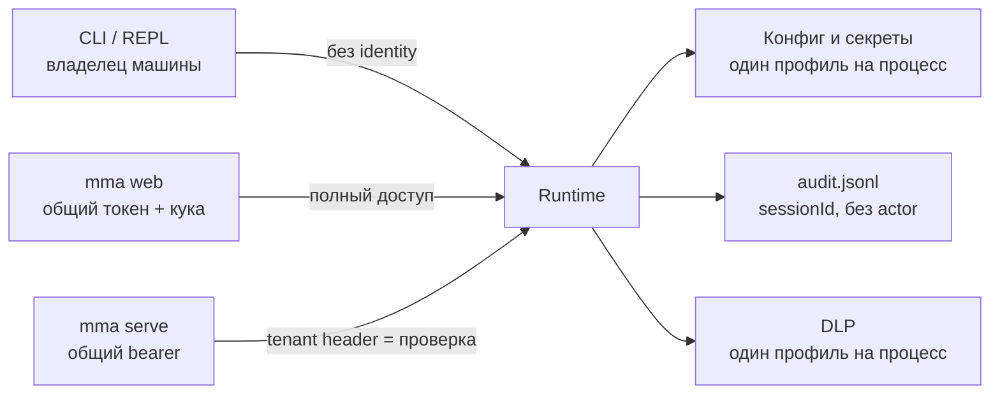
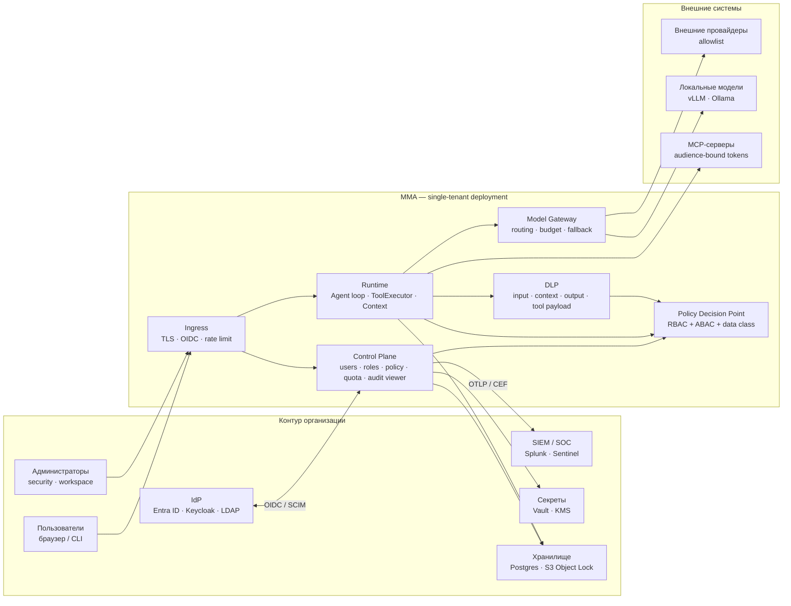
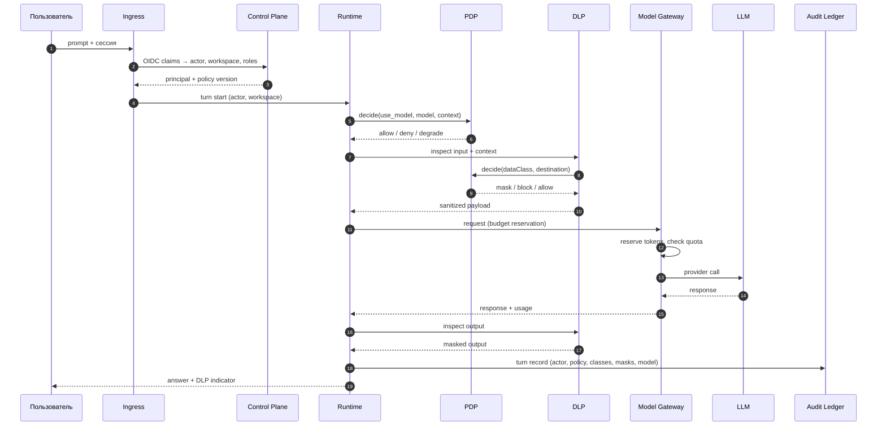
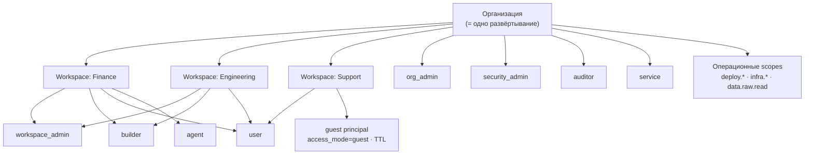
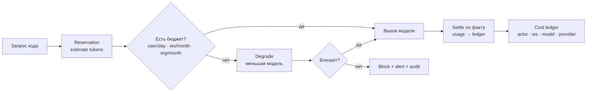
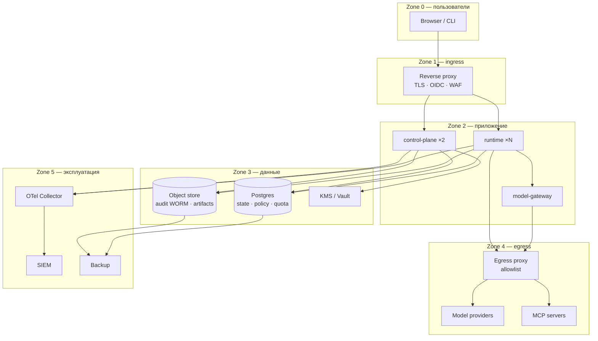
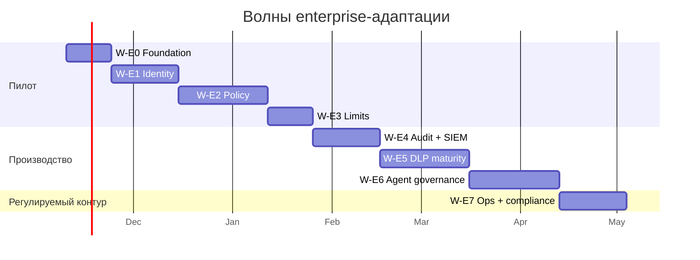
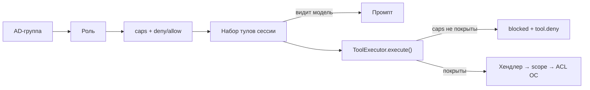

# MMA в контуре организации: enterprise-адаптация

> **Если коротко.** MMA — программа-обёртка для языковых моделей: она даёт агенту
> память, инструменты и правила. У одного разработчика на его машине она уже
> работает. «Внедрить в организацию» — значит поставить её туда, где много людей,
> свои правила доступа, аудит и бюджет. Это другой продукт. Ниже — чем он
> отличается и с чего начать.

**Дата:** 2026-11-03 · **Статус:** draft for decision · **Ветка:** `docs/enterprise-deployment`
**Аудитория:** инженерная roadmap + CISO/security review.

**Связанные документы:**
[architecture v2](./2026-10-12-architecture-v2-design.md) ·
[production readiness](../archive/specs/2026/2026-09-28-production-readiness-design.md) ·
[corporate data policy](./2026-10-19-corporate-data-policy-design.md) ·
[DLP transparency](./2026-11-02-dlp-transparency-and-coverage-design.md) ·
[service API](../agents/service-api.md) ·
[observability](../agents/observability.md) ·
[debt register](../agents/debt.md).

---

## 0. С чего начать

### 0.1. Что такое «enterprise» и почему это не про размер

Слово **enterprise** переводят как «корпоративный» или «организационный». Это не
версия продукта и не набор функций. Это **режим использования**: программа стоит
в компании, и ей пользуются разные люди с разными правами и обязанностями.

Ключевое отличие от личного инструмента:

- у личного — один владелец и один уровень доверия;
- у организационного — много действующих лиц, и каждому нужно отдельно доказать
  право на действие, а потом записать, что он сделал.

Поэтому enterprise — не про размер компании. Юридическая фирма на 30 человек с
клиентскими данными может требовать больше контроля, чем IT-компания на 500 человек.

Это как разница между личным автомобилем и корпоративным парком: машина та же, но
появляются права на вождение, страховка, журнал поездок и человек, отвечающий за
исправность.

### 0.2. Чем enterprise отличается от личного использования

| Вопрос                | Личный инструмент            | Enterprise                                      |
| --------------------- | ---------------------------- | ----------------------------------------------- |
| Кто пользователь      | вы                           | сотрудники, подрядчики, гости, сервисы и агенты |
| Кто настраивает       | вы                           | отдельная команда или администратор             |
| Какие права           | все, раз это ваша машина     | минимально необходимые, по ролям                |
| Какие данные          | ваши                         | регулируемые, с классами и правилами            |
| Нужен ли аудит        | нет                          | да, как доказательство для аудитора             |
| Кто платит            | вы                           | бюджет департамента или организации             |
| Что при сбое          | перезапустили и пошли дальше | регламент, ответственный, сроки восстановления  |
| Что считается успехом | «у меня работает»            | «проходит проверки и выдерживает нагрузку»      |

### 0.3. Какие бывают организации

| Тип организации                               | Что для неё критично                                 | Что это значит для MMA                                        |
| --------------------------------------------- | ---------------------------------------------------- | ------------------------------------------------------------- |
| Регулируемая (банк, страховая, медицина, гос) | Данные нельзя выносить; нужны аудит и residency      | On-prem или private VPC, retention, SIEM, отзыв доступа       |
| Крупный бизнес                                | Много сотрудников и подразделений; SSO, роли, бюджет | Identity + policy + квоты; workspace как граница департамента |
| Средний бизнес или один департамент           | Быстро запустить, немного людей, предсказуемая цена  | Private VPC, минимальный admin UI, пилот на 20–50 человек     |
| КИИ, оборонка, закрытый контур                | Нет выхода в интернет                                | Air-gap, локальные модели, offline-обновления                 |
| Внешние пользователи (партнёры, подрядчики)   | Временный доступ, который должен истекать            | Отдельный тип принципала `guest` с TTL и sponsor              |

### 0.4. Из каких вопросов состоит enterprise-требование

Любая организация, прежде чем пустить агента к своим данным, задаёт пять вопросов.
Это и есть карта требований, а не список модных слов.

| Вопрос                      | Что нужно                                                           | Как называется  |
| --------------------------- | ------------------------------------------------------------------- | --------------- |
| Кто этот человек?           | Вход через корпоративный IdP, MFA, отзыв доступа, срок жизни сессии | Identity        |
| Что ему разрешено?          | Роли, права, запреты, разделение обязанностей                       | Access и policy |
| Что можно делать с данными? | Классы данных, маскирование, запрет отправки наружу                 | DLP             |
| Что он сделал?              | Запись: кто, когда, какая модель, какое решение, какие данные       | Audit           |
| Кто платит и кто это чинит? | Квоты, бюджет, деплой, обновления, доступность                      | Ops и cost      |

В MMA сильнее всего третий блок (DLP) и защита инструментов. Слабее всего — первый,
второй и четвёртый: identity, роли и аудит. Именно там основная работа, а не в
«ещё одном фильтре».

### 0.5. Почему для MMA это отдельная задача

MMA уже умеет то, чего нет у многих self-hosted чатов: проверять данные на границе
провайдера, маскировать чувствительное и применять политику ко всем инструментам в
одной точке.

Но у него нет организационного слоя: всё построено вокруг одного процесса, без
пользователей, ролей и доказательного аудита. Для одного разработчика это нормально.
Для организации — нет.

Поэтому enterprise-адаптация — не «добавить SSO и галочку». Это достроить слой
управления: identity, роли, политику, аудит, квоты и эксплуатацию. Ядро при этом
не переписывается: DLP и enforcement остаются, вокруг них появляется управляющий
контур.

Хорошая новость: **single-tenant** («1 организация = 1 развёртывание») упрощает
задачу. Не нужны изоляция между клиентами, биллинг и делегирование между
организациями.

### 0.6. Как читать дальше

Документ идёт по одному маршруту, пять шагов:

1. **§1. Где MMA сейчас** — факты: что уже работает и чего не хватает.
2. **§2. Куда движемся** — целевая картина: роли, политика, аудит, развёртывание.
3. **§3. Как это выглядит в жизни** — семь коротких сценариев.
4. **§4. Как к этому прийти** — этапы, волны, первые две недели.
5. **§5. Стоит ли это делать** — оценка, что покупать и что строить, вывод.

Приложения A–J — справочники: матрица доступа, сравнение с рынком, конфиг, тесты,
термины, FAQ, выдача тулов. Читать их подряд не нужно. Если нужен только вывод —
сразу §5.3.

---

## 1. Где MMA сейчас

Мы выяснили, что enterprise — это управление людьми, данными и ответственностью.
Теперь зафиксируем, где MMA находится сегодня. Это факты, а не намерения; полная
инвентаризация — в
[production readiness](../archive/specs/2026/2026-09-28-production-readiness-design.md)
и спеках DLP.

### 1.1. Что уже работает

| Механизм                        | Где                                                                    | Почему это ценно                                                                          |
| ------------------------------- | ---------------------------------------------------------------------- | ----------------------------------------------------------------------------------------- |
| Единая точка enforcement тулов  | `src/tools/executor.ts` (`enforcePathArgs`, `enforceUrlArgs`)          | Политика не может быть забыта в хендлере; новые тулы обязаны объявить `security`          |
| DLP на границе провайдера       | `src/modules/security/data-policy/guard.ts`, `egress-provider.ts`      | Инспекция **до** отправки модели и **после** ответа, fail-closed                          |
| Классификация и псевдонимизация | `data-policy/classify.ts`, `tokens.ts`, `project.ts`                   | Приоритет `secret > path > machine/env > pii`; модель видит `<PII:…>`, секреты необратимы |
| Детекторы                       | `data-policy/detectors/*`                                              | Секреты, пути, env, PII РФ/BY, base64/hex, «склеенные» секреты, Unicode-гомоглифы         |
| Защищённые пути always-on       | `security/protected-paths.ts`                                          | `.git/`, `.env*`, ключи, `.npmrc`, `.netrc` — независимо от конфига                       |
| Сетевые гарды и шлюз egress     | `outbound-policy.ts`, `dns-guard.ts`, `ip-guard.ts`, `webui/egress.ts` | SSRF/DNS/IP для вебхуков, веб-тулов, картинок; один guard на JSON, SSE, файлы             |
| Аудит и нотификации             | `audit-log.ts`, `audit-webhook.ts`, `audit-notifier.ts`                | Файл + webhook с retry-очередью и DLP-фильтрацией тела                                    |
| Лимиты и шифрование             | `rate-limiter.ts`, `session-encryption.ts`                             | Глобальные RPM/параллелизм; AES-256-CBC + HMAC (но выключено по умолчанию)                |
| Гварды-тесты                    | `tests/security/*`, `tests/arch/egress-guard.test.ts`                  | Инварианты держатся тестами, а не дисциплиной                                             |

### 1.2. Чего не хватает

| Домен                       | Сейчас                                                                                                                                                       | Следствие                                                              |
| --------------------------- | ------------------------------------------------------------------------------------------------------------------------------------------------------------ | ---------------------------------------------------------------------- |
| **Identity**                | Один статический токен на поверхность: bearer в `mma serve`, `x-mma-token`/кука в `mma web`. Пользователей, логина, MFA, logout нет                          | Нет SSO, SCIM, service accounts, отзыва доступа                        |
| **Роли и multi-user**       | Нет RBAC/ABAC. `X-Mma-Principal`/`X-Mma-Run` — непроверяемые метки; `X-Mma-Tier`/`X-Mma-Scopes` объявлены в OpenAPI, но игнорируются. «1 тенант = 1 процесс» | Нельзя «своя политика для роли» и разделить департаменты               |
| **Политика данных**         | DLP-конфиг один на процесс; классы только технические (`secret`, `path`, `machine`, `env`, `pii`, `fileContent`)                                             | Нет `public/internal/confidential/restricted` и per-role overlay       |
| **DLP на выходе и в MCP**   | Проекция ответа есть, но отдельной политики «что нельзя возвращать» нет; DLP для MCP вне объёма                                                              | Утечка через ответ и tool-payload MCP контролируется слабее            |
| **Retention и PII at rest** | Ротация `session.jsonl` 8 МБ, gzip через 30 дней, `maxSessions: 50`; retention-политик и legal hold нет. `sessionEncryption.enabled=false`                   | Нельзя ответить «что и сколько хранится»; компрометация диска = утечка |
| **Квоты и стоимость**       | 60 LLM-запросов/мин и 5 параллельных тулов **глобально на процесс**; `CostTracker` только суммирует, enforcement бюджета нет                                 | Один активный пользователь исчерпывает лимит департамента              |
| **Аудит и SIEM**            | `audit.jsonl` append-only без hash chain/подписи; в записи только `sessionId`, **без actor**; generic webhook (по умолчанию выключен), нет CEF/LEEF/OTLP     | Аудит не доказательство и не отвечает «кто»                            |
| **HITL и sandbox**          | `question`/`approve` живут в процессе; `approve` для protected-path одноразовый. Bash/файлы исполняются на хосте, `security.bash.blacklist` — фильтр         | Рестарт теряет ожидание; успешный prompt injection = RCE               |
| **MCP, поставка, HA**       | Нет per-user OAuth 2.1 и audience-проверки; нет Dockerfile/Helm и `/healthz`; один процесс без реплик, бэкапов, SLO и runbook                                | Нельзя штатно развернуть в VPC заказчика и дать гарантии               |
| **Governance**              | Нет risk file, DPIA-маппинга, policy-as-code                                                                                                                 | ISO/SOC2/EU AI Act — только вручную                                    |

### 1.3. Главное следствие



Любой, кто получил токен, получает **всё** — чат, конфиг, файлы, провайдеров, аудит.
Разделения «администратор / пользователь / аудитор» нет: выдать токен сотруднику
означает выдать root.

Ни один из текущих лимитов не привязан к пользователю, команде или организации.
Они защищают процесс от runaway-рана, но не бюджет. Полная таблица лимитов —
в Приложении A.

---

## 2. Куда движемся

Из §1 видно: менять надо не DLP, а добавить вокруг него управляющий слой. Сначала —
принципы, по которым он строится. Потом — из чего он состоит и как работает.

### 2.1. Семь принципов

1. **Один субъект — один актор.** Каждое действие несёт `actor` и `workspace`.
   Анонимных действий нет.
2. **Одно решение — один PDP.** Проверка прав и данных вызывается из одной точки;
   хендлеры политику не реализуют.
3. **Политика — данные, не код.** Bundle версионируется, подписывается, ревьюится
   как код; смена политики — событие аудита.
4. **Deny by default для внешнего egress.** Внутренние модели — исключение,
   оформленное политикой.
5. **Квота — до вызова, аудит — после.** Блокировка бессмысленна, если модель
   уже получила токены.
6. **Организационный слой не живёт в хендлерах.** Identity/policy/quota/audit —
   сервисы, а не поля в тулах.
7. **Один тенант = одно развёртывание.** Multi-tenant SaaS — non-goal.

### 2.2. Из чего состоит контур



| Компонент             | Ответственность                                                                                   | Что не делает                                         |
| --------------------- | ------------------------------------------------------------------------------------------------- | ----------------------------------------------------- |
| **Ingress**           | TLS, OIDC-сессия, базовый rate limit, маршрутизация                                               | Не принимает решений о данных                         |
| **Control Plane**     | Пользователи, workspace'ы, роли, policy bundles, квоты, просмотр аудита                           | Не исполняет агента                                   |
| **Runtime**           | Петля агента, тулы, контекст, вызовы модели                                                       | Не хранит политику у себя в коде                      |
| **PDP**               | `decide(actor, action, resource, context) → allow/deny/mask/approval`                             | Не хранит секреты и не вызывает модели                |
| **DLP**               | Классификация, детекция, маскирование, блок, rehydrate                                            | Не решает, «можно ли роль» — это PDP                  |
| **Model Gateway**     | Роутинг, reservation бюджета, fallback, учёт токенов                                              | Не применяет data-политику                            |
| **Audit Ledger**      | Append-only запись, hash chain, экспорт, retention                                                | Не редактирует события                                |
| **Credential Broker** | Короткоживущие токены пользователя и агента на конкретный destination (`cifs/fs`, `mcp:<server>`) | Не решает, что разрешено, и не хранит токены на диске |
| **Secrets**           | Ключи провайдеров, signing keys, DB credentials                                                   | Не выдаёт их пользователям                            |

### 2.3. Путь одного запроса

Схема выше показывает, из чего контур состоит. Теперь — в каком порядке всё
происходит, когда сотрудник отправляет сообщение.



Ключевое: **два решения** (PDP о действии, PDP о данных) и **две инспекции**
(вход, выход). Оба решения и обе инспекции попадают в одну запись аудита.
Токен на каждый destination (`cifs/fs`, `mcp:<server>`) выдаёт credential broker
на время хода; в аудите остаётся, чей это был токен (ADR-14).

### 2.4. Кто и что может



| Роль              | Может                                                                       | Не может                                       |
| ----------------- | --------------------------------------------------------------------------- | ---------------------------------------------- |
| `org_admin`       | Управлять IdP-маппингом, workspace'ами, глобальными политиками, квотами org | Читать содержимое чужих сессий без break-glass |
| `security_admin`  | DLP-политика, tool allowlist, инциденты, retention                          | Менять роли org_admin, деплоить код            |
| `workspace_admin` | Пользователи и квоты своего workspace, allowlist в рамках глобального       | Поднимать класс данных выше разрешённого       |
| `builder`         | Агенты, скиллы, промпты, тесты                                              | Менять политику, выдавать себе тулы            |
| `user`            | Чат, запуск разрешённых агентов                                             | Менять конфиг, читать аудит, менять политику   |
| `auditor`         | Read-only аудит и политика, экспорт                                         | Исполнять агента, менять политику              |
| `service`         | API по scopes (`session.create`, `task.run`, `events.read`)                 | Ходить в UI, менять политику                   |
| `agent`           | Только task-scoped тулы/модели, выданные на запуск                          | Иметь standing credentials                     |

**Операционные scopes — не роли.** DevOps и sysadmin — должностные функции, которым
выдают явные scopes. Scopes не наследуются от роли: `org_admin` не получает
`infra.*` автоматически.

| Scope                           | Что даёт                   | Кому                 | Ограничение           |
| ------------------------------- | -------------------------- | -------------------- | --------------------- |
| `deploy.run`, `deploy.rollback` | rollout/rollback, canary   | DevOps               | без policy и контента |
| `ops.read`                      | health, метрики, стоимость | DevOps               | без промптов          |
| `infra.kms`                     | ключи, ротация             | Sysadmin             | два подтверждения     |
| `infra.backup`                  | backup/restore             | Sysadmin             | restore в изоляцию    |
| `audit.integrity`               | проверка hash chain        | Sysadmin, auditor    | без контента          |
| `data.raw.read`                 | break-glass чтение         | Безопасник, Sysadmin | два approval + TTL    |

**Гость — не роль, а тип принципала.** `actor.type=guest`, `access_mode=guest`,
TTL и sponsor. Гость не член workspace и получает отдельный policy profile
(`public` + локальная модель).

**Чья identity у агента — зависит от режима запуска.** Интерактивный агент
действует **от имени пользователя** (on-behalf-of): файлы, MCP и API он видит с
его правами, отзыв в AD действует немедленно, а вред от prompt injection
ограничен правами этого человека. Автономный прогон (scheduled, webhook, service)
идёт под собственной identity агента: `agent_id`, sponsor (`workspace_admin`),
срок делегирования, список тулов. Оба режима обслуживает **credential broker**:
он выдаёт короткоживущий токен на конкретный destination (`cifs/fs`,
`mcp:<server>`), audience-bound, и не хранит его на диске. Standing credentials
у агента нет ни в одном режиме.

**Тулы выдаются по capability, а не по имени.** У каждого тула объявлена
возможность (`security.caps`: `fs.read`, `fs.write`, `net`, `proc`, `interactive`,
`mem`, `subagent`). Роль получает набор возможностей; тул доступен, если все его
`caps` покрыты выдачей и имя не в `deny`. Имена — второй, сужающий фильтр для
исключений. Набор тулов сессии вычисляется из роли один раз при старте; строгий
`toolAllowlist` и проверка в `ToolExecutor.execute()` остаются единственной точкой
enforcement — теги и `alwaysOn` его не обходят. Скрытие тула из промпта — UX, а
не граница. Ловушка: `bash` объявлен как `proc`, но пишет файлы, поэтому роли без
`fs.write` его не получают либо shell живёт в песочнице с read-only ФС.
Развёрнутый пример — Приложение J.

**Человек ≠ роль.** Одна персона может нести несколько ролей, но права не
суммируются неограниченно: каждая роль и scope проверяются отдельно.

Полная матрица «действие × персона» — в Приложении A.

### 2.5. Как принимается решение о данных

Решение принимается по четырём осям:

```
role × workspace × data class × destination → effect
```

`destination`: `local_model`, `external_model:<allowlisted>`, `mcp:<server>`,
`webhook:<host>`, `file:<workspace>`.
`effect`: `allow | mask | block | require_approval | degrade`.

Пример bundle (policy-as-code):

```yaml
apiVersion: mma.policy/v1
version: 7
defaults:
  external_egress: deny
  unknown_data_class: mask
rules:
  - id: restricted-never-external
    when: { dataClass: [restricted], destination: external_model }
    effect: block
  - id: confidential-mask-external
    when: { dataClass: [confidential], destination: external_model }
    effect: mask
  - id: finance-pii-local-only
    when: { role: [user], workspace: [finance], dataClass: [pii], destination: external_model }
    effect: block
  - id: prod-write-requires-approval
    when: { tool: [bash, write, edit], workspace: [production] }
    effect: require_approval
  - id: auditor-readonly
    when: { role: [auditor], action: [tool.invoke] }
    effect: block
```

Без этих свойств модель политики не работает:

- **Версия в каждом решении.** Аудит хранит `policy_version`, иначе нельзя
  объяснить вчерашнее поведение.
- **Два глаза на изменение.** Публикация bundle требует approval второго
  `security_admin`; изменение — событие аудита.
- **Тестируемость.** У bundle есть unit-тесты; CI не пропускает политику, которая
  разрешает `restricted → external`.

### 2.6. Как считаются деньги



- **Резервация, а не пост-фактум.** Иначе параллельные запросы вместе пробивают cap.
- **Три уровня:** `user/day`, `workspace/month`, `org/month`; плюс `session/run`
  (tokens, turns, time).
- **При исчерпании:** block, degrade до локальной модели, notify.
- **Атрибуция:** ledger хранит `actor`, `workspace`, `agent`, `model`, `provider`,
  `tokens_in/out`, `cost`, `currency`, `price_version`.
- **Сверка:** отчёт «ledger vs счёт провайдера» обязателен, иначе цифрам не верят.

### 2.7. Что записывается в аудит

Одна запись на значимое действие:

```jsonc
{
  "event_id": "evt_...",
  "ts": "2026-11-03T10:00:00Z",
  "org": "acme",
  "workspace": "finance",
  "actor": { "type": "user", "id": "u_123", "display": "a.ivanov" },
  "agent": { "id": "ag_reporting", "sponsor": "u_100" },
  "session_id": "ses_...",
  "turn_id": "trn_...",
  "action": "model.call",
  "resource": "gpt-4.1-mini",
  "data_classes": ["pii"],
  "policy": { "version": 7, "decision": "mask", "reason": "confidential-mask-external" },
  "model": { "requested": "gpt-4.1-mini", "actual": "gpt-4.1-mini", "provider": "openai" },
  "usage": { "tokens_in": 1200, "tokens_out": 300, "cost": 0.0042, "currency": "USD" },
  "approval": null,
  "hash_prev": "sha256:...",
  "hash_self": "sha256:...",
}
```

| Требование         | Решение                                                                     |
| ------------------ | --------------------------------------------------------------------------- |
| Tamper-evident     | Hash chain + ежедневный anchor в WORM-хранилище                             |
| Реконструируемость | Один `turn_id` связывает prompt, решения, тулы, модель, ответ               |
| SIEM               | OTLP GenAI + JSON/CEF-экспортёр; pull и push                                |
| Retention          | hot 90 дней → warm 1 год → cold/legal hold 7 лет                            |
| EU AI Act          | ≥ 6 месяцев для high-risk логов; настраиваемо выше                          |
| Privacy            | Поля редактируются, а не отключаются; доступ к оригиналам — отдельное право |
| Удаление           | Deleting = tombstone + крипто-стирание ключа партиции                       |

**Что не логируем:** сырые секреты, полные PII в открытом виде, ключи провайдеров,
содержимое защищённых файлов. Логируем класс и hash/превью.

### 2.8. Как это разворачивается

Целевой контур можно поставить четырьмя способами. Выбор — не про престиж, а про
правила работы с данными.

| Режим         | Где работает                                              | Где данные                 | Как обновляется              | Кому подходит                       |
| ------------- | --------------------------------------------------------- | -------------------------- | ---------------------------- | ----------------------------------- |
| `on-prem`     | В серверной заказчика                                     | На его железе              | Скачать, проверить, выкатить | Банки, госсектор                    |
| `private-vpc` | В облаке заказчика, в изолированной сети                  | В его аккаунте             | Из реестра образов           | Средний и крупный бизнес            |
| `air-gapped`  | В контуре без маршрута в интернет                         | Только внутри контура      | Физический носитель          | КИИ, оборонка, гостайна             |
| `hybrid`      | Приложение у заказчика, модель или управление — у вендора | Часть данных уходит наружу | Вендор обновляет сам         | Только если residency это допускает |

Чем изолированнее режим, тем дороже эксплуатация. Выбирайте **наименее изолированный**
режим, который допускают правила работы с данными, а не самый строгий «на всякий случай».

Внутри режима зоны выглядят так:



---

## 3. Как это выглядит в жизни

Схема — это карта. Теперь посмотрим, как она выглядит в обычный рабочий день.
Семь коротких сценариев; если нужен только общий смысл, достаточно прочитать
первый и последний.

**S1. Сотрудник: договор с персональными данными.**
Финансовый отдел, `clearance: confidential`, внешняя модель разрешена с маскированием.
Вход по OIDC → `actor=u_123`, `workspace=finance`, `roles=[user]`, `policy_version=7`.
DLP классифицирует договор как `confidential` + `pii`. PDP: `confidential-mask-external`
→ `mask`; модель получает `<PII:9f…>` и `<PERSON:41…>`. Ответ проходит output-инспекцию,
клиент восстанавливает токены и показывает «3 фрагмента замаскированы».
Попытка отправить договор через `web_fetch` → `destination=external` → `block`.
**Аудит:** `model.call`, `dlp.mask`, `policy.allow`, `tool.deny`.

**S2. Ограниченный пользователь: тикет с PII.**
Подрядчик в support, `clearance: internal`, внешние модели запрещены, тулы не выданы,
квота 20 000 токенов/день. В IdP `employment=contractor`; overlay:
`external_egress=deny`, `tools=[]`. Запрос к внешней модели → `deny`, интерфейс
предлагает локальную; секреты маскируются, PII остаётся в контуре. MCP Jira →
`tool.deny`. Экспорт и копирование файлов отключены.
**Аудит:** `policy.deny` (external), `policy.degrade` (local), `tool.deny`,
`dlp.mask`, `quota.warn` при 80%.

**S3. Гость: демо для внешнего партнёра.**
Доступ на 8 часов, `workspace=demo`, `clearance=public`, sponsor — `workspace_admin`.
Сессия эфемерная: нет памяти, resume и списка прошлых чатов; загрузка файлов
отключена. Вставлен внутренний документ → DLP видит `confidential` → `block`.
Разрешён только локальный public-контент; ответ помечен «guest». Через 8 часов сессия
и контент удаляются, аудит сохраняется по retention.
**Аудит:** `guest.session.start` (sponsor, TTL), `policy.block`, `guest.session.expire`.

**S4. Админ workspace: онбординг десяти человек.**
`workspace_admin` в `engineering`; глобальная политика — от `security_admin`.
Видит только свой workspace. Создаёт пользователей, назначает `user`/`builder`,
ставит квоту 1 000 $/мес, добавляет `web_fetch` в allowlist workspace (только если
разрешён глобально). Попытка поднять `clearance` до `restricted` → `deny`; попытка
изменить глобальное DLP-правило → `deny` + запрос безопаснику.
**Аудит:** `admin.user.create`, `admin.role.assign`, `admin.quota.set`,
`policy.deny` ×2, `request.create`.

**S5. Безопасник: инцидент с `.env`.**
Алерт `security_block` — чтение `.env` в `engineering`. Открывает инцидент: actor,
tool, путь (маскирован), policy version, решение `block`. Видит только masked-превью;
оригинал — через break-glass (S7). Пишет правило `restricted-never-external`, гоняет
dry-run на replay последних 30 дней. Публикует bundle со вторым подтверждением;
версия +1, событие в аудите и SIEM. Деплой не выполняет.
**Аудит:** `incident.open`, `policy.test`, `policy.publish` (два approver),
`audit.raw_access` (если был break-glass).

**S6. DevOps: канареечный релиз.**
Сотрудник с ролью `user` и scopes `deploy.run` / `deploy.rollback` / `ops.read`.
CI собирает и подписывает образ; DevOps выкатывает 10% трафика, смотрит p95 latency,
error rate и стоимость на запрос — **не видит** промпты. SLO-алерт → `deploy.rollback`.
Ротацию ключей выполняет DevOps, подтверждает `security_admin`; значение ключа не
показывается никому. Поменять data-политику или выдать себе `security_admin` не может.
**Аудит:** `deploy.start`, `deploy.promote`, `deploy.rollback`, `secret.rotate`.

**S7. Системный администратор: восстановление и break-glass.**
Сотрудник со scopes `infra.kms` / `infra.backup` / `audit.integrity` и `data.raw.read`;
доступ через jump host + MFA, без обычного логина в чат. Восстанавливает Postgres в
изолированное окружение, проверяет hash chain и контрольные суммы. Для чтения сессии
оформляет break-glass: причина, объект, TTL 30 минут, два подтверждения
(`org_admin` + `security_admin`). Vault выдаёт time-boxed токен только на чтение;
каждое чтение — событие аудита. По истечении TTL токен отзывается.
**Аудит:** `infra.backup.restore`, `audit.chain.verify`, `breakglass.request`,
`breakglass.approve` ×2, `audit.raw_access`, `breakglass.expire`.

---

## 4. Как к этому прийти

Картина есть. Теперь порядок работ. Внедрение идёт тремя этапами: **пилот** (один
отдел), **производство** (департамент), **регулируемый контур** (банк, госсектор,
КИИ). Внутри — восемь волн; волна здесь — не календарный спринт, а пакет работ с
проверяемым результатом. Каждая волна не требует «сначала всё отрефакторить».



### 4.1. Восемь волн

| Волна                     | Результат                       | Объём                                                                                                                                                                                                                         | Критерий приёмки                                                                                                               |
| ------------------------- | ------------------------------- | ----------------------------------------------------------------------------------------------------------------------------------------------------------------------------------------------------------------------------- | ------------------------------------------------------------------------------------------------------------------------------ |
| **W-E0 Foundation**       | Развёртывается в VPC заказчика  | Dockerfile/Helm, `/healthz` (алиас `/v1/health` и `/v1/ready`), graceful shutdown, enterprise-профиль конфига (paths on, contentScan on, sessionEncryption on, auditNotifier on), secrets из env/Vault                        | `docker run` → health 200; профиль проходит 9 тестов в части конфигурации                                                      |
| **W-E1 Identity**         | SSO и субъект в каждом действии | OIDC-вход в web вместо общего токена, SCIM (или sync из IdP), users/workspaces/roles, service API keys со scopes, logout/active sessions, cookie `Secure`, `actor` в аудите `audit.jsonl`, credential broker (delegation/OBO) | Тесты 1, 19: disable в IdP блокирует вход/сессию/tool-call; файлы читаются от имени пользователя                               |
| **W-E2 Policy**           | Роли реально ограничивают       | PDP + RBAC/ABAC, классы `public/internal/confidential/restricted`, per-role DLP overlays, tool grants по `caps`, минимальный admin UI, policy-as-code + тесты                                                                 | Тесты 2, 4, 7, 20, 21: смена роли меняет чат, агента и tool-call; чужая шара отсутствует; запись запрещена роли без `fs.write` |
| **W-E3 Limits**           | Нельзя превысить бюджет         | Quota service, reservation/settle, `user/day` + `workspace/month` + `org/month`, rate limit per user, cost ledger                                                                                                             | Тест 8: блокировка до вызова, алерт, запись о попытке                                                                          |
| **W-E4 Audit + SIEM**     | Аудит — доказательство          | Hash chain, WORM, OTel GenAI spans, SIEM-экспортёр, retention/legal hold, аудит админ-действий, UI просмотра                                                                                                                  | Тесты 5, 13: восстановление вчерашнего хода; подмена строки ловится                                                            |
| **W-E5 DLP maturity**     | DLP покрывает выход и MCP       | Output-политика, классификация документов, DLP для MCP, коннектор к внешнему DLP, NER, режим `warn`                                                                                                                           | Тест 3: PII в промпте, документе и ответе                                                                                      |
| **W-E6 Agent governance** | Агент не может выйти за пределы | Sandbox-профиль, durable HITL, kill-switch, MCP OAuth 2.1 + audience, agent identity и scoped credentials                                                                                                                     | Тесты 10–12, 14                                                                                                                |
| **W-E7 Ops + compliance** | Промышленная эксплуатация       | HA (2+ реплики), backup/restore, SLO + runbook, подпись policy bundles, risk file / DPIA-маппинг, пентест                                                                                                                     | Тесты 6, 9; RTO/RPO подтверждены учениями                                                                                      |

### 4.2. Зависимости и сроки

**Зависимости:** W-E1 → W-E2 → W-E3; W-E4 можно начинать параллельно с W-E2
(схема события не зависит от UI). W-E5 зависит от W-E2 (классы) и W-E3 (стоимость).
W-E6 зависит от W-E2/E4.

**Оценка трудозатрат:** 2–3 инженера, ~20–26 недель до W-E7. Пилот (W-E0…E3) —
10–12 недель.

### 4.3. Первые две недели

1. Зафиксировать IdP и способ provisioning (OIDC + SCIM или sync).
2. Утвердить персоны, роли и матрицу «роль × класс × destination» — это
   политическое решение, не инженерное.
3. Собрать enterprise-профиль конфига и контейнер (W-E0).
4. Ввести `actor` в существующий аудит — даже без полного control plane это сразу
   повышает ценность логов.
5. Выбрать 3–5 acceptance-тестов, которые будут прогоняться на каждом релизе.

### 4.4. Что считается внедрением

Не «работает у нас», а пройденные приёмочные проверки. Их 21:

- **9 базовых** — identity, parity прав, DLP на входе и выходе, смена роли,
  реконструкция аудита, inventory, замена модели, квоты, residency;
- **6 агентных** — prompt injection, kill-switch, durable approval, tamper-evidence,
  MCP audience, on-behalf-of;
- **6 ролевых** — гость и TTL, ограниченный пользователь, админ workspace,
  разделение обязанностей, изоляция хранилищ, запись файлов по capability.

Полные E2E-сценарии — в Приложении F.

---

## 5. Стоит ли это делать

План есть. Остаётся ответить на два вопроса: насколько это большой разрыв и что
из этого нужно покупать, а что строить.

### 5.1. Оценка

Коротко: **7.5/10** как локальный harness и **4.0/10** как enterprise-платформа.
Пилот поднимает enterprise-оценку до **6.9**, все волны — до **8.8**. Это разные
продукты, и смешивать их — главная ошибка при планировании.

Ниже — из чего складывается enterprise-оценка: семь доменов с весами.

| Домен                   |  Вес |  Сейчас | Цель (пилот) | Цель (prod) | Что тянет вниз                                               |
| ----------------------- | ---: | ------: | -----------: | ----------: | ------------------------------------------------------------ |
| Identity & access       |  20% | **2.0** |          7.0 |         9.0 | Нет пользователей, SSO, SCIM, ролей, service accounts        |
| DLP & data governance   |  20% | **6.5** |          8.0 |         9.0 | Нет классов документов, output-политики, MCP, retention, NER |
| Agent action security   |  15% | **6.0** |          7.5 |         9.0 | Нет sandbox, durable HITL, MCP OAuth, kill-switch            |
| Audit & observability   |  15% | **4.0** |          7.0 |         9.0 | Нет актора, tamper-evidence, SIEM, OTel                      |
| Limits & cost           |  10% | **3.0** |          7.0 |         8.5 | Нет per-user/team, reservation, attribution                  |
| Deployment & isolation  |  10% | **3.0** |          6.0 |         8.5 | Нет контейнера, health, HA, SLO, workspace-изоляции          |
| Governance & compliance |  10% | **2.0** |          5.0 |         8.0 | Нет policy-as-code, risk file, маппинга, DPIA                |
| **Взвешенный итог**     | 100% | **4.0** |      **6.9** |     **8.8** |                                                              |

Расчёт «сейчас»: `0.2·2 + 0.2·6.5 + 0.15·6 + 0.15·4 + 0.1·3 + 0.1·3 + 0.1·2 = 4.0`.

Это **не** результат пентеста или сертификации, а оценка покрытия контролей по
коду и документации на 2026-11-03. Сравнение с рынком — в Приложении B.

### 5.2. Что покупать, что интегрировать, что строить

Правило: **дифференциатор строим, инфраструктуру покупаем.** Дифференциатор MMA —
DLP на egress + enforcement агентных тулов + локальные модели.

**Покупаем:** IdP (Entra ID, Keycloak, Okta), SIEM (Splunk, Sentinel, QRadar),
секреты (Vault, KMS), audit store (Postgres + S3 Object Lock).

**Интегрируем:** model gateway (LiteLLM-совместимый), sandbox runtime (Docker/gVisor,
позже Firecracker), внешний DLP (Purview, Google DLP, Presidio).

**Строим:** PDP-обвязку и policy-as-code, admin UI, DLP-коннектор для MCP, квоты и
cost ledger, credential broker (delegation/OBO), отображение политики в UI.

### 5.3. Вывод

1. **Проблема не в безопасности, а в отсутствии плоскости управления.**
   DLP и enforcement у MMA уже сильные. Не хватает **кто** субъект, **какая** у
   него политика и **кто** это подтвердит аудитору.

2. **Single-tenant — правильная целевая модель, и это упрощает задачу.**
   Не нужны multi-tenant изоляция, биллинг и делегирование между организациями.

3. **Начинать нужно не с DLP и не с sandbox, а с identity + policy + audit.**
   Без субъекта и решения остальные контроли нечем связать.

**Рекомендуемый первый шаг:** пилот на одном департаменте (20–50 пользователей),
одном workspace, одном внешнем провайдере через шлюз. Волны **W-E0 + W-E1**
параллельно. Критерий выхода — приёмочные проверки, а не «работает у нас».

---

## 6. Ключевые решения (ADR)

Всё выше — что и почему. Ниже — решения, которые фиксируем, чтобы не пересматривать
их на каждой волне.

| ID         | Решение                                                                                    | Альтернатива                  | Почему так                                                                                         |
| ---------- | ------------------------------------------------------------------------------------------ | ----------------------------- | -------------------------------------------------------------------------------------------------- |
| **ADR-1**  | Single-tenant на развёртывание; workspace — логическая граница                             | Multi-tenant SaaS             | Изоляция, residency, отсутствие биллинга; совпадает с текущим инвариантом                          |
| **ADR-2**  | IdP покупаем; свой user store не строим                                                    | Свой логин/пароли             | Безопасность и lifecycle дешевле купить                                                            |
| **ADR-3**  | Один PDP-интерфейс; OPA/Rego или JSON-правила на MVP                                       | Проверки в каждом хендлере    | Иначе политика дрейфует (уже было в архитектуре)                                                   |
| **ADR-4**  | Квота — reservation до вызова                                                              | Пост-фактум лимит по usage    | Параллельные запросы пробивают cap                                                                 |
| **ADR-5**  | Аудит — hash chain + WORM                                                                  | «Логи в файле»                | Аудит должен быть доказательством                                                                  |
| **ADR-6**  | DLP: свои детекторы + внешний коннектор                                                    | Только внешний DLP-прокси     | Свой слой уже глубоко встроен; прокси не видит tool-payload                                        |
| **ADR-7**  | Автономный агент — своя identity: `agent_id` + sponsor, task-scoped токены                 | Один общий API-ключ           | Least privilege и аудит «чей агент» для фоновых прогонов                                           |
| **ADR-8**  | Sandbox — контейнерный профиль                                                             | Чёрные списки команд          | Список — фильтр, не граница                                                                        |
| **ADR-9**  | Admin UI минимальный, но обязательный                                                      | Только YAML/CLI               | Политику без UI не выдадут в организации                                                           |
| **ADR-10** | Модели — через gateway с бюджетом                                                          | Прямые вызовы провайдера      | Одна точка учёта, failover, блокировка                                                             |
| **ADR-11** | Разделение обязанностей: policy ≠ deploy ≠ infra                                           | Один «супер-админ»            | Компрометация одной учётки не даёт и политику, и исполнение, и данные                              |
| **ADR-12** | Гость — тип принципала с TTL и sponsor                                                     | Гость как `user` в workspace  | Иначе временный доступ становится постоянным и получает память/файлы                               |
| **ADR-13** | Break-glass только двумя лицами и на время                                                 | Постоянный `data_reader`      | Доступ к сырому контенту должен быть исключением с доказательством                                 |
| **ADR-14** | Интерактивный агент действует от имени пользователя (on-behalf-of) через credential broker | Одна сервисная учётка на всех | Права AD — единственный источник правды; отзыв мгновенный; blast radius injection = права человека |

---

## 7. Риски, non-goals, открытые вопросы

И последнее: что может пойти не так и что осталось решить до старта.

### 7.1. Риски

| Риск                                           | Вероятность | Влияние | Митигация                                                       |
| ---------------------------------------------- | ----------- | ------- | --------------------------------------------------------------- |
| Ложные срабатывания DLP → пользователи обходят | Высокая     | Высокое | Режим `warn` на пилоте, tuning, NER, объяснение в UI            |
| Scope creep: identity затрагивает все модули   | Высокая     | Среднее | Волны и контракты; `actor` через контекст, не через каждый тул  |
| Задержка PDP на каждом tool-call               | Средняя     | Среднее | Локальный кэш решений + версия bundle + benchmark p95           |
| Air-gap ломает обновления политики             | Средняя     | Среднее | Offline bundles, подпись, ручной импорт                         |
| Миграция конфига ломает существующих           | Средняя     | Среднее | Версионирование, `config migrate`, default = текущее поведение  |
| Малая модель «не понимает» отказ политики      | Средняя     | Низкое  | Формулировки ошибок в `tool.friendly.*`, подсказка «что делать» |
| Аудит растёт быстрее бюджета                   | Средняя     | Среднее | Tiered retention, партиции, сжатие, cap на событие              |
| Пентест найдет обход sandbox                   | Низкая      | Высокое | Defense in depth: sandbox + policy + egress allowlist           |

### 7.2. Non-goals

- Multi-tenant SaaS, биллинг между организациями, delegated admin между тенантами.
- Собственный IdP, собственный SIEM, собственный model gateway, собственный
  ML-DLP-движок.
- Юридические заключения по EU AI Act / 152-ФЗ — только инженерный маппинг.
- Изменение UX-канона чата (`STYLE.md`) и i18n-контракта.
- Полный рефакторинг ядра «заодно»: изменения — по швам, с гвардами.

### 7.3. Открытые вопросы (решить до старта)

|   № | Вопрос                                                | Кто решает       | Влияние                        |
| --: | ----------------------------------------------------- | ---------------- | ------------------------------ |
|   1 | Какой IdP у заказчика: Entra ID, Keycloak, LDAP+OIDC? | CISO/IT          | W-E1, схема SCIM               |
|   2 | Нужен ли air-gap?                                     | Заказчик         | Модели, обновления, телеметрия |
|   3 | Кто владеет policy bundle — security или workspace?   | Governance       | Модель ролей                   |
|   4 | Retention: 6 мес., 1 год, 7 лет?                      | Legal/compliance | Хранилище, стоимость           |
|   5 | Внешний DLP: Purview, Google DLP, Presidio, свой?     | CISO             | W-E5                           |
|   6 | Бюджет в валюте провайдера или внутренних кредитах?   | Finance          | Cost ledger                    |
|   7 | Нужна ли HA и какой RTO/RPO?                          | Ops              | W-E7, стоимость                |
|   8 | Разрешать ли `require_approval` в нерабочее время?    | Ops              | HITL, эскалация                |
|   9 | Кто подписывает policy bundle вторым ключом?          | Security         | Два глаза                      |

> **Решено (№8 прежней редакции):** identity агента зависит от режима запуска —
> интерактивный от имени пользователя, автономный от своего имени (ADR-7,
> ADR-14).

---

## Приложение A. Матрица доступа и текущие лимиты

Приложения — не продолжение рассказа, а справочники. Открывайте их, когда нужна
конкретная таблица.

Легенда: ✅ разрешено · 🔶 маска/approval/ограничение · ⛔ запрещено ·
➖ не применимо. Матрица — **верхняя граница** при условии, что инструмент и
модель включены в allowlist workspace; по умолчанию действует deny.

| Действие                  |  Сотрудник   | Ограниченный |   Гость   |   Админ WS   |   Безопасник   |    DevOps     |    Sysadmin    |
| ------------------------- | :----------: | :----------: | :-------: | :----------: | :------------: | :-----------: | :------------: |
| Чат с локальной моделью   |      ✅      |      ✅      | ✅ public |      ✅      |       ✅       |      🔶       |       ⛔       |
| Чат с внешней моделью     |   🔶 mask    |      ⛔      |    ⛔     |   🔶 mask    |    🔶 mask     |      ⛔       |       ⛔       |
| Загрузка файлов           |      ✅      |      ⛔      |    ⛔     |      ✅      |       ✅       |      ⛔       |       ⛔       |
| Чтение файлов workspace   |      ✅      |      🔶      |    ⛔     |      ✅      |       ✅       |      ⛔       |       ⛔       |
| Запись файлов / `bash`    | 🔶 approval  |      ⛔      |    ⛔     | 🔶 approval  |       ⛔       |      ⛔       |       ⛔       |
| MCP / внешние тулы        | 🔶 allowlist |      ⛔      |    ⛔     | 🔶 allowlist |       ⛔       |      ⛔       |       ⛔       |
| Экспорт результата        |      🔶      |      ⛔      |    ⛔     |      🔶      |       🔶       |      ⛔       |       ⛔       |
| Просмотр аудита           |      ⛔      |      ⛔      |    ⛔     |  🔶 свой WS  |       ✅       |  🔶 metadata  |  🔶 integrity  |
| Сырой контент сессии      |      ⛔      |      ⛔      |    ⛔     |      ⛔      | 🔶 break-glass |      ⛔       | 🔶 break-glass |
| Управление пользователями |      ⛔      |      ⛔      |    ⛔     |  ✅ свой WS  |       ⛔       |      ⛔       |       ⛔       |
| Изменение data-политики   |      ⛔      |      ⛔      |    ⛔     |      ⛔      | ✅ + 2-е лицо  |      ⛔       |       ⛔       |
| Деплой / rollback         |      ⛔      |      ⛔      |    ⛔     |      ⛔      |       ⛔       |      ✅       |       🔶       |
| KMS / БД / бэкапы         |      ⛔      |      ⛔      |    ⛔     |      ⛔      |       ⛔       | 🔶 с approval |       ✅       |

**Почему так (separation of duties):** сотрудник не экспортирует без ограничения —
экспорт самый частый канал утечки; ограниченный не получает внешнюю модель;
гость не член workspace; админ workspace управляет людьми и бюджетом, но не
политикой; безопасник меняет политику, но не деплоит; DevOps деплоит, но не читает
контент; sysadmin имеет доступ к инфраструктуре, но не к контенту.

**Анти-паттерны:** `infra.*` получает токен приложения «для удобства»;
`security_admin` деплоит «быстро поправить»; `guest` добавляется как обычный `user`;
`workspace_admin` поднимает `clearance`; DevOps хранит ключи в env ноутбука.

**Текущие лимиты** — все глобальные, ни один не привязан к пользователю:

| Уровень  | Лимит                 | Значение           | Ключ                                                                                                  |
| -------- | --------------------- | ------------------ | ----------------------------------------------------------------------------------------------------- |
| Процесс  | LLM-запросы/мин       | 60                 | `security.rateLimits.maxRequestsPerMinute`                                                            |
| Процесс  | Параллельные тулы     | 5                  | `security.rateLimits.maxParallelTasks`                                                                |
| Сессия   | Окно контекста        | 32 768             | `contextWindow`                                                                                       |
| Сессия   | Итерации тулов        | 200                | `maxToolIterations`                                                                                   |
| Сессия   | Файловые операции     | 100                | `security.maxFileOperations` (проверяется внутри тулов, не в `ToolExecutor` — расхождение с INV-9/10) |
| Ход      | Порог «застрял»       | 6                  | `stuckThreshold`                                                                                      |
| Ход      | Критик                | 4 вызова, 1 repair | `critic.maxCalls`, `critic.maxRepairCycles`                                                           |
| Сабагент | `max_tokens`          | 32 000             | clamp в `subagent-limits.ts`                                                                          |
| Сабагент | Время                 | 180 с / 1800 с     | `subagent.timeoutMs`, `subagent.maxDurationMs`                                                        |
| Сервис   | Очередь / sync wait   | 5 / 10 с           | `service.maxQueueLength`, `service.syncWaitMs`                                                        |
| Сервис   | Retention результатов | 7 дней             | `service.resultRetentionDays`                                                                         |

---

## Приложение B. Сравнение с рынком

Балл — та же взвешенная модель, экспертная оценка по публичной документации на
октябрь 2026. Это не рейтинг продуктов, а карта **где MMA выигрывает и где
проигрывает**.

| Класс / продукт                             | Identity | DLP | Audit | Limits | Deploy |    Итог | Лучшее                                      | Худшее                                        |
| ------------------------------------------- | -------: | --: | ----: | -----: | -----: | ------: | ------------------------------------------- | --------------------------------------------- |
| **MMA сейчас**                              |        2 | 6.5 |     4 |      3 |      3 | **4.0** | Глубина DLP, self-host, единый enforcement  | Нет identity/admin/ops                        |
| **MMA цель**                                |        9 |   9 |     9 |    8.5 |    8.5 | **8.8** | Сочетание DLP + self-host + агентные тулы   | Придётся строить control plane                |
| Microsoft Copilot Studio / Azure AI Foundry |        9 |   8 |     9 |      8 |      5 | **8.5** | Entra/Purview/Sentinel из коробки; SOC2/ISO | Cloud lock-in, residency, нет on-prem         |
| AWS Bedrock Agents                          |        8 | 6.5 |     8 |    7.5 |      6 | **7.8** | IAM/CloudTrail, приватные сети, масштаб     | Guardrails слабее DLP-класса; vendor-specific |
| Google Vertex Agent Builder                 |        8 |   7 |     8 |      8 |    5.5 | **7.7** | IAM, VPC-SC, CMEK, audit                    | Cloud-only, сложность                         |
| Dify Enterprise                             |        7 | 3.5 |     5 |      6 |    7.5 | **5.9** | Workspace/RBAC, self-host, UX               | DLP уровня «фильтр», governance неглубокий    |
| LibreChat                                   |        7 |   2 |     4 |      5 |      8 | **5.4** | OIDC/SAML/LDAP, per-user token balance, MIT | Нет DLP/агентного enforcement                 |
| Open WebUI                                  |        8 |   2 |     5 |      3 |      8 | **5.4** | LDAP/SCIM/groups/audit, offline             | DLP нет; лицензия на брендинг >50 users       |
| AnythingLLM                                 |        4 |   2 |     3 |      3 |      7 | **3.7** | Быстрый старт, MIT                          | Multi-user только Docker, governance нет      |

**Что скопировать:** у Copilot/Foundry — «IdP + policy engine + audit + DLP» как
отдельные плоскости; у Bedrock — per-call authorization и trace каждого tool-call;
у Open WebUI — SCIM/LDAP и группы как первый шаг; у LibreChat — per-user token
balance как MVP квоты; у Dify — workspace как единицу делегирования.

**Где MMA может выиграть:** self-host + air-gap + DLP на egress; агентные тулы под
политикой (`bash`, файлы, URL, MCP в одной точке); малые модели — стоимость
внедрения ниже, чем у платформ, требующих GPU.

---

## Приложение C. Маппинг на фреймворки

| Требование                                    | MMA-контроль                                      | Где                      |
| --------------------------------------------- | ------------------------------------------------- | ------------------------ |
| **ISO 27001 A.5.15–5.18** Access control      | Роли, workspace, least privilege, review          | §2.4, W-E1/E2            |
| **ISO 27001 A.8.2** Privileged access         | Отдельные `org_admin`/`security_admin`, два глаза | §2.4, ADR-3              |
| **ISO 27001 A.8.11** Data masking             | Псевдонимизация, маска секретов                   | `data-policy/project.ts` |
| **ISO 27001 A.8.12** DLP                      | Egress guard, классы, output                      | §2.3, W-E5               |
| **ISO 27001 A.8.15–8.16** Logging/monitoring  | Audit ledger, SIEM, алерты                        | §2.7, W-E4               |
| **ISO 27001 A.8.24** Cryptography             | TLS, KMS/Vault, at-rest encryption                | W-E0/E7                  |
| **SOC 2 CC6** Logical access                  | OIDC/SCIM, роли, отзыв                            | W-E1                     |
| **SOC 2 CC7** Monitoring                      | Аудит, алерты, retention                          | W-E4                     |
| **NIST AI RMF Govern**                        | Policy-as-code, роли, инвентарь                   | §2.5, W-E2               |
| **NIST AI RMF Map**                           | Классы данных, контекст, destination              | §2.5                     |
| **NIST AI RMF Measure**                       | Cost/tokens, DLP-метрики, eval                    | §2.6–2.7                 |
| **NIST AI RMF Manage**                        | Kill-switch, approval, инциденты                  | W-E6                     |
| **OWASP LLM01** Prompt injection              | Sandbox, least privilege, approval                | W-E6                     |
| **OWASP LLM02** Sensitive disclosure          | DLP input/output, маска                           | W-E5                     |
| **OWASP LLM06** Excessive agency              | Tool allowlist, scoped credentials                | W-E2/E6                  |
| **OWASP LLM07** System prompt leakage         | Проекция промпта, DLP                             | `data-policy`            |
| **OWASP LLM10** Unbounded consumption         | Квоты, reservation, kill-switch                   | W-E3                     |
| **EU AI Act Art. 14** Human oversight         | Durable HITL, панель                              | W-E6                     |
| **EU AI Act Art. 19** Logs ≥ 6 мес.           | Retention tier                                    | W-E4                     |
| **GDPR Art. 5(1)(e), 17** Storage/deletion    | Retention, tombstone, crypto-erase                | W-E4                     |
| **152-ФЗ ст. 18, 19** Localization/protection | On-prem, KMS, журналы                             | §2.8                     |
| **NIST SP 800-207** Zero trust                | Per-call authz, audience tokens                   | §2.4                     |

---

## Приложение D. Enterprise-профиль конфига (эскиз)

Не финальный контракт; показывает, какие ключи должны существовать.

```yaml
# mma.enterprise.yaml — эскиз, не реализовано
deployment:
  mode: on-prem # on-prem | private-vpc | air-gapped
  tenant: acme
  region: ru-msk

identity:
  provider: oidc # oidc | saml | ldap
  issuer: https://idp.acme.example
  client_id: mma
  scim: true
  group_role_map:
    MMA-Admins: org_admin
    MMA-Security: security_admin
    MMA-Audit: auditor
    MMA-Finance: user
  group_scope_map: # scopes выдаются отдельно от роли
    MMA-Platform: [deploy.run, deploy.rollback, ops.read]
    MMA-Infra: [infra.kms, infra.backup, audit.integrity]
  session:
    absolute_hours: 12
    idle_minutes: 30

policy:
  engine: opa # opa | builtin
  bundle: /etc/mma/policy
  require_two_person_publish: true
  default:
    external_egress: deny
    unknown_data_class: mask

data:
  classes: [public, internal, confidential, restricted]
  dlp:
    mode: enforce # enforce | warn
    detectors: [secrets, paths, pii_rf, pii_by, machine, encoded]
    ner: false
    external_connector: none # purview | google-dlp | presidio
  retention:
    hot_days: 90
    warm_days: 365
    legal_hold_days: 2555
    legal_hold_enabled: true

limits:
  user:
    tokens_per_day: 200000
    cost_per_month_usd: 50
    max_concurrent: 2
  workspace:
    tokens_per_month: 5000000
    cost_per_month_usd: 1000
  org:
    cost_per_month_usd: 20000
  on_exhausted: degrade # block | degrade | notify

audit:
  ledger: postgres
  worm: s3-object-lock
  hash_chain: true
  export: [otlp, cef, json]
  siem:
    endpoint: https://siem.acme.example/ingest
  include_prompt: masked # none | masked | full (только с approval)

agents:
  sandbox: true
  approval:
    durable: true
    ttl_minutes: 60
    escalate_to: security_admin
  kill_switch: true
  mcp:
    oauth: true
    audience_check: true

models:
  gateway: litellm
  allowlist: [gpt-4.1-mini, claude-sonnet, local-qwen]
  fallback: local-qwen
```

---

## Приложение E. Что меняется в существующих контрактах

Список **точек расширения**, а не рефакторинга. Всё, что не перечислено, остаётся
как есть до отдельного решения.

| Контракт                  | Сейчас                                   | Целевое изменение                                                         | Совместимость                                  |
| ------------------------- | ---------------------------------------- | ------------------------------------------------------------------------- | ---------------------------------------------- |
| `session.jsonl`           | `source`, `module`, tokens, duration     | + `actor`, `workspace`, `policy_version`, `decision`, `data_classes`      | Новые поля; старые читатели игнорируют         |
| `audit.jsonl`             | `sessionId` + action                     | + `event_id`, `actor`, `hash_prev`, `hash_self`, `policy`                 | Новый формат; миграция чтения                  |
| `ToolDefinition.security` | `{ caps, pathArgs?, urlArgs?, manual? }` | + `dataClasses?`, `risk?`, `requiredRole?` (декларация, не enforcement)   | Опциональные поля                              |
| `ToolExecutor.execute()`  | path/url/rate                            | + вызов PDP перед исполнением; решение в аудит                            | Поведение при пустой политике = текущее        |
| Выдача тулов              | `tags` + `toolAllowlist` на прогон       | role → `caps` → `toolAllowlist` на старте сессии; `deny`/`allow` по имени | Allowlist остаётся строгим; без роли = текущее |
| Provider egress guard     | классификация + mask/block               | + `workspace`/`role` в контексте; решение PDP о destination               | Default = текущий `dataPolicy`                 |
| Config                    | v1/v2 домены                             | + `identity`, `policy`, `limits`, `audit`, `agents`                       | `config migrate`, default = текущее поведение  |
| HTTP `mma serve`          | bearer + `X-Mma-Tenant`                  | + API keys со scopes; `X-Mma-Tenant` остаётся проверкой                   | Bearer можно оставить для миграции             |
| HTTP `mma web`            | общий токен/кука                         | OIDC-сессия; cookie `Secure`; logout                                      | Токен — только для loopback/dev                |
| `question`/`approve`      | in-process                               | Durable approval service + approval token                                 | Fallback на текущий режим                      |
| Rate limiter              | глобальный                               | + per-actor/per-workspace счётчики                                        | Глобальный остаётся как backstop               |
| Health                    | `/v1/health`, `/v1/ready`                | `/healthz`, `/readyz` как алиасы                                          | Обратная совместимость                         |

**Правило миграции:** каждый контракт сначала получает новое поле/сервис, работающий
параллельно со старым; удаление старого — отдельная волна после того, как
enterprise-профиль пройдёт приёмочные тесты.

---

## Приложение F. Приёмочные тесты

Прогоняются на каждом релизе enterprise-профиля; падение = блокирующий дефект.

| ID     | Тест                                                | Ожидание                                                                             |
| ------ | --------------------------------------------------- | ------------------------------------------------------------------------------------ |
| E2E-1  | Disable user in IdP → login, resume, tool-call      | Все три отказаны                                                                     |
| E2E-2  | Tool-call, недоступный пользователю в источнике     | Отказ + запись с actor/tool/decision                                                 |
| E2E-3  | Synthetic PII в prompt, document, ответе            | Редакция/блок по классу; оригинал не в логах                                         |
| E2E-4  | Смена роли `internal → confidential`                | Чат, агент и прямой tool-call меняют поведение без правки тулов                      |
| E2E-5  | Реконструкция вчерашнего turn                       | Восстановимы actor, model actual, документы, тулы, policy version                    |
| E2E-6  | Inventory query                                     | Возвращает модели/тулы/агентов из фактического трафика                               |
| E2E-7  | Замена модели в workflow                            | Политика и поля аудита те же                                                         |
| E2E-8  | Исчерпание квоты команды                            | Блок до вызова + алерт + запись попытки                                              |
| E2E-9  | Проверка residency                                  | Данные/логи/бэкапы в регионе и под ключами заказчика                                 |
| E2E-10 | Prompt injection из файла                           | Нет записи вне workspace, нет обхода approval                                        |
| E2E-11 | Kill-switch                                         | In-flight мутации остановлены                                                        |
| E2E-12 | Рестарт во время approval                           | Approval сохранён, решение и автор восстановимы                                      |
| E2E-13 | Подмена строки аудита                               | Детектируется проверкой цепочки                                                      |
| E2E-14 | MCP token audience                                  | Токен отвергается другим API                                                         |
| E2E-15 | Гость: внутренний документ + истечение TTL          | Блок; сессия и контент удалены, аудит сохранён                                       |
| E2E-16 | Ограниченный: внешняя модель и тулы                 | Внешняя модель и MCP запрещены; локальная работает                                   |
| E2E-17 | Админ WS: поднять clearance / изменить policy       | Оба действия запрещены и записаны                                                    |
| E2E-18 | Разделение обязанностей                             | `infra.*` без break-glass не читает контент; `security_admin` не деплоит             |
| E2E-19 | On-behalf-of: чтение шары интерактивным агентом     | Файловый сервер видит пользователя, не service account; отзыв в AD закрывает доступ  |
| E2E-20 | Два хранилища, две группы                           | Группа А видит только AA; ББ отсутствует в namespace сессии (не «запрещён фильтром») |
| E2E-21 | Роль `reader` вызывает `write_file`, `edit`, `bash` | Все три отказаны до хендлера; `tool.deny` с actor/caps/rule_id; ACL шары не тронут   |

---

## Приложение G. Термины

Только слова, которые влияют на решения в этом документе. Общеизвестные
аббревиатуры (API, HTTP, JSON, UI) не расшифровываются.

### Идентичность и доступ

| Термин                | Значение                                                                                      |
| --------------------- | --------------------------------------------------------------------------------------------- |
| **IdP**               | Identity Provider: Entra ID, Keycloak, Okta, LDAP                                             |
| **SSO**               | Single Sign-On: один логин на все корпоративные системы                                       |
| **OIDC**              | OpenID Connect: протокол входа поверх OAuth 2.0                                               |
| **SCIM**              | Автоматическое создание/удаление пользователей из IdP                                         |
| **RBAC**              | Доступ по ролям                                                                               |
| **ABAC**              | Доступ по атрибутам (workspace, clearance, TTL)                                               |
| **PDP**               | Policy Decision Point: `allow/deny/mask/approval/degrade`                                     |
| **principal**         | Субъект доступа: человек, сервис, агент или гость                                             |
| **actor**             | Конкретный principal, совершивший действие; попадает в аудит                                  |
| **role**              | Единица RBAC: `user`, `workspace_admin`, `security_admin` и т.д.                              |
| **scope**             | Явное операционное право (`deploy.run`, `infra.kms`), не роль                                 |
| **clearance**         | Уровень допуска: `public/internal/confidential/restricted`                                    |
| **break-glass**       | Аварийный доступ к контенту с двумя подтверждениями и TTL                                     |
| **on-behalf-of**      | Агент действует с правами пользователя, а не со своими                                        |
| **credential broker** | Сервис, выдающий короткоживущий токен на конкретный destination                               |
| **delegation / RBCD** | Передача Kerberos-прав пользователя сервису (constrained или resource-based)                  |
| **confused deputy**   | Сервис со своими широкими правами выполняет запрос человека, у которого прав нет              |
| **capability (caps)** | Класс действия тула (`fs.read`, `fs.write`, `net`, `proc`…); единица выдачи прав, не имя тула |

### Данные и безопасность

| Термин                   | Значение                                                                |
| ------------------------ | ----------------------------------------------------------------------- |
| **DLP**                  | Data Loss Prevention: классификация, маска, блок                        |
| **PII**                  | Персональные данные (ФИО, телефон, паспорт)                             |
| **mask / pseudonymize**  | Замена чувствительных данных токеном; секреты — необратимо              |
| **rehydrate**            | Восстановление замаскированных значений на стороне приложения           |
| **fail-closed**          | При ошибке — запретить, а не пропустить                                 |
| **allowlist / denylist** | Белый / чёрный список                                                   |
| **policy bundle**        | Версионированный набор правил, который применяет PDP                    |
| **decision**             | Результат PDP: `allow`, `deny`, `mask`, `require_approval`, `degrade`   |
| **prompt injection**     | Внедрение инструкций в данные (файл, веб-страница), чтобы обойти агента |
| **tool call**            | Вызов инструмента агентом: `bash`, файлы, `web_fetch`, MCP              |
| **sandbox**              | Изолированная среда исполнения тулов, а не чёрный список команд         |
| **kill-switch**          | Аварийная остановка агента и его мутаций                                |
| **least privilege**      | Минимально необходимые права                                            |
| **separation of duties** | Политика, деплой и инфра — разные люди                                  |

### Эксплуатация и соответствие

| Термин                     | Значение                                                    |
| -------------------------- | ----------------------------------------------------------- |
| **SIEM / SOC**             | Система корреляции событий безопасности / центр мониторинга |
| **OTel / OTLP**            | OpenTelemetry / протокол экспорта телеметрии                |
| **WORM**                   | Write Once, Read Many: хранилище «только запись» для аудита |
| **retention / legal hold** | Срок хранения / запрет удаления на время разбирательства    |
| **hash chain**             | Цепочка хешей: подмена строки аудита ломает проверку        |
| **reservation / settle**   | Резерв бюджета до вызова модели и списание по факту         |
| **on-prem / air-gap**      | В ЦОД заказчика / изолированный контур без внешней сети     |
| **data residency**         | Требование хранить данные в определённом регионе            |
| **DPIA**                   | Data Protection Impact Assessment                           |
| **EU AI Act**              | Регламент ЕС об ИИ; логи high-risk ≥ 6 месяцев              |
| **152-ФЗ**                 | Федеральный закон «О персональных данных»                   |
| **КИИ**                    | Критическая информационная инфраструктура                   |

### Инфраструктура и агенты

| Термин         | Значение                                                                   |
| -------------- | -------------------------------------------------------------------------- |
| **MCP**        | Model Context Protocol: подключение агента к внешним инструментам и данным |
| **HITL**       | Human-in-the-Loop: подтверждение опасного действия человеком               |
| **OPA / Rego** | Open Policy Agent и его язык правил                                        |
| **NER**        | Named Entity Recognition: распознавание ФИО, адресов и т.п.                |
| **KMS / HSM**  | Управление ключами / аппаратный модуль для ключей                          |
| **Vault**      | Хранилище секретов и короткоживущих токенов                                |
| **VPC**        | Изолированная сеть в облаке заказчика                                      |
| **TTL**        | Время жизни токена, сессии или гостевого доступа                           |
| **HA**         | High Availability: несколько реплик для доступности                        |
| **RTO / RPO**  | Сколько допустимо восстанавливаться после сбоя / сколько данных потерять   |
| **CEF**        | Common Event Format: формат событий для SIEM                               |

### Обозначения документа

| Обозначение       | Что значит                                      |
| ----------------- | ----------------------------------------------- |
| **§n / §n.m**     | Номер раздела документа                         |
| **W-E0…W-E7**     | Волны внедрения (Enterprise waves) из §4        |
| **S1…S7**         | Сценарии использования из §3                    |
| **E2E-1…E2E-21**  | Приёмочные тесты из Приложения F                |
| **ADR-1…ADR-14**  | Архитектурные решения из §6                     |
| **ORG, WS1, CP…** | Имена блоков на Mermaid-схемах, не аббревиатуры |

---

## Приложение H. Источники

**Фреймворки и стандарты**

- OWASP Top 10 for LLM Applications 2025 — <https://genai.owasp.org/llm-top-10/>
- NIST AI RMF и Generative AI Profile (AI 600-1) — <https://www.nist.gov/itl/ai-risk-management-framework>
- ISO/IEC 42001:2023 — <https://www.iso.org/standard/42001>
- NIST SP 800-207 Zero Trust — <https://csrc.nist.gov/pubs/sp/800/207/final>
- EU AI Act, Art. 14/19 — <https://artificialintelligenceact.eu/article/19/>
- 152-ФЗ, ст. 18–19 — <https://www.consultant.ru/document/cons_doc_LAW_61801/>

**Практика рынка (проверено 2026-11)**

- ASCENDING, «Enterprise AI Governance Framework: 9 Platform Requirements» — <https://blog.ascendingdc.com/blog/enterprise-ai-governance-framework-platform-requirements/>
- Sim, «Best AI Agent Platforms for Enterprise Teams in 2026» — <https://www.sim.ai/library/best-ai-agent-platforms-for-enterprise-teams-2026>
- VDF AI, «Open WebUI vs LibreChat vs AnythingLLM (2026)» — <https://vdf.ai/blog/open-webui-vs-librechat-vs-anythingllm/>
- Strac, «AI DLP: Data Loss Prevention for Generative AI and AI Agents» — <https://www.strac.io/blog/ai-dlp>
- OSO, «OPA vs Cedar vs Zanzibar» — <https://www.osohq.com/learn/opa-vs-cedar-vs-zanzibar>
- CSA, «Agent Identity Governance Framework v1» — <https://labs.cloudsecurityalliance.org/agentic/agentic-identity-governance-framework-v1/>

**Внутренние**

- [architecture v2](./2026-10-12-architecture-v2-design.md), [schematics](./2026-10-12-architecture-v2-schematics.md)
- [production readiness](../archive/specs/2026/2026-09-28-production-readiness-design.md)
- [corporate data policy](./2026-10-19-corporate-data-policy-design.md)
- [DLP transparency](./2026-11-02-dlp-transparency-and-coverage-design.md), [secret masking](../archive/specs/2026/2026-10-20-dlp-secret-masking-precision-design.md)
- [outbound policy](./2026-10-15-outbound-policy-design.md), [local provider taint](./2026-11-02-local-provider-taint-design.md)
- [service API](../agents/service-api.md), [observability](../agents/observability.md), [debt](../agents/debt.md)

**Методология документа**

- Diátaxis: четыре типа документации и порядок «обучение → задача → справка» — <https://diataxis.fr/>
- IBM Documentation, progressive disclosure: «ведём по шагам, а не выкладываем всё сразу» — <https://www.ibm.com/docs/en/technical-content?topic=practices-progressive-disclosure>
- Google Technical Writing, organizing large documents — <https://developers.google.com/tech-writing/two/large-docs>

---

## Приложение I. FAQ

Вопросы, которые повторяются на ревью, и ответы, которые не должны
переизобретаться на каждой встрече.

### I.1. Доступ к файлам и хранилищам

**Нужно несколько файловых хранилищ с разными правами: группе А — шары AA,
группе Б — ББ. Как это устроить?**

Правами файлового сервера, а не конфигом агента. Группа А в AD получает ACL на
шару AA и не получает на ББ. Агент работает под identity пользователя — значит
видит ровно его шары. Если identity пользователя недоступна (см. I.2), сессия
получает отдельный mount namespace, где смонтированы только разрешённые шары:
неразрешённых путей в процессе нет вовсе.

**Почему нельзя просто прописать allowlist путей в MMA?**

Allowlist в коде — фильтр, а не граница: `bash`, симлинк или `..` обходят его
внутри смонтированного дерева. Границей может быть только то, чего процесс не
видит: namespace, контейнер или ACL ОС.

**Нужен ли MMA вообще, если права даёт AD?**

Для одного сценария «юрист читает юридические файлы» — нет, хватает SMB + AD.
MMA нужен для другого: поиск и анализ файлов агентом, DLP на границе модели,
аудит и единая политика тулов. Права на файлы при этом остаются у ОС.

### I.2. Identity агента

**Агент заходит в шару под своими правами — разве нет?**

Технически может, но это confused deputy: чтобы искать по всем делам, агенту
выдают доступ ко всем шарам, и тогда любой пользователь агента читает чужие
файлы. Правильно — интерактивный агент действует от имени пользователя (ADR-14).

**Пользователь вошёл на компьютере по AD, затем SSO в браузере — этого
достаточно?**

Для входа в MMA — да. Для файлов — нет: SSO даёт серверу токен «кто это», но не
Kerberos-тикет, которым открывается SMB. Нужно ограниченное делегирование
(constrained delegation или RBCD) либо работа через SSH с
`GSSAPIDelegateCredentials`.

**AD-группы же есть в токене — почему этого мало?**

Токен отвечает «что разрешено в MMA». SMB спрашивает «чей Kerberos-тикет».
Группы в токене помогают выбрать роль и политику, но не дают прав на файловом
сервере.

**Что видно в логах файлового сервера?**

При on-behalf-of — пользователя. При сервисной учётке — её, у всех одинаково.
Тогда связать действие с человеком можно только по аудиту MMA (`actor`,
`agent_id`, `turn_id`), и это слабее.

**А фоновые агенты без пользователя?**

Собственная identity агента: `agent_id`, sponsor, TTL и список тулов (ADR-7).
Пользовательских токенов у них нет по определению.

### I.3. Поиск и аудит

**Агент строит общий индекс по всем шарам — это обход ACL?**

Да. Индекс, собранный под широкими правами, отдаёт юристу чужие фрагменты.
Индекс должен быть per-user либо фильтроваться по правам до выдачи.

**Как доказать аудитору, что действие совершил агент, а не человек?**

Kerberos не различает эти случаи. Запись аудита несёт `actor`, `agent_id`,
`turn_id`, `policy_version`; записи MMA и файлового сервера связываются по
сессии и времени. Отдельного поля «действовал агент» в SMB-логе нет.

**Можно ли обойтись без credential broker, выдав агенту одну сервисную учётку?**

Можно, но тогда граница изоляции — сам агент, а не AD. Это допустимо, если
сессия получает отдельный namespace/контейнер только со своими шарами, а
prompt injection не считается угрозой. Для регулируемого контура нужен broker.

### I.4. Тулы и запись файлов

**Одним пользователям можно редактировать файлы через агента, другим нельзя.
Как это сделать?**

Роль `editor` получает `fs.write`, роль `reader` — только `fs.read`. Набор тулов
сессии вычисляется из caps: `write_file`, `edit`, `move_file` у `reader`
отсутствуют, а попытка вызова блокируется в `ToolExecutor.execute()` до хендлера,
с `tool.deny` в аудите. Куда именно писать, дополнительно ограничивают scope,
protected-пути и ACL шары.

**Достаточно ли просто не показывать write-тулы модели?**

Нет. Скрытие из промпта — UX: модель не тратит ходы на заведомо запрещённое.
Граница — проверка в исполнителе, которая не зависит от того, что модель «знает».

**Почему `bash` нельзя выдать роли без `fs.write`?**

`bash` объявлен как `proc`, но `echo > file` пишет файлы. Роль без записи его не
получает либо shell работает в песочнице с read-only ФС. Чёрный список команд
здесь не годится — это фильтр, а не граница.

**Почему не выдавать тулы просто по именам?**

Список из десятков имён гниёт, переименование ломает права, а `bash` в списке
выглядит одним пунктом, хотя даёт процессы, запись и сеть. Право — это
capability; имя — исключение. Развёрнутый пример — Приложение J.

---

## Приложение J. Выдача тулов по ролям

Справочник: как из AD-группы получается набор тулов и где это проверяется.
Нормативное правило — §2.4.

### J.1. Поток



1. IdP отдаёт группы; `group_role_map` превращает их в роли (§2.4).
2. Роль даёт `caps` и исключения `deny`/`allow`.
3. Набор тулов вычисляется один раз при старте сессии: все `caps` тула покрыты,
   имя не в `deny`, при необходимости — в `allow`.
4. Модель видит только этот набор.
5. Любой вызов всё равно проходит `ToolExecutor.execute()`: тул вне allowlist —
   `blocked` до хендлера.
6. Для разрешённого тула дальше работают `pathArgs`, scope, protected-пути и
   ACL ОС.

### J.2. Пример

```yaml
roles:
  reader:
    caps: [fs.read]
    deny: [bash, mcp]
  editor:
    caps: [fs.read, fs.write]
    deny: [bash]
  workspace_admin:
    caps: [fs.read, fs.write, net]

rules:
  - id: prod-write-requires-approval
    when: { caps: [fs.write], workspace: [production] }
    effect: require_approval
```

| Тул                          | caps            | reader | editor |
| ---------------------------- | --------------- | :----: | :----: |
| `read_file`, `grep`, `glob`  | `fs.read`       |   ✅   |   ✅   |
| `write_file`, `edit`, `move` | `fs.write`      |   ⛔   |   ✅   |
| `bash`                       | `proc` (manual) |   ⛔   |   ⛔   |
| `web_fetch`                  | `net`           |   ⛔   |   ⛔   |

`editor` в production пишет через approval, в остальных workspace — сразу.

### J.3. Почему гибрид

| Модель       | Плюс                                           | Минус                                                                            |
| ------------ | ---------------------------------------------- | -------------------------------------------------------------------------------- |
| Только имена | Всё явно; новый тул сам не появится            | Список гниёт; переименование ломает права; `bash` маскирует три возможности      |
| Только caps  | Коротко и по смыслу; новый тул наследует класс | Гранулярность грубая; `caps: []` проходит всегда; объявление может занижать силу |
| **Гибрид**   | Право = caps, исключения = имена               | Нужно ревью объявлений `security`                                                |

Итог: caps — единица права, имена — исключения. Гейт формы `security` уже есть;
честность объявления держится ревью, а `bash`/`mcp` помечены `manual`.

### J.4. Сабагенты и аудит

- Сабагент получает пересечение allowlist родителя и своего scope; пустой scope —
  ноль тулов.
- `tool.allow` / `tool.deny` пишут `actor`, `workspace`, `tool`, `caps`, `rule_id`,
  `policy_version`.
- UI показывает причину: «роль reader — только чтение», а не просто прячет кнопку.

### J.5. Что есть и что добавить

Есть: `security.caps` у тулов, строгий `toolAllowlist` (теги и `alwaysOn` его не
обходят), enforcement в `ToolExecutor`, scope, protected-пути, аудит.

Добавить: слой «роль → caps → allowlist», который **вычисляет** `toolAllowlist`
при старте сессии. Второй точки проверки не появляется, второй `if` в хендлерах
не появляется.
