# MMA v2 — Схемы архитектуры

## 1. Запуск системы

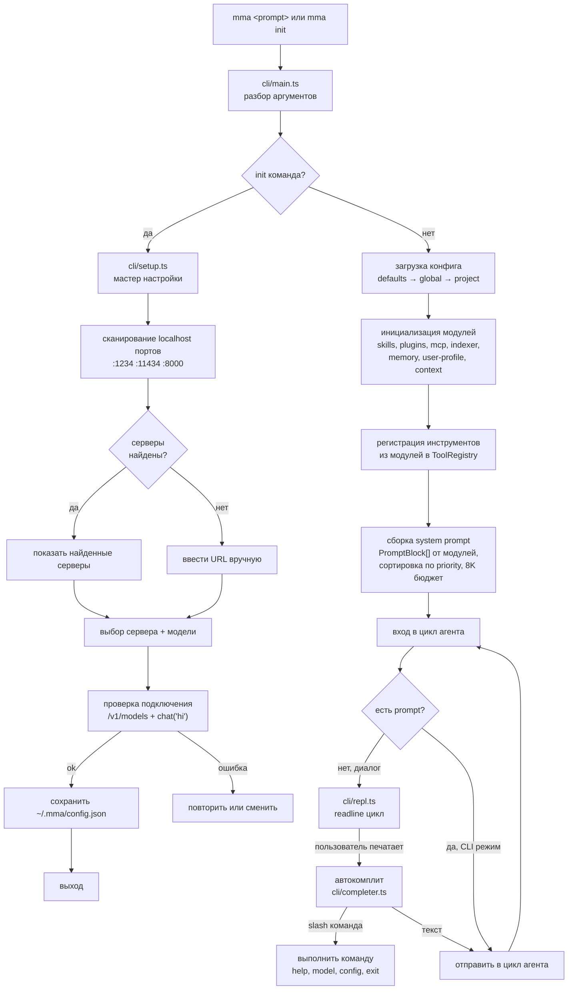

---

## 2. Система регистрации модулей

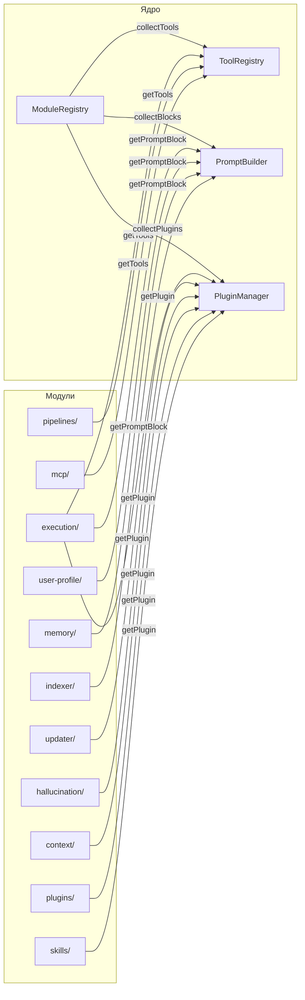

---

## 3. Цикл агента (конечный автомат)

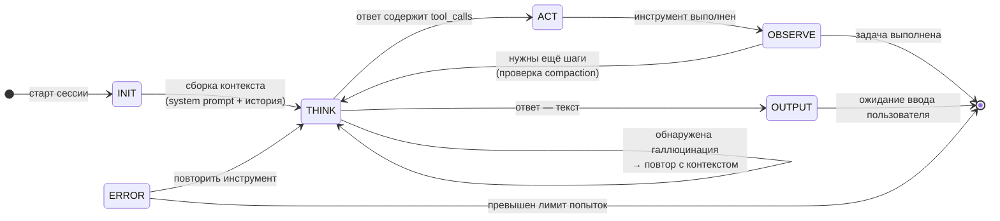

---

## 4. Конвейер выполнения инструментов

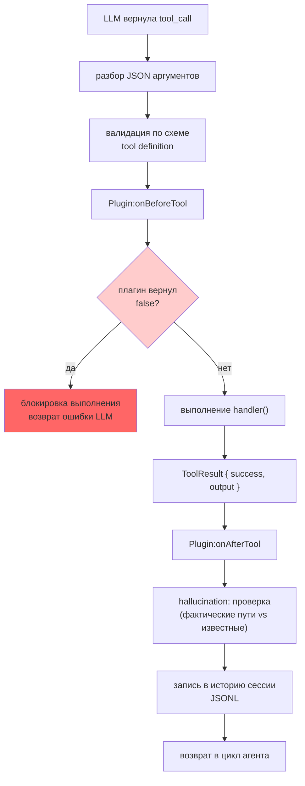

---

## 5. Взаимодействие REPL

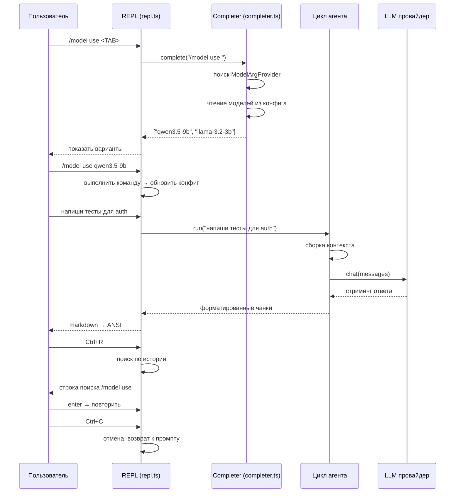

---

## 6. Компакшен контекста

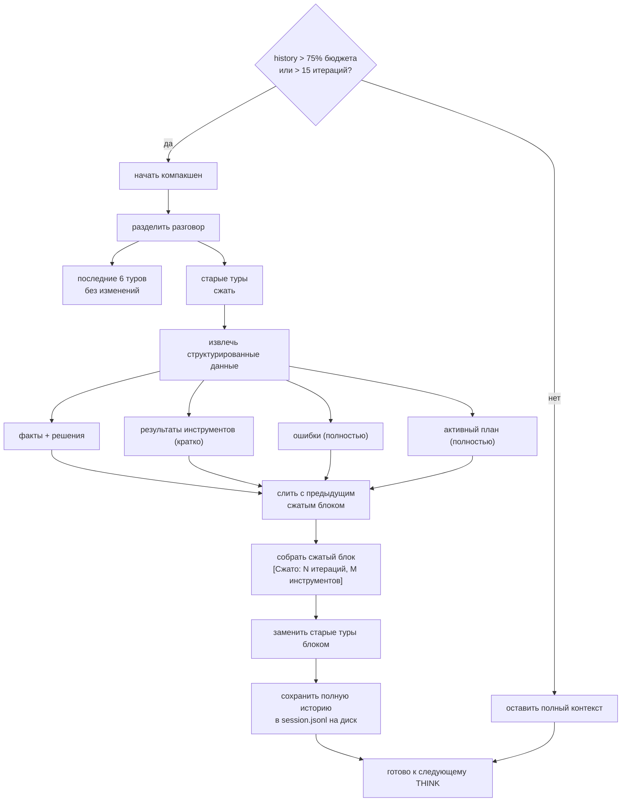

---

## 7. Детекция галлюцинаций

```mermaid
flowchart LR
    RESP["Ответ LLM"] --> PRE{
        "пустой или короткий<br/>менее 10 токенов?"
    }
    PRE -->|да| FAIL_RETRY["RETRY<br/>повторный вызов LLM"]
    PRE -->|нет| REPEAT{
        "пересечение > 50%<br/>с предыдущим ответом?"
    }
    REPEAT -->|да| FAIL_RETRY
    REPEAT -->|нет| CONFIDENCE{
        "маркеры неуверенности?<br/>(maybe, I think, probably)"
    }
    CONFIDENCE -->|да| WARN["WARN<br/>показать с ⚠️"]
    CONFIDENCE -->|нет| FACTUAL["извлечь пути/API из текста"]
    
    FACTUAL --> KNOWN{"путь есть в<br/>известном наборе?"}
    KNOWN -->|нет| FACT_WARN["WARN<br/>упомянут неизвестный путь"]
    KNOWN -->|да| CONSISTENT{"противоречит<br/>предыдущим решениям?"}
    
    CONSISTENT -->|да| CONSIST_WARN["WARN<br/>обнаружено противоречие"]
    CONSISTENT -->|нет| PASS["PASS ✓<br/>показать пользователю"]
    
    FAIL_RETRY --> RETRY_CHECK{"попыток >= 3?"}
    RETRY_CHECK -->|нет| RETRY_CTX["добавить предупреждение<br/>в контекст и повторить"]
    RETRY_CTX --> PRE
    RETRY_CHECK -->|да| BLOCK["BLOCK<br/>запросить вмешательство пользователя"]
```

---

## 8. Архитектура истории сессии

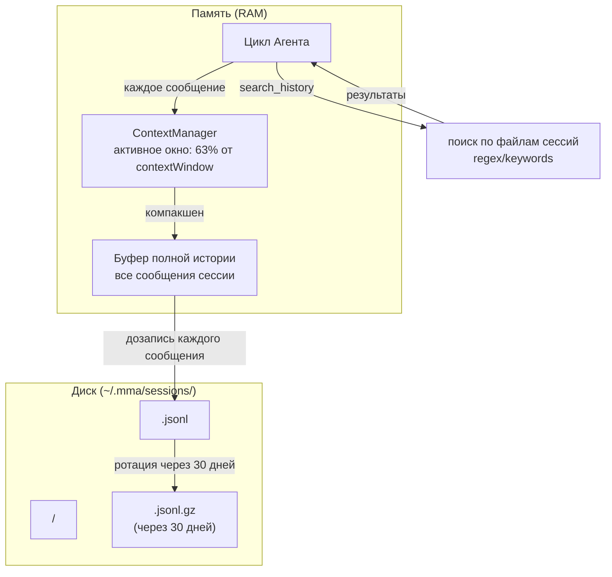

---

## 9. Полный цикл агента: один раунд

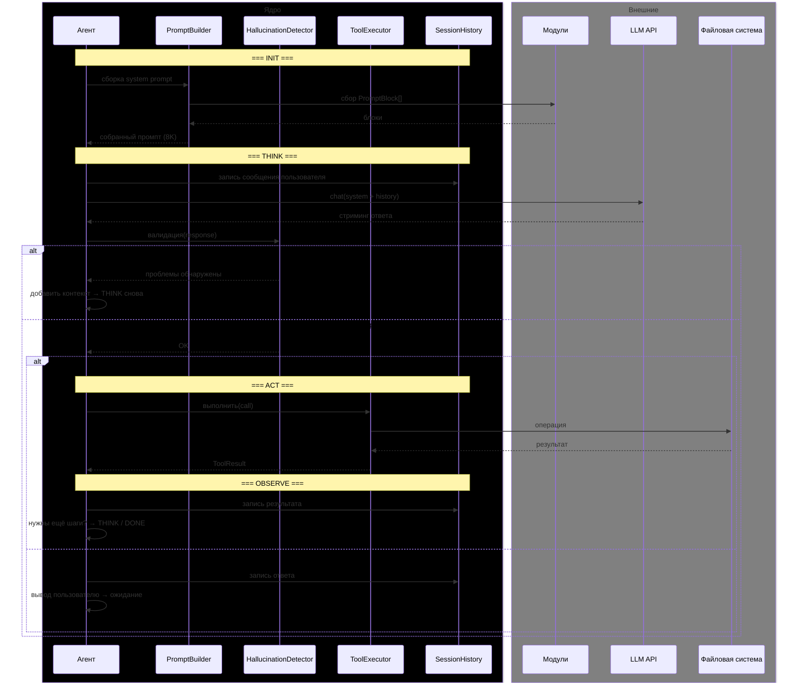

---

## 10. Слияние конфигурации

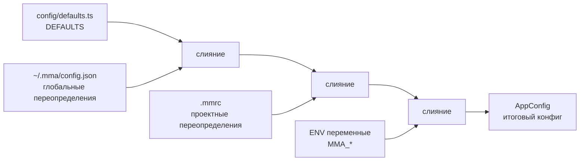

---

## 11. Архитектура автокомплита

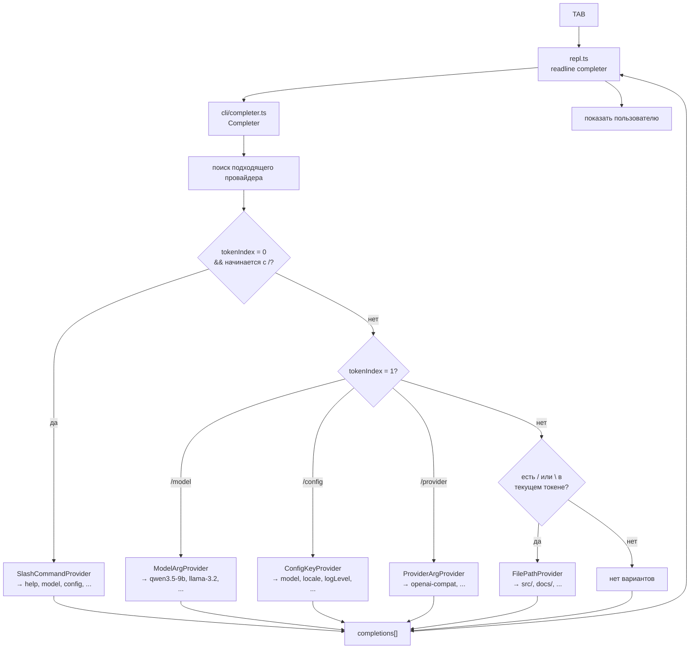

---

## 12. Task Execution Pipeline

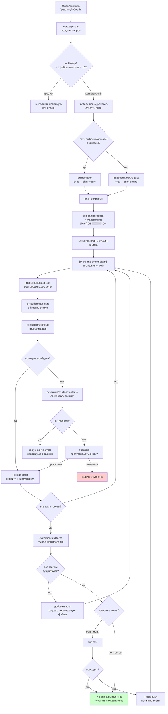

## 13. Диаграмма зависимостей пакетов

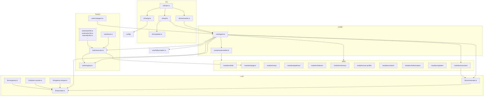
